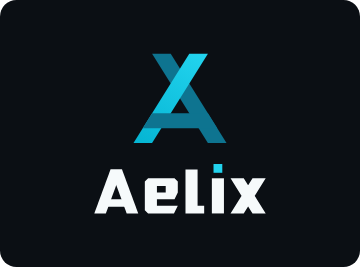
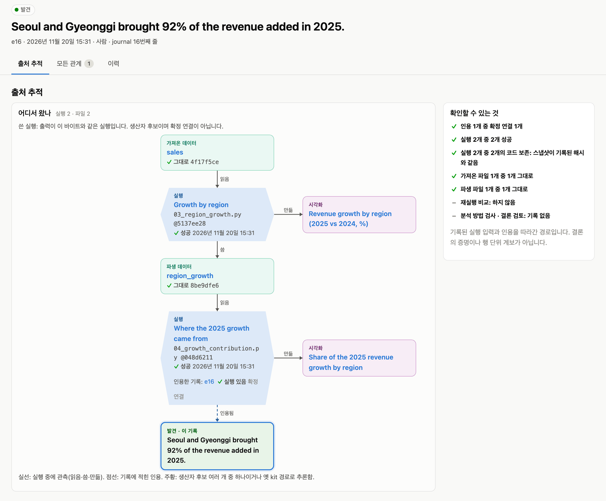
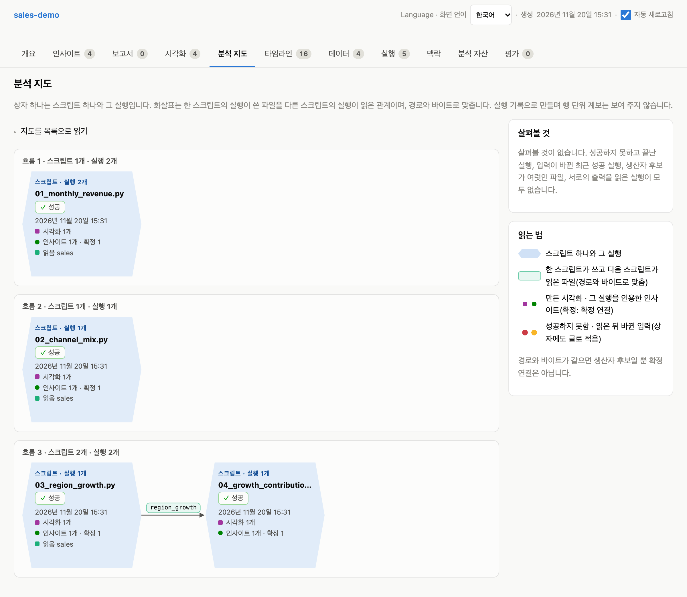
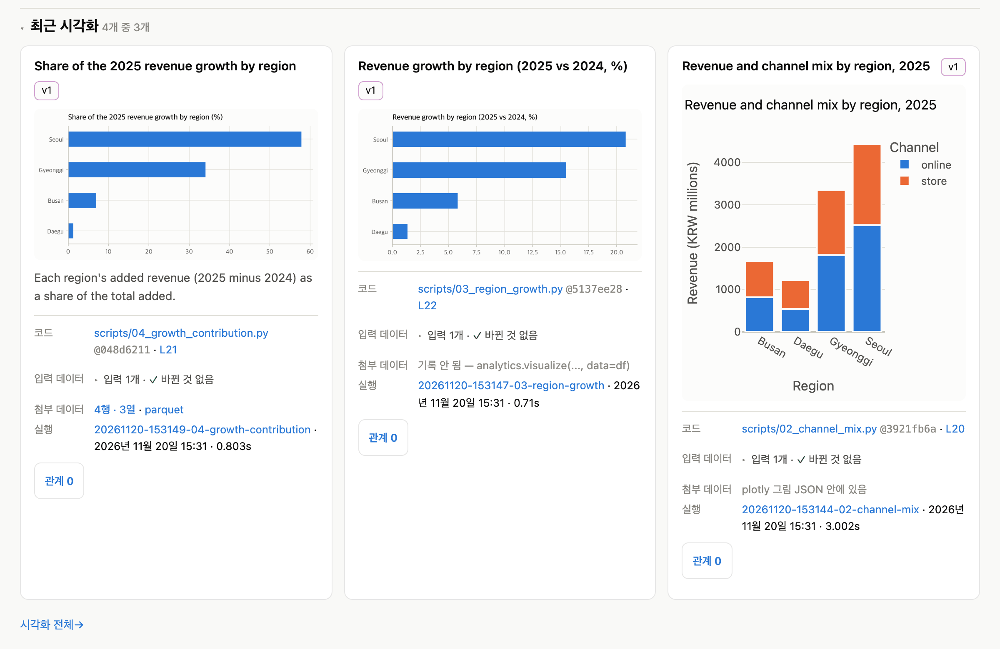

<div align="center">



# Aelix Analytics

**에이전트 시대의 새로운 데이터 분석 패러다임.**

사람과 에이전트가 하나의 분석 프로젝트에서 같은 그림을 보며 일하고, 모든 단계가 근거로 이어진 채
분석을 이어 갑니다.

[English](README.md) · 한국어 · [5분 시작](#5분-시작) · [기능](#기능)

</div>

## 왜 필요한가

- **노트북**(`.ipynb`)은 코드 옆에 출력을 남기지만, 어떤 실행이 어떤 차트를 만들었는지, 왜 분석의 방향이 바뀌었는지는 남기지
  않습니다.
- **BI 도구**는 완성된 숫자를 보여 주지만 거기까지 온 과정은 보여 주지 않습니다.
- **AI 에이전트**는 대화 속에서 분석하고, 그 판단의 흐름은 세션과 함께 끝납니다.

**Aelix Analytics에서 분석은 계속 이어지는 프로젝트입니다.** 목표, 지표, 데이터, 실행, 차트, 발견과 결정이 모두 자기가 어디서
왔는지 가리키는 기록입니다. 사람과 에이전트가 같은 기록을 읽고 쓰므로 무엇을 알았고, 무엇이 그 근거이며, 다음에 무엇을 할지를
같이 압니다. 새 세션도, 다른 모델도, 다른 사람도 처음부터 다시 하지 않고 거기서 이어 갑니다.



> **베타입니다.** 샌드박스가 아닙니다. 스크립트는 사용자의 권한으로 돌고, [aelix](https://github.com/handochan/aelix-ai)에서
> 에이전트의 `analytics_run`은 묻지 않고 코드를 실행합니다. 먼저 [한계](#한계)를 읽으세요.

## 기능

그림은 [5분 시작](#5분-시작)의 데모에, 다른 스크립트가 쓴 표를 읽는 스크립트 하나를 더한 것입니다.

### 근거

- **출처 추적.** 발견·차트·파일에서 실행과 데이터를 거쳐 가져온 파일까지 거슬러 올라가고, 무엇을 확인할 수 있었는지 봅니다.
- **분석 지도.** 스크립트와 그 실행, 그 사이를 잇는 파일을 한 페이지에서 봅니다.
- **실행 기록.** 실행마다 실행된 그대로의 코드, 감지한 입력(sha256), 출력, 데이터가 붙은 차트, 로그, 환경을 남깁니다.
- **재실행 비교.** 스냅샷을 다시 실행해 차트와 출력을 비교합니다: `match`·`mismatch`·`failed`·`inconclusive`.
- **stale 표시.** 입력이 그 뒤에 바뀐 차트를 표시합니다.



### 함께 보는 맥락

- **`CONTEXT.md`.** 목표·관심 지표·정의·다음 할 일. 버전이 모두 남고, aelix에서는 매 프롬프트에 들어갑니다.
- **Journal.** 근거를 인용하는 발견·결정·가정·질문·할 일. 나중 기록이 앞선 질문이나 할 일을 닫을 수 있습니다.
- **지표.** 지표를 정의하고(모호한 지표도), 지금의 초점을 정하고, 관측을 기록합니다.
- **Checkpoint.** 다음 세션이나 다른 사람을 위한, 분석이 지금 어디에 있는지의 요약.
- **검색.** 모두 읽지 않고 기록과 그 근거를 찾습니다.


### Workspace

기록에서 다시 만드는 정적 HTML이며, 작업하는 동안 저절로 새로 고칩니다. 탭은 개요, 인사이트, 보고서, 시각화, 분석 지도, 타임라인,
데이터, 실행, 맥락, 분석 자산, 평가입니다.

- **버전 이력.** 차트·데이터셋·스크립트·`CONTEXT.md`의 모든 버전과, 각 버전을 무엇이 썼는지.
- **평가.** 기록의 충실도, 도구 사용, 우회 의심, 사용 중 문제(workflow feedback), kit 밖에서 한 작업.
- **영어·한국어.** 화면 언어를 오른쪽 위에서 바꿉니다.




### 보고서와 자산

- **자유 형식 보고서.** 분석 도중 언제든 어떤 형식으로든(HTML, Markdown 등) 보고서를 쓰고, 지정한 근거와 연결된 바뀌지 않는
  버전의 Report로 저장합니다. 컬럼별 보고서처럼 반복되는 보고서는 묶음으로 관리합니다.
- **재사용 자산 발굴.** 분석에서 다시 쓸 만한 것(함수, 모듈, 패키지, skill)을 검사와 함께 자산 후보로 남깁니다. 후보는 제안 →
  시험 → 검증을 거치고, 직접 등록할 때만 프로젝트에 들어갑니다. 요청하면 kit이 후보를 제안하고, 켜 두면 스스로 제안합니다.

### 공유와 협업

- **공유. 프로젝트나 고른 Report의 독립 사본을 폴더나 ZIP으로 만들고, 누출과 깨진 링크를 검사합니다. 공유 폴더에 게시하면
  "최신" 페이지 주소가 바뀌지 않습니다.
- **사람과 에이전트.** `analytics` 명령, Python SDK, aelix 도구가 같은 기록을 쓰고, 기록마다 누가 어떻게 남겼는지 적힙니다.
  aelix에서는 `/analytics`가 패널을 열고, kit 밖에서 한 bash 작업은 관찰된 활동으로 남습니다.

## 5분 시작

[uv](https://docs.astral.sh/uv/)가 필요합니다. 아래 둘 가운데 **하나**를 설치합니다. 둘 다 `analytics` 명령을 만들므로, 첫째에서
둘째로 옮기려면 먼저 `uv tool uninstall aelix-analytics`를 실행합니다.

```sh
uv tool install --python 3.12 aelix-analytics     # analytics 명령만
```

```sh
uv tool install --python 3.12 aelix==0.1.0b2 --with aelix-analytics --with-executables-from aelix-analytics   # aelix, 확장, analytics
```

데모(합성 매출 데이터, 실행 세 개, 메모, 재실행 검증. 모델 없음)를 만들고 엽니다.

```sh
analytics demo ~/analyses/demo          # 처음에는 uv 환경 준비로 1분 안팎 걸립니다
cd ~/analyses/demo && analytics open    # 브라우저에서 Workspace 열기
```

aelix를 설치했다면 `cd ~/analyses/demo && aelix`로 켭니다. `/analytics`로 패널을 열거나, 그냥 요청합니다.
예: *"지역별 성장률 차트에 플롯 데이터도 기록되게 고쳐줘."*

## 설치

명령과 확장은 Python 3.11 이상에서 돕니다. 분석은 프로젝트마다 자기 uv 환경(Python 3.12 이상)에서 돌고, aelix 환경에는 들어가지
않습니다. 대상 운영체제는 Linux·macOS·Windows이고, 어디서 무엇을 실행했는지는 [지원 범위](docs/SUPPORT.md)에 있습니다.

| 원하는 것 | 명령 |
|---|---|
| `analytics` 명령 | `uv tool install --python 3.12 aelix-analytics` |
| 확장을 넣은 aelix(같은 `analytics` 포함) | `uv tool install --python 3.12 aelix==0.1.0b2 --with aelix-analytics --with-executables-from aelix-analytics` |
| 첫째에서 둘째로 옮기기 | `uv tool uninstall aelix-analytics` 뒤에 둘째 줄 |
| 업그레이드 | `uv tool upgrade aelix-analytics` 또는 `uv tool upgrade aelix`. 그 뒤 aelix를 다시 시작 |
| 제거 | `uv tool uninstall aelix-analytics` 또는 `uv tool uninstall aelix` |

체크아웃에서 만들 때:

```sh
cd /path/to/aelix-analytics && uv build     # dist/aelix_analytics-0.32.1-py3-none-any.whl
uv tool install --python 3.12 dist/aelix_analytics-0.32.1-py3-none-any.whl
uv tool install --python 3.12 aelix==0.1.0b2 --with dist/aelix_analytics-0.32.1-py3-none-any.whl
```

설치하지 않고 쓸 때는 `bin/analytics`(POSIX)가 같은 명령이고, `aelix -e /path/to/aelix-analytics/extension/aelix_analytics.py`가 한
세션에 확장을 로드합니다. 확장 등록, 업그레이드, Windows, 이전 kit의 프로젝트는 [사용 안내](docs/USER-GUIDE.md#설치본wheel으로-쓰기)에
있습니다.

## 동작 방식

프로젝트는 폴더 하나입니다.

```text
my-analysis/
  analytics.json          프로젝트의 정체성
  CONTEXT.md              목표·관심 지표·정의·발견·다음 할 일
  journal.jsonl           덧붙이기만 하는 타임라인: 가져오기·실행·발견·결정·질문 등
  pyproject.toml, uv.lock 이 프로젝트만의 환경
  data/imported/          가져온 데이터(Parquet)와 원본 경로·sha256·스키마
  data/derived/           실행이 만든 Parquet
  scripts/                고치는 분석 코드
  runs/<run id>/          실행마다 한 폴더: 코드 스냅샷·입력·출력·차트와 그 데이터·로그
  workspace/              만들어지는 HTML (직접 고치지 않음. 기록에서 다시 만듦)
```

스크립트를 kit으로 실행하면 run이 생깁니다. kit은 입력을 세 가지(라이브러리 훅, 코드 안의 경로 글자, 선언한 입력)로 찾고, 출력은
실행 전후의 파일을 비교해 찾은 뒤 Workspace를 다시 만듭니다.

## 쓰는 법

**aelix에서**는 에이전트에게 도구 여섯 개가 있습니다.

| 도구 | 하는 일 |
|---|---|
| `analytics_status` | 데이터셋, 최근 실행, 차트와 stale 여부, 열린 질문, 핵심 기록 |
| `analytics_query` | 데이터셋 위의 읽기 전용 DuckDB SQL 한 문장 |
| `analytics_import` | CSV·TSV·JSON·NDJSON·Parquet을 `data/imported/`에 Parquet으로 |
| `analytics_run` | 스크립트를 실행하고 기록. `rerun_of`로 재실행해 비교 |
| `analytics_record` | 발견·결정·가정·질문·할 일·메모를 근거와 함께 기록 |
| `analytics_init` | 새 프로젝트. 사용자가 요청했을 때만 |

게시, 프로젝트 신뢰, 자산 등록은 사람이 `/analytics`에서 정합니다.

**셸에서**: `analytics run scripts/01_trend.py --title "월별 추세"`, `analytics query "SELECT …"`, `analytics record finding "…"`,
`analytics status`, `analytics build`, `analytics publish`. 전체는 `analytics --help`에 있습니다. skill이나 다른 에이전트도
`analytics run`을 쓰게 하세요. `python scripts/x.py`로 직접 돌리면 run으로 기록되지 않습니다. aelix 밖의 에이전트는
`AELIX_ANALYTICS_ACTOR=agent`를 설정해야 합니다. 설정하지 않으면 그 기록은 사람의 것으로 남습니다.

**스크립트에서** SDK는 선택입니다(SDK 없이 Polars·DuckDB로 읽거나 `plt.show()`를 불러도 기록됨). SDK는 이름과 명시적인 연결을
더합니다.

```python
import aelix_analytics as analytics

sales = analytics.read("sales")                                    # data/imported/sales.parquet의 Polars DataFrame
monthly = analytics.sql("SELECT ... FROM sales GROUP BY ALL").pl() # 모든 데이터셋이 view인 DuckDB
analytics.save(monthly, "monthly_revenue")                         # data/derived/monthly_revenue.parquet
analytics.visualize(fig, "monthly-revenue", title="…", data=monthly)   # matplotlib·plotly 차트와 그 데이터
analytics.record("finding", "…")                                   # 이 실행에 연결된 journal 기록
analytics.save_report("q3-review", files="reports_out/q3", entry="index.html",
                      title="3분기 검토", previous_revision=None)    # 버전이 있는 Report(보고서 탭)
```

문서는 저장해야 Report가 됩니다. `workspace/` 밖에 쓴 뒤 `analytics.save_report`로, 셸에서는 `analytics reports save q3-review
--files reports_out/q3 --entry index.html --title "3분기 검토" --previous none`으로 저장합니다. 목록은 `analytics reports list`입니다.

## 한계

- **샌드박스도 승인 단계도 없습니다.** 스크립트는 사용자의 권한으로 돌고, aelix는 확장 도구를 실행하기 전에 묻지 않으며, 헤드리스
  모드는 모두 승인합니다.
- **계보는 최선 노력입니다.** 훅을 거치지 않는 읽기(pyarrow로 직접 읽기, C 확장이 계산된 경로를 여는 것)는 놓칠 수 있습니다.
  `no input files were detected` 경고는 입력을 하나도 감지하지 못했을 때만 나오므로, 그런 입력은 경고와 관계없이 선언하세요.
  행 단위 계보는 없습니다.
- **불변성은 약속입니다.** `data/imported/`나 `runs/`를 고치는 것을 막지 않고 해시 비교로 드러낼 뿐입니다. 해시 체인이나 서명은
  없습니다.
- **트랜잭션이 없습니다.** 강제로 끝난 run은 `incomplete`로 보이고, 같은 요청을 두 번 보내면 run이 두 개 생깁니다.
- **재실행은 같은 환경을 가정합니다.** 환경을 비교하지 않고, 로컬 helper 모듈은 지금의 `scripts/`에서 import됩니다.
- **규모.** Workspace는 매번 전체를 다시 만듭니다. run이 수백 개이거나 데이터가 수 GB이면 느려집니다.
- **개인정보.** Workspace는 데이터 미리보기를 보이고, 로컬 telemetry는 비밀처럼 보이는 값을 가린 bash 명령의 앞부분을 남깁니다.
  공유하기 전에 확인하세요.
- **Windows**에서는 프로젝트 경로를 짧게 두고, Ctrl+C와 PowerShell 인코딩에 알아 둘 것이 있습니다:
  [Windows에서 쓸 때](docs/USER-GUIDE.md#windows에서-쓸-때).

각 부분이 무엇을 보장하고 무엇을 보장하지 않는지(G절)는 [현재 계약](docs/CONTRACTS.md)에 있습니다.

## 문서

| 문서 | 내용 |
|---|---|
| [사용 안내](docs/USER-GUIDE.md) | 설치와 확장 등록, Windows, 명령, 작성 주체, SDK, 자산, checkpoint, 프롬프트의 맥락, 공유, 한계, 이전 kit |
| [현재 계약](docs/CONTRACTS.md) | 이 버전이 구현하고 보장하는 것 |
| [제품 방향](docs/PRODUCT.md) | 비전과 사용자가 얻어야 하는 것 |
| [아키텍처](docs/ARCHITECTURE.md) | 모듈, 경계, 의존 방향 |
| [지원 범위](docs/SUPPORT.md) | 실행해 본 Python·운영체제·aelix·설치 경로와 그 증거 |
| [변경 이력](CHANGELOG.md) | kit 버전별 변경 |
| [기여 가이드](CONTRIBUTING.md) | 변경을 제안하는 법과 CI가 돌리는 검사 |
| [프로젝트 운영](docs/PROJECT-OPERATIONS.md) | Issue·Project 관리, 에이전트 공통 지침, 인수인계 |

`docs/`의 설계 문서에는 아직 만들지 않은 부분도 있습니다. 지금 있는 것의 기준은 현재 계약입니다.

## 개발

```sh
cd /path/to/aelix-analytics
uv sync --locked
uv run --locked pytest -q --timeout 600 --timeout-method=thread   # kit, 런처, 배포본(wheel을 빌드해 새 환경에 설치)
AELIX_ANALYTICS_TEST_INSTALL=1 uv run --locked pytest -q --timeout 600 --timeout-method=thread tests/test_packaging.py   # aelix 0.1.0b2와 실제 uv로 끝까지 (네트워크)
uv run --isolated --no-project --python 3.12 --with aelix==0.1.0b2 --with pytest==9.1.1 --with pytest-timeout==2.4.0 \
  python -m pytest -q -p no:cacheprovider --timeout 300 --timeout-method=thread tests/test_extension.py tests/test_asset_extension.py \
  tests/test_checkpoint_extension.py tests/test_usage_report.py tests/test_agent_cli.py \
  tests/test_panel_extension.py   # aelix 통합 (CI와 같은 환경)
uv run --locked ruff check tests extension src tools
```

CI가 돌리는 명령 전체와 고정값은 [기여 가이드](CONTRIBUTING.md#현재-개발-검증)에 있습니다.

## 보안과 라이선스

관리자: [@handochan](https://github.com/handochan). 보안 취약점은 공개 Issue가 아니라 비공개로 알려 주세요: [보안 정책](SECURITY.md).
라이선스는 [Apache License 2.0](LICENSE)입니다.
