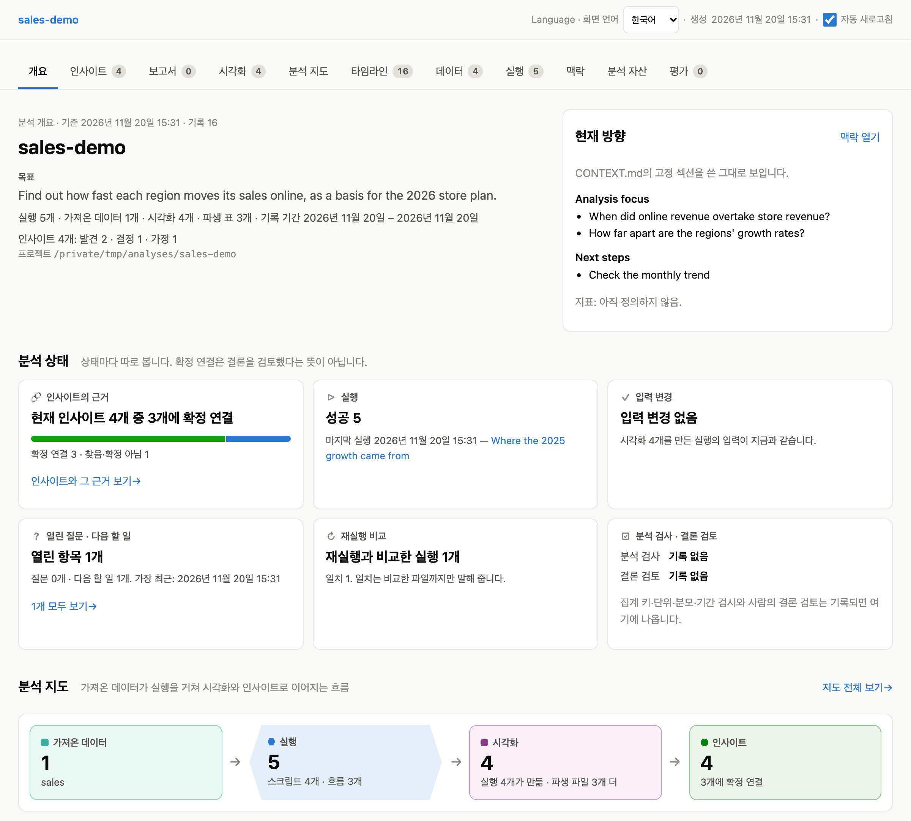
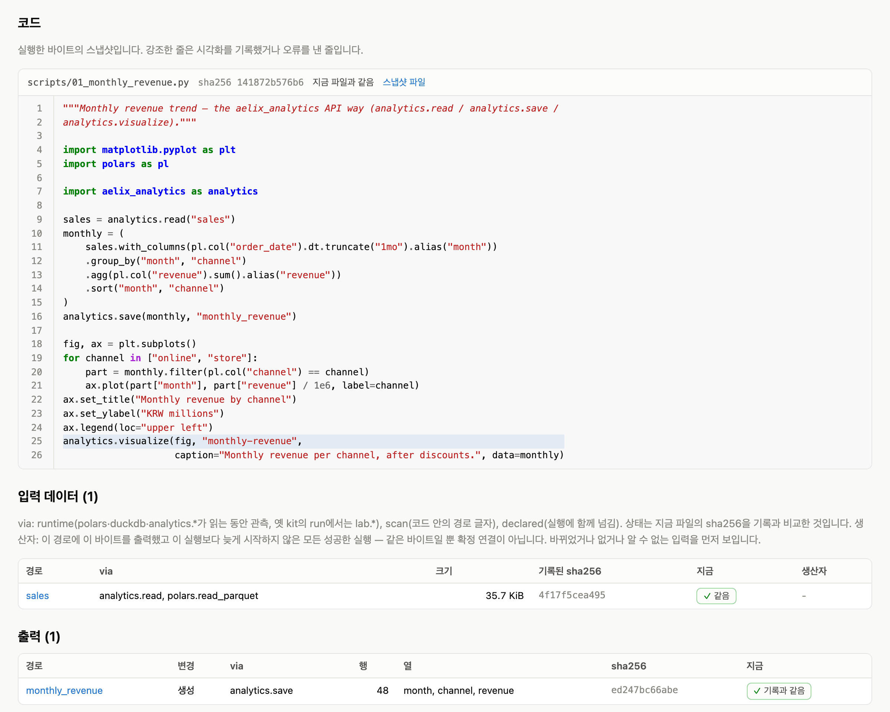
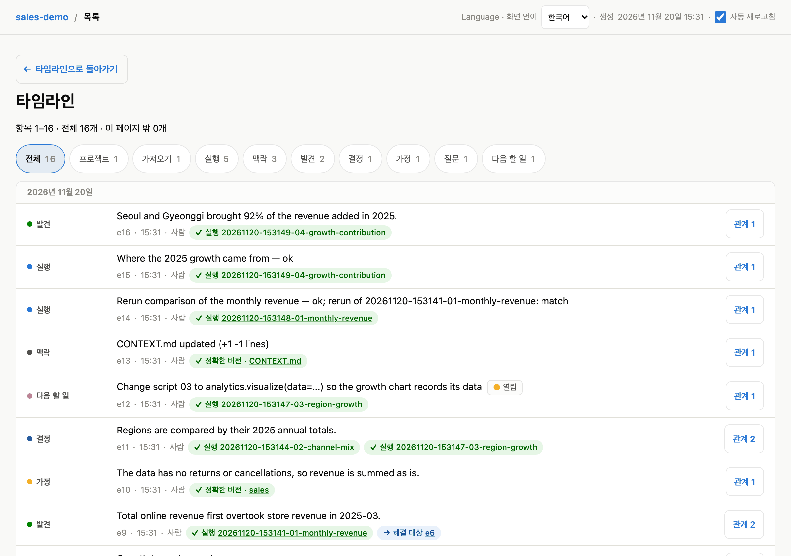

<div align="center">


# Aelix Analytics

**에이전트 시대의 새로운 데이터 분석 방식.**

사람과 에이전트가 하나의 분석 프로젝트에서 같은 그림을 보며 일하고, 모든 단계가 근거로 이어진 채
분석을 이어 갑니다.

[English](README.md) · 한국어 · [5분 시작](#5분-시작)

</div>

노트북(`.ipynb`)과 BI 도구는 사람이 화면 앞에서 하는 분석을 위해 만들어졌습니다. 노트북은 코드 옆에 출력을 남기지만,
어떤 실행이 어떤 차트를 만들었는지, 왜 분석의 방향이 바뀌었는지는 남기지 않습니다. BI 대시보드는 완성된 숫자를 보여 주지만
거기까지 온 과정은 보여 주지 않습니다. AI 에이전트가 분석하면 그 판단의 흐름은 세션과 함께 끝나는 대화 속에만 있습니다.

Aelix Analytics는 다른 분석 패러다임을 제안합니다. 분석은 **계속 이어지는 프로젝트**입니다. 목표, 지표와 질문, 데이터,
코드의 모든 실행, 모든 차트, 모든 발견과 결정이 자기가 어디서 왔는지 가리키는 기록으로 남습니다. 사람과 에이전트가 같은
기록을 읽고 쓰므로, 둘은 분석에 대해 같은 인식에서 일합니다. 무엇을 알았고, 무엇이 그 근거이며, 다음에 무엇을 할지입니다.
새 세션도, 다른 모델도, 다른 사람도 처음부터 다시 하지 않고 거기서 이어 갑니다.


- **근거가 이어져 있습니다.** 발견에서 그 근거인 실행, 실행된 그대로의 코드, 그 실행이 읽은 데이터, 그 데이터를 쓴 실행을 거쳐
  가져온 파일까지 따라갑니다. 위 그래프가 그 길입니다.
- **같은 그림을 봅니다.** 목표·관심 지표·다음 할 일은 평범한 파일에 있습니다. aelix에서는 에이전트가 매 프롬프트에 그것을 받고,
  사람은 Workspace의 첫 화면에서 봅니다.
- **분석은 지금처럼 Python으로.** DuckDB, Polars, matplotlib, plotly로 씁니다. kit은 실행마다 기록을 남기고, 둘러보고 다시
  만들고 공유할 수 있는 정적 HTML **Workspace**를 만듭니다.

> **베타입니다.** 샌드박스가 아닙니다. 스크립트는 사용자의 권한으로 돌고,
> [aelix](https://github.com/handochan/aelix-ai)에서 에이전트의 `analytics_run`은 묻지 않고 코드를 실행합니다.
> 실데이터에 쓰기 전에 [한계](#한계)를 읽으세요.

## 할 수 있는 것

그림은 [5분 시작](#5분-시작)의 데모 프로젝트에 스크립트 하나를 더한 것입니다. 그 스크립트는 다른 스크립트가 쓴 표를 읽고
발견을 기록합니다.

**근거가 이어져 있습니다.** 분석 지도는 작업의 흐름을 보입니다. 상자 하나는 스크립트와 그 실행들이고, 화살표는 한 스크립트의
실행이 쓰고 다른 스크립트의 실행이 읽은 파일입니다(경로와 바이트로 맞춤). 발견·차트·파일 어디서든 출처 추적(위 그림)이 같은
연결을 따라 가져온 데이터까지 거슬러 올라가고, 무엇을 확인할 수 있었는지 말합니다. 둘 다 행 단위 계보는 아닙니다.


**사람과 에이전트가 같은 그림을 봅니다.** 개요는 `CONTEXT.md`의 목표와 현재 방향에서 시작해 근거의 상태를 보입니다. 확정
연결이 있는 인사이트의 수, 실행의 결과, 입력 변경, 재실행 비교, 열린 질문, 분석 검사와 결론 검토를 서로 섞지 않고 따로
보입니다.



**차트를 거슬러 올라갑니다.** 차트는 모두 한 *실행*(run)에 속합니다. run은 스크립트를 한 번 실행한 기록으로, 실행된 그대로의
코드 스냅샷, 감지한 입력과 그 sha256, 출력, 로그, 환경을 담습니다. 차트 카드에서 코드(실행이 알면 그 차트를 기록한 줄), 입력(지금도
같은 바이트인지, 그 뒤에 바뀌었는지), 차트에 첨부한 데이터로 갑니다. 첨부한 데이터가 없으면 기록하지 않았다고 보입니다.




**대화가 끝나도 맥락이 남습니다.** `CONTEXT.md`에는 목표, 관심 지표와 질문, 정의, 다음 할 일이 있습니다. `journal.jsonl`은
가져오기·실행·발견·결정·가정·질문·할 일이 일어난 순서대로 쌓이는 기록입니다. 나중 기록이 앞선 질문이나 할 일을 닫을 수 있어,
무엇을 언제 알았고 왜 판단이 바뀌었는지 따라갈 수 있습니다. aelix에서는 지금의 맥락이 정해진 분량 안에서 섹션 단위로 매
프롬프트에 들어갑니다. aelix 밖의 사람과 다른 에이전트는 같은 파일을 읽습니다.



**사람과 에이전트가 같은 프로젝트에서 일합니다.** `analytics` 명령, Python SDK, aelix 도구가 같은 기록을 쓰고, 기록마다 누가
어떻게 남겼는지가 적힙니다. 모델 없이 직접 분석하다가 에이전트에게 넘기고, 다시 이어받을 수 있습니다.

**다시 실행해 비교합니다.** 재실행은 한 run의 코드 스냅샷을 다시 돌려 차트(첨부한 데이터, 없으면 plotly 그림이나 PNG 바이트)와
출력 바이트를 비교하고 `match`·`mismatch`·`failed`·`inconclusive`로 판정합니다.

**보고서와 공유.** 직접 쓴 문서(HTML, Markdown 등)를 버전이 있는 **Report**로 저장합니다. 프로젝트나 고른 Report의 독립 사본을
만들고, 누출과 깨진 링크를 검사하고, 팀이 열 수 있는 폴더에 게시합니다.

**평범한 파일.** 데이터는 Parquet, 기록은 JSON 줄, Workspace는 정적 HTML이고, 프로젝트마다 자기 uv 환경이 있습니다. 서버가
필요 없습니다.

## 5분 시작

[uv](https://docs.astral.sh/uv/)가 필요합니다. 아래 둘 가운데 **하나**를 설치합니다.

모델 없이 분석할 `analytics` 명령만:

```sh
uv tool install --python 3.12 aelix-analytics
```

또는 이 확장을 넣은 [aelix](https://github.com/handochan/aelix-ai). 같은 `analytics` 명령도 함께 설치됩니다.

```sh
uv tool install --python 3.12 aelix==0.1.0b2 --with aelix-analytics --with-executables-from aelix-analytics
```

둘 다 `analytics` 명령을 만들므로, 첫째에서 둘째로 옮기려면 먼저 `uv tool uninstall aelix-analytics`를 실행합니다.

데모 프로젝트를 만듭니다. 합성 매출 데이터, 예제 실행 세 개, 메모, 재실행 검증이 들어 있고 모델은 쓰지 않습니다.

```sh
analytics demo ~/analyses/demo          # 처음에는 uv 환경 준비로 1분 안팎 걸립니다
cd ~/analyses/demo && analytics open    # 브라우저에서 Workspace 열기
```

Workspace의 화면 언어는 오른쪽 위에서 한국어로 바꿀 수 있습니다. aelix를 설치했다면 프로젝트 폴더에서 에이전트와 이어서
분석합니다: `cd ~/analyses/demo && aelix`.

aelix에서 `/analytics`는 패널을 엽니다: 현황, Workspace, Reports, 기록, 공유, 설정. 그다음은 평소처럼 분석을 요청합니다.
예: *"지역별 성장률 차트에 플롯 데이터도 기록되게 고쳐줘."* 에이전트가 데이터를 가져오고, SQL로 살펴보고, 스크립트를 써서
kit으로 실행하므로 실행마다 기록이 남습니다.

## 설치

명령과 확장은 Python 3.11 이상에서 돕니다. 분석은 프로젝트마다 자기 uv 환경(Python 3.12 이상)에서 돌기 때문에 분석
라이브러리가 aelix 환경에 들어가지 않습니다. 대상 운영체제는 Linux·macOS·Windows이고, 어디서 무엇을 설치하고 실행했는지는
[지원 범위](docs/SUPPORT.md)에 있습니다.

| 원하는 것 | 명령 |
|---|---|
| `analytics` 명령 | `uv tool install --python 3.12 aelix-analytics` |
| 확장을 넣은 aelix(같은 `analytics` 포함) | `uv tool install --python 3.12 aelix==0.1.0b2 --with aelix-analytics --with-executables-from aelix-analytics` |
| 첫째에서 둘째로 옮기기 | `uv tool uninstall aelix-analytics` 뒤에 둘째 줄(둘 다 `analytics`를 만듦) |
| 업그레이드 | `uv tool upgrade aelix-analytics` 또는 `uv tool upgrade aelix`. 그 뒤 aelix를 다시 시작 |
| 제거 | `uv tool uninstall aelix-analytics` 또는 `uv tool uninstall aelix` |

체크아웃에서 직접 만들 수도 있습니다.

```sh
cd /path/to/aelix-analytics && uv build     # dist/aelix_analytics-0.32.1-py3-none-any.whl
uv tool install --python 3.12 dist/aelix_analytics-0.32.1-py3-none-any.whl
uv tool install --python 3.12 aelix==0.1.0b2 --with dist/aelix_analytics-0.32.1-py3-none-any.whl
```

설치하지 않고 체크아웃으로도 씁니다. `bin/analytics`(POSIX)가 같은 명령이고, `aelix -e /path/to/aelix-analytics/extension/aelix_analytics.py`가
한 세션에 확장을 로드합니다. 모든 세션에 확장을 등록하는 법, 업그레이드, Windows, 이전 kit이 만든 프로젝트를 옮기는 법은
[사용 안내](docs/USER-GUIDE.md#설치본wheel으로-쓰기)에 있습니다.

## 동작 방식

프로젝트는 폴더 하나입니다.

```text
my-analysis/
  analytics.json          프로젝트의 정체성
  CONTEXT.md              목표·관심 지표·정의·발견·다음 할 일 (사람과 에이전트가 함께 고침)
  journal.jsonl           덧붙이기만 하는 타임라인: 가져오기·실행·발견·결정·질문 등
  pyproject.toml, uv.lock 이 프로젝트만의 환경
  data/imported/          가져온 데이터(Parquet)와 원본 경로·sha256·스키마
  data/derived/           실행이 만든 Parquet
  scripts/                고치는 분석 코드
  runs/<run id>/          실행마다 한 폴더: 코드 스냅샷·입력·출력·플롯 데이터가 있는 차트·로그
  workspace/              만들어지는 HTML Workspace (직접 고치지 않음. 기록에서 다시 만듦)
```

사람이나 에이전트가 `scripts/`에 스크립트를 쓰고 kit으로 실행하면 run이 생깁니다. kit은 코드를 스냅샷으로 남기고, 입력을 세
가지로 찾습니다: 라이브러리 훅, 코드 안의 경로 글자, 직접 선언한 입력. 출력은 실행 전후의 프로젝트 파일을 비교해 찾고,
차트는 그 데이터와 함께 저장한 뒤 Workspace를 다시 만듭니다. 차트가 읽은 입력이 그 뒤에 바뀌면 그 차트는 *stale*로
표시됩니다.

## 쓰는 법

**aelix에서**는 에이전트에게 도구 여섯 개가 있습니다.

| 도구 | 하는 일 |
|---|---|
| `analytics_status` | 데이터셋, 최근 실행, 차트와 stale 여부, 열린 질문, 핵심 기록 |
| `analytics_query` | 데이터셋 위의 읽기 전용 DuckDB SQL 한 문장 |
| `analytics_import` | CSV·TSV·JSON·NDJSON·Parquet을 `data/imported/`에 Parquet으로 |
| `analytics_run` | 스크립트를 실행하고 기록. `rerun_of`로 재실행해 비교 |
| `analytics_record` | 발견·결정·가정·질문·할 일·메모를 근거와 함께 기록 |
| `analytics_init` | 새 프로젝트. 사용자가 요청했을 때만 |

게시, 프로젝트 신뢰, 분석 자산 등록은 사람이 정합니다. 에이전트의 지침이 이것을 `/analytics`의 사람에게 맡깁니다.

**셸에서**는 `analytics`가 같은 일을 합니다: `analytics run scripts/01_trend.py --title "월별 추세"`, `analytics query "SELECT …"`,
`analytics record finding "…"`, `analytics status`, `analytics build`, `analytics publish`. 전체는 `analytics --help`에 있습니다.
skill이나 다른 에이전트가 분석 스크립트를 돌린다면 `analytics run`으로 부르게 하세요. `python scripts/x.py`로 직접 돌리면 run으로
기록되지 않습니다. aelix 밖의 에이전트는 `AELIX_ANALYTICS_ACTOR=agent`를 설정해야 합니다. 설정하지 않으면 그 기록은 사람의
것으로 남습니다.

**스크립트에서** SDK는 선택입니다. SDK 없이 Polars·DuckDB로 읽거나 `plt.show()`를 불러도 기록됩니다. SDK는 이름과 명시적인 연결을
더합니다.

```python
import aelix_analytics as analytics

sales = analytics.read("sales")                                    # data/imported/sales.parquet의 Polars DataFrame
monthly = analytics.sql("SELECT ... FROM sales GROUP BY ALL").pl() # 모든 데이터셋이 view인 DuckDB
analytics.save(monthly, "monthly_revenue")                         # data/derived/monthly_revenue.parquet
analytics.visualize(fig, "monthly-revenue", title="…", data=monthly)   # matplotlib·plotly 차트와 그 데이터
analytics.record("finding", "…")                                   # 이 실행에 연결된 journal 기록
analytics.save_report("q3-review", files="reports_out/q3", entry="index.html",
                      title="3분기 검토", previous_revision=None)    # 버전이 있는 Report(Reports 탭)
```

문서는 저장해야 Report가 됩니다. `workspace/` 밖에 쓰고 `analytics.save_report`로, 셸에서는 `analytics reports save q3-review
--files reports_out/q3 --entry index.html --title "3분기 검토" --previous none`으로 저장합니다. 목록은 `analytics reports list`입니다.

## 한계

- **샌드박스도 승인 단계도 없습니다.** 스크립트는 사용자의 권한으로 돕니다. aelix는 확장 도구를 실행하기 전에 묻지 않고,
  헤드리스 모드는 모두 승인합니다.
- **계보는 최선 노력입니다.** 훅을 거치지 않는 읽기(pyarrow로 직접 읽기, C 확장이 계산된 경로를 여는 것 등)는 놓칠 수 있습니다.
  run은 입력을 하나도 감지하지 못했을 때만 `no input files were detected`로 경고하므로, 그런 입력은 경고와 관계없이 선언하세요.
  행 단위 계보는 없습니다.
- **불변성은 약속입니다.** `data/imported/`나 `runs/`를 고치는 것을 막지 않고, 해시 비교로 드러날 뿐입니다. 해시 체인이나 서명은
  없습니다.
- **트랜잭션이 없습니다.** 강제로 끝난 run은 `incomplete`로 보입니다. 같은 요청을 두 번 보내면 run이 두 개 생깁니다.
- **재실행은 같은 환경을 가정합니다.** 환경을 비교하지 않고, 로컬 helper 모듈은 지금의 `scripts/`에서 import됩니다.
- **규모.** Workspace는 매번 전체를 다시 만듭니다. run이 수백 개이거나 데이터가 수 GB이면 느려집니다.
- **개인정보.** Workspace는 데이터 미리보기를 보이고, 로컬 telemetry는 비밀처럼 보이는 값을 가린 bash 명령의 앞부분을 남깁니다.
  공유하기 전에 확인하세요.
- **Windows**에서는 프로젝트 경로를 짧게 두고, Ctrl+C와 PowerShell 인코딩에 알아 둘 것이 있습니다. 사용 안내의
  [Windows에서 쓸 때](docs/USER-GUIDE.md#windows에서-쓸-때)를 보세요.

각 부분이 무엇을 보장하고 무엇을 보장하지 않는지는 [현재 계약](docs/CONTRACTS.md)(G절)에 있습니다.

## 문서

| 문서 | 내용 |
|---|---|
| [사용 안내](docs/USER-GUIDE.md) | 설치와 확장 등록, Windows, 명령, 작성 주체 규칙, SDK, 분석 자산, checkpoint, 맥락이 프롬프트에 들어가는 방식, 공유, 한계, 이전 kit에서 옮기기 |
| [현재 계약](docs/CONTRACTS.md) | 이 버전이 구현하고 보장하는 것, 필드 단위 |
| [제품 방향](docs/PRODUCT.md) | 비전과 사용자가 얻어야 하는 것 |
| [아키텍처](docs/ARCHITECTURE.md) | 모듈, 경계, 의존 방향 |
| [지원 범위](docs/SUPPORT.md) | 실행해 본 Python·운영체제·aelix·설치 경로와 그 증거 |
| [변경 이력](CHANGELOG.md) | kit 버전별 변경 |
| [기여 가이드](CONTRIBUTING.md) | 변경을 제안하는 법과 CI가 돌리는 검사 |
| [프로젝트 운영](docs/PROJECT-OPERATIONS.md) | Issue·Project 관리, 에이전트 공통 지침, 인수인계 |

`docs/`의 제안·설계 문서는 아직 만들지 않은 부분을 포함해 설계를 설명합니다. 지금 있는 것의 기준은 현재 계약입니다.

## 개발

```sh
cd /path/to/aelix-analytics
uv sync --locked
uv run --locked pytest -q --timeout 600 --timeout-method=thread   # kit, 런처, 배포본(wheel을 빌드해 새 환경에 설치)
AELIX_ANALYTICS_TEST_INSTALL=1 uv run --locked pytest -q --timeout 600 --timeout-method=thread tests/test_packaging.py   # aelix 0.1.0b2와 실제 uv로 끝까지 (네트워크)
uv run --isolated --no-project --python 3.12 --with aelix==0.1.0b2 --with pytest==9.1.1 --with pytest-timeout==2.4.0 \
  python -m pytest -q -p no:cacheprovider --timeout 300 --timeout-method=thread tests/test_extension.py tests/test_asset_extension.py \
  tests/test_checkpoint_extension.py tests/test_usage_report.py tests/test_agent_cli.py \
  tests/test_panel_extension.py   # aelix 통합 (CI와 같은 환경)
uv run --locked ruff check tests extension src tools
```

CI가 돌리는 명령 전체와 고정값은 [기여 가이드](CONTRIBUTING.md#현재-개발-검증)에 있습니다.

## 보안과 라이선스

관리자: [@handochan](https://github.com/handochan). 보안 취약점은 공개 Issue에 쓰지 마세요. [보안 정책](SECURITY.md)을 보세요.
라이선스는 [Apache License 2.0](LICENSE)입니다.
