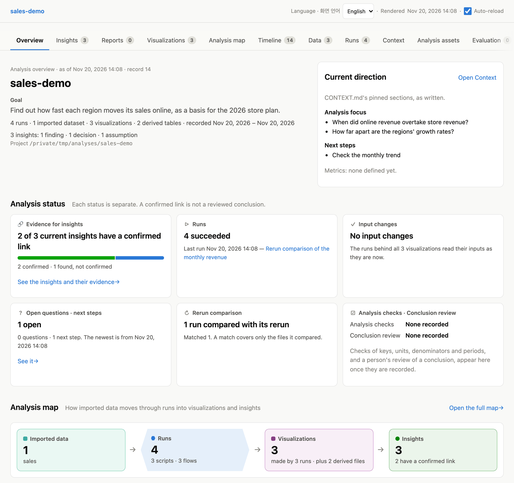
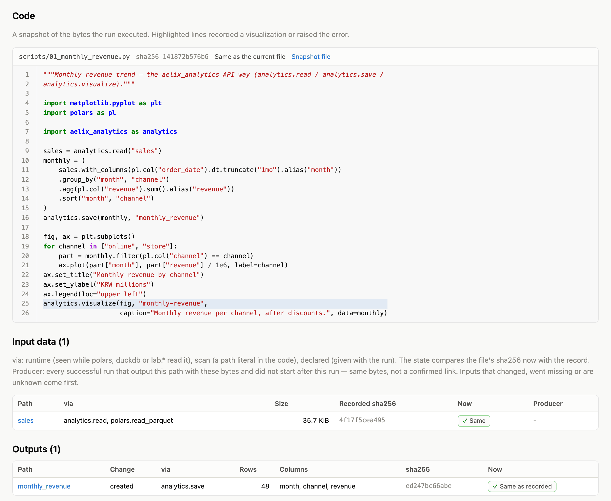

# Aelix Analytics

**Data analysis that keeps its evidence, so people and AI agents can check it, continue it and share it.**

English · [한국어](README.ko.md)

An analysis done with an AI agent tends to end with the chat: the charts survive, but not which code drew
them, which data they read, or why the analysis turned the way it did. Aelix Analytics keeps all of that in
the project itself.

- **Every chart leads back to its evidence:** the exact code that drew it, the input files it read (by
  sha256), and the data plotted.
- **Findings and decisions point at the run behind them.** So do assumptions and open questions.
- **The goal, focus and next steps live in plain files.** The next session reads them first, whether it is
  you, an agent, or an agent on another model.

You keep writing ordinary Python with DuckDB, Polars, matplotlib or plotly. The kit records each run and
builds a static HTML **Workspace** to browse, rebuild and share.



> **First public beta (kit 0.32.1).** This is not a sandbox. Scripts run with your permissions, and in
> [aelix](https://github.com/handochan/aelix-ai) the agent's `analytics_run` executes code without asking
> first. Read [Limits](#limits) before you use it on real data.

## What you get

**Charts you can trace.** Each chart belongs to a *run*: one execution of a script, recorded with a snapshot
of the code as it ran, the sha256 of every input, the outputs, logs and environment. A chart card links to
the line that drew it, to its inputs (still the same bytes, or changed since), and to the data attached to
the chart.




**Context that outlives the conversation.** `CONTEXT.md` holds the goal, the analysis focus, definitions and
next steps. `journal.jsonl` is the timeline of what happened: imports, runs, findings, decisions, assumptions,
questions and to-dos. A later entry closes an earlier one, so you can see what was known when, and why the
analysis changed. In aelix, the current context goes into every prompt, section by section within a
budget, and a new session starts from it.


**People and agents work on the same project.** The `analytics` command, the Python SDK and the aelix tools
write the same records, and each record says who made it (`human` or `agent`). You can analyse by hand
without any model, hand over to an agent, and take it back.

**Reruns you can compare.** A rerun executes a run's code snapshot again and compares the plotted data and
the output bytes: `match`, `mismatch`, `failed` or `inconclusive`.

**Reports and sharing.** Save a document you wrote (HTML, Markdown, …) as a versioned **Report**. Build a
standalone copy of the project or of chosen Reports, check it for leaks and broken links, and publish it to
a folder your team can open.

**Plain files.** Data is Parquet, records are JSON lines, the Workspace is static HTML, and each project has
its own uv environment. Nothing needs a server.

## Quick start

You need [uv](https://docs.astral.sh/uv/). Install the `analytics` command and make the demo project:
synthetic sales data, three example runs, notes, and a rerun check. No model is involved.

```sh
uv tool install --python 3.12 aelix-analytics
analytics demo ~/analyses/demo          # the first time takes about a minute to set up the uv environment
cd ~/analyses/demo && analytics open    # the Workspace in your browser
```

To continue the analysis with an agent, install [aelix](https://github.com/handochan/aelix-ai) with this
extension and start it in the project folder:

```sh
uv tool install --python 3.12 aelix==0.1.0b2 --with aelix-analytics --with-executables-from aelix-analytics
cd ~/analyses/demo && aelix
```

In aelix, `/analytics` opens a panel: status, the Workspace, Reports, records, sharing and settings. Then
ask for analysis as usual, for example *"Make the region growth chart record its plot data too."* The
agent imports data, explores it with SQL, writes scripts and runs them through the kit, so every run is
recorded.

## Install

Python 3.11 or newer runs the command and the extension. Each project's analysis runs in its own uv
environment (Python 3.12 or newer), so analysis libraries never go into aelix's environment. The targets
are Linux, macOS and Windows; [Support](docs/SUPPORT.md) lists what was installed and run where.

| You want | Run |
|---|---|
| The `analytics` command | `uv tool install --python 3.12 aelix-analytics` |
| aelix with the extension (and the same `analytics`) | `uv tool install --python 3.12 aelix==0.1.0b2 --with aelix-analytics --with-executables-from aelix-analytics` |
| To upgrade | `uv tool upgrade aelix-analytics`, or `uv tool upgrade aelix`; then restart aelix |
| To uninstall | `uv tool uninstall aelix-analytics`, or `uv tool uninstall aelix` |

To build from a checkout instead:

```sh
cd /path/to/aelix-analytics && uv build     # dist/aelix_analytics-0.32.1-py3-none-any.whl
uv tool install --python 3.12 dist/aelix_analytics-0.32.1-py3-none-any.whl
uv tool install --python 3.12 aelix==0.1.0b2 --with dist/aelix_analytics-0.32.1-py3-none-any.whl
```

A checkout also runs without installing: `bin/analytics` (POSIX) is the same command, and
`aelix -e /path/to/aelix-analytics/extension/aelix_analytics.py` loads the extension for one session.
The [user guide](docs/USER-GUIDE.md#설치본wheel으로-쓰기) (in Korean) covers registering the extension for
every session, upgrading, Windows, and moving projects made by older kits.

## How it works

A project is a folder:

```text
my-analysis/
  analytics.json          the project's identity
  CONTEXT.md              goal, analysis focus, definitions, findings, next steps (people and agents edit it)
  journal.jsonl           append-only timeline: imports, runs, findings, decisions, questions, …
  pyproject.toml, uv.lock this project's own environment
  data/imported/          imported data as Parquet, with source path, sha256 and schema
  data/derived/           Parquet files that runs wrote
  scripts/                the analysis code you edit
  runs/<run id>/          one folder per run: code snapshot, inputs, outputs, charts with plot data, logs
  workspace/              the generated HTML Workspace (do not edit; it is rebuilt from the records)
```

You (or the agent) write scripts in `scripts/`. Running one through the kit makes a run. The kit snapshots
the code and detects inputs three ways: library hooks, path literals in the code, and inputs you declare.
It finds outputs by comparing the project's files before and after, and saves charts with their data. Then
it rebuilds the Workspace. A chart is marked *stale* when an input it read has changed since.

## Using it

**In aelix**, the agent has six tools:

| Tool | What it does |
|---|---|
| `analytics_status` | datasets, recent runs, charts and whether they are stale, open questions, key records |
| `analytics_query` | one read-only DuckDB SQL statement over the datasets |
| `analytics_import` | CSV, TSV, JSON, NDJSON or Parquet into `data/imported/` as Parquet |
| `analytics_run` | run a script and record it; `rerun_of` reruns a run and compares |
| `analytics_record` | a finding, decision, assumption, question, to-do or note, linked to its evidence |
| `analytics_init` | a new project, only when you ask for one |

Publishing, trusting a project and registering analysis assets are yours to decide. The agent's guidelines
leave them to you, in `/analytics`.

**From the shell**, `analytics` does the same work: `analytics run scripts/01_trend.py --title "Monthly
trend"`, `analytics query "SELECT …"`, `analytics record finding "…"`, `analytics status`, `analytics build`,
`analytics publish`. See `analytics --help`. If a skill or another agent runs analysis scripts, have it call
`analytics run`: a plain `python scripts/x.py` is not recorded as a run. An agent outside aelix should set
`AELIX_ANALYTICS_ACTOR=agent`, or its records count as yours.

**In scripts**, the SDK is optional, since plain Polars and DuckDB reads and `plt.show()` are recorded too.
It adds names and explicit links:

```python
import aelix_analytics as analytics

sales = analytics.read("sales")                                    # a Polars DataFrame of data/imported/sales.parquet
monthly = analytics.sql("SELECT ... FROM sales GROUP BY ALL").pl() # DuckDB, with every dataset as a view
analytics.save(monthly, "monthly_revenue")                         # data/derived/monthly_revenue.parquet
analytics.visualize(fig, "monthly-revenue", title="…", data=monthly)   # a matplotlib or plotly chart and its data
analytics.record("finding", "…")                                   # a journal record linked to this run
analytics.save_report("q3-review", files="reports_out/q3", entry="index.html",
                      title="Q3 review", previous_revision=None)    # a versioned Report, in the Reports tab
```

A document becomes a Report only when you save it. Write it outside `workspace/` and save it with
`analytics.save_report`, or with `analytics reports save q3-review --files reports_out/q3 --entry index.html
--title "Q3 review" --previous none` from the shell. `analytics reports list` lists the Reports.

## Limits

- **No sandbox and no approval step.** Scripts run with your permissions. aelix does not ask before an
  extension's tool runs, and headless mode approves everything.
- **Lineage is best effort.** Reads that bypass the hooks, such as pyarrow directly or a C extension
  opening a computed path, can be missed. The run then warns `no input files were detected`; declare such
  inputs. There is no row-level lineage.
- **Immutability is a convention.** Nothing stops you from editing `data/imported/` or `runs/`. Hash checks
  show the change. There are no hash chains or signatures.
- **No transactions.** A killed run shows as `incomplete`. Sending the same request twice makes two runs.
- **Reruns assume the same environment.** Environments are not compared, and local helper modules are
  imported from the current `scripts/`.
- **Scale.** The Workspace is rebuilt in full each time. Hundreds of runs or gigabytes of data slow it
  down.
- **Privacy.** The Workspace shows previews of your data, and the local telemetry keeps the start of bash
  commands, after it masks values that look like secrets. Check before you share.
- **Windows** needs short project paths, and has notes on Ctrl+C and PowerShell encoding: see
  [Windows](docs/USER-GUIDE.md#windows에서-쓸-때) in the user guide.

The [current contract](docs/CONTRACTS.md) states what each part guarantees and what it does not (section G).

## Documentation

The detailed documents are in Korean.

| Document | What is in it |
|---|---|
| [User guide](docs/USER-GUIDE.md) | Installing and registering the extension, Windows, commands, the authorship rules, the SDK, analysis assets, checkpoints, how context reaches the prompt, sharing, limits, and moving from older kits |
| [Current contract](docs/CONTRACTS.md) | What this version implements and guarantees, field by field |
| [Product direction](docs/PRODUCT.md) | The vision and what users should get |
| [Architecture](docs/ARCHITECTURE.md) | Modules, boundaries and dependency direction |
| [Support](docs/SUPPORT.md) | Python, OS, aelix and install paths that were run, with evidence |
| [Changelog](CHANGELOG.md) | Changes by kit version |
| [Contributing](CONTRIBUTING.md) | How to propose a change and the checks CI runs |
| [Project operations](docs/PROJECT-OPERATIONS.md) | Issues and the Project board, shared instructions for agents, handoffs |

Proposals and design documents under `docs/` describe what is not built yet. The current contract is the
reference for what exists.

## Development

```sh
cd /path/to/aelix-analytics
uv sync --locked
uv run --locked pytest -q --timeout 600 --timeout-method=thread   # the kit, the launcher, and the wheel installed in a fresh environment
AELIX_ANALYTICS_TEST_INSTALL=1 uv run --locked pytest -q --timeout 600 --timeout-method=thread tests/test_packaging.py   # end to end with aelix 0.1.0b2 and real uv (network)
uv run --isolated --no-project --python 3.12 --with aelix==0.1.0b2 --with pytest==9.1.1 --with pytest-timeout==2.4.0 \
  python -m pytest -q -p no:cacheprovider --timeout 300 --timeout-method=thread tests/test_extension.py tests/test_asset_extension.py \
  tests/test_checkpoint_extension.py tests/test_usage_report.py tests/test_agent_cli.py \
  tests/test_panel_extension.py   # the aelix integration, as in CI
uv run --locked ruff check tests extension src tools
```

[Contributing](CONTRIBUTING.md#현재-개발-검증) has every command CI runs and the pins.

## Security and license

Maintainer: [@handochan](https://github.com/handochan). Do not report vulnerabilities in public issues. See
the [security policy](SECURITY.md). Aelix Analytics is licensed under the [Apache License 2.0](LICENSE).
