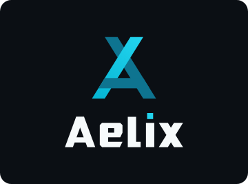
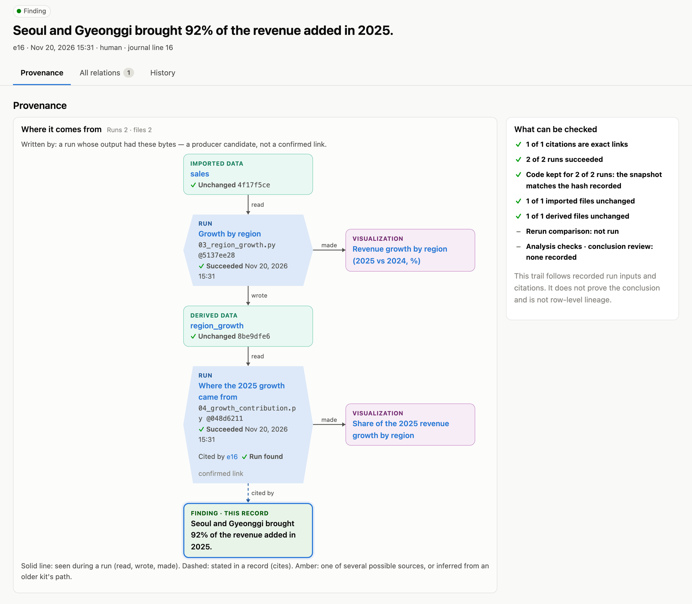
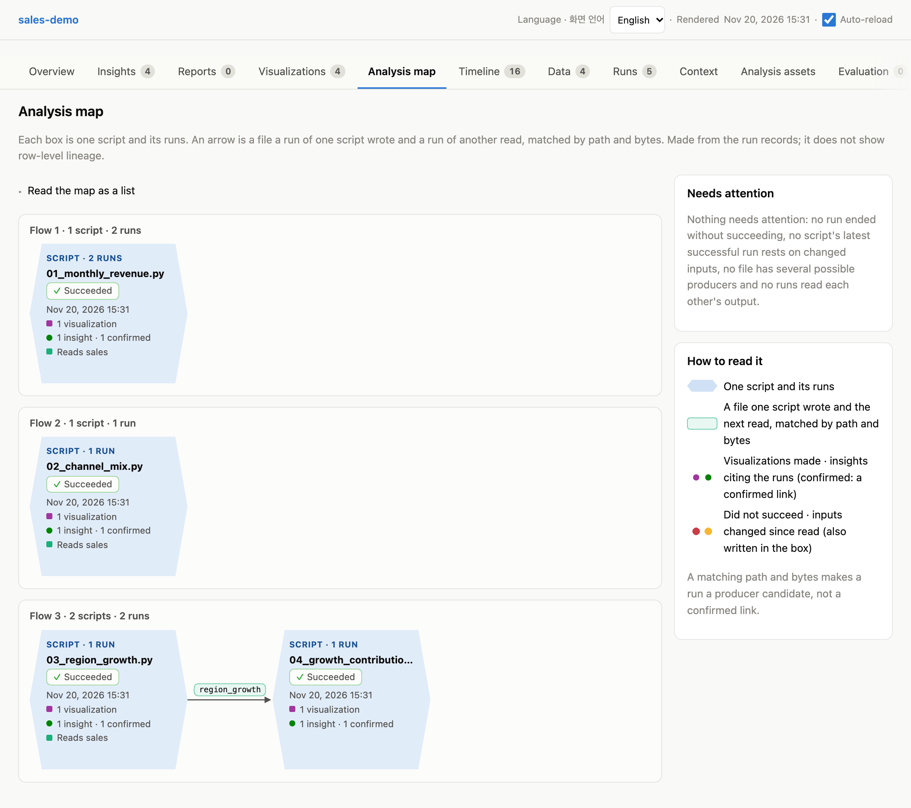
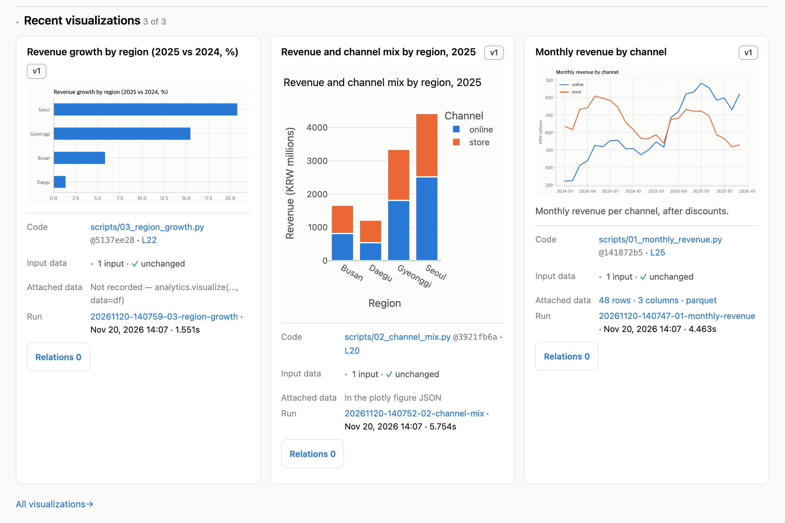
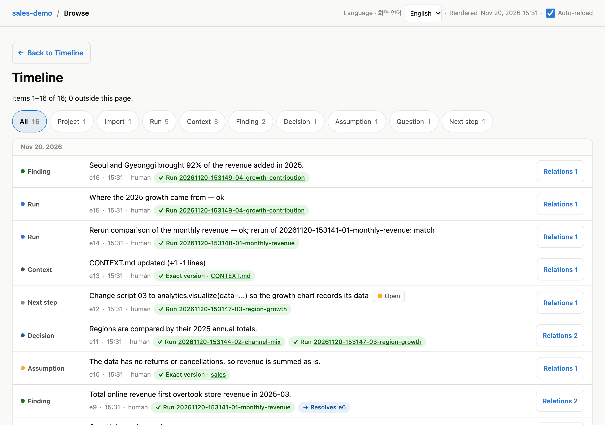

<div align="center">



# Aelix Analytics

**A new paradigm of data analysis for the age of AI agents.**

People and agents work in one analysis project, see the same picture of it, and carry it forward with
every step tied to its evidence.

English · [한국어](README.ko.md) · [Quick start](#quick-start) · [Features](#features)

</div>

## Why

- **Notebooks** (`.ipynb`) keep code next to its output, but not which run made which chart, or why the
  analysis changed course.
- **BI tools** show finished numbers, not how they were reached.
- **AI agents** do the work in a chat, and the reasoning ends with the session.

**In Aelix Analytics, an analysis is a project that keeps going.** Goals, metrics, data, runs, charts,
findings and decisions are records that point to where they came from. People and agents read and write
the same records, so they share one understanding: what is known, on what evidence, and what comes next.
A new session, another model or another person continues from there instead of starting over.



> **Beta.** Not a sandbox: scripts run with your permissions, and in [aelix](https://github.com/handochan/aelix-ai)
> the agent's `analytics_run` runs code without asking. Read [Limits](#limits) first.

## Features

The pictures show the demo from the [Quick start](#quick-start) with one more script, which reads a table
another script wrote.

### Evidence

- **Provenance.** Follow a finding, chart or file back through runs and data to the imported files, and see
  what could be checked.
- **Analysis map.** Scripts, their runs, and the files that connect them, on one page.
- **Run records.** Each run keeps its code as it ran, the inputs it detected (with sha256), its outputs,
  charts with their data, logs and environment.
- **Reruns.** Run a snapshot again and compare its charts and outputs: `match`, `mismatch`, `failed` or
  `inconclusive`.
- **Stale charts.** A chart whose inputs changed since is flagged.



### Shared context

- **`CONTEXT.md`.** Goal, focus, definitions and next steps, with every version kept. In aelix the agent
  gets it with each prompt.
- **Journal.** Findings, decisions, assumptions, questions and to-dos, each citing its evidence. A later
  entry can close an earlier one.
- **Metrics.** Define metrics (vague ones too), set the current focus, record observations.
- **Checkpoints.** A summary of where the analysis stands, for the next session or person.
- **Search.** Look up records and their evidence without reading everything.


### Workspace

A static HTML site rebuilt from the records, reloading as you work. Its tabs are Overview, Insights,
Reports, Visualizations, Analysis map, Timeline, Data, Runs, Context, Analysis assets and Evaluation.

- **Version history.** Every chart, dataset, script and `CONTEXT.md` version, and what used each one.
- **Evaluation.** Record coverage, tool usage, possible workarounds, workflow feedback, and work done
  outside the kit.
- **English or Korean.** Switch the interface at the top right.






### Reports and assets

- **Free-form reports.** Write a report in any form at any point of the analysis (HTML, Markdown, …) and
  save it as an immutable, versioned Report, linked to the evidence you name. Group repeated reports, such
  as one per column, into a collection.
- **Reusable assets.** Find what is worth reusing in an analysis: a function, module, package or skill
  becomes an asset candidate with checks. It goes from proposed to trial to validated, and enters a project
  only when you register it. The kit suggests candidates when you ask, or on its own if you turn that on.

### Sharing and teamwork

- **Sharing. Build a standalone copy of the project or of chosen Reports, as a folder or ZIP, checked for
  leaks and broken links. Publish it to a shared folder with a stable "latest" page.
- **People and agents.** The `analytics` command, the Python SDK and the aelix tools write the same records,
  each marked with who made it and how. In aelix, `/analytics` opens a panel, and bash work outside the kit
  is noted as observed activity.

## Quick start

You need [uv](https://docs.astral.sh/uv/). Install **one** of these. Both make an `analytics` command, so
to switch from the first to the second, run `uv tool uninstall aelix-analytics` first.

```sh
uv tool install --python 3.12 aelix-analytics     # the analytics command alone
```

```sh
uv tool install --python 3.12 aelix==0.1.0b2 --with aelix-analytics --with-executables-from aelix-analytics   # aelix, the extension and analytics
```

Make the demo (synthetic sales data, three runs, notes and a rerun check; no model) and open it:

```sh
analytics demo ~/analyses/demo          # about a minute the first time, to set up its uv environment
cd ~/analyses/demo && analytics open    # the Workspace in your browser
```

With aelix, run `cd ~/analyses/demo && aelix`. Type `/analytics` for the panel, or just ask, for example
*"Make the region growth chart record its plot data too."*

## Install

The command and the extension need Python 3.11 or newer. Analysis runs in each project's own uv
environment (Python 3.12 or newer), never in aelix's. The targets are Linux, macOS and Windows;
[Support](docs/SUPPORT.md) lists what was run where.

| You want | Run |
|---|---|
| The `analytics` command | `uv tool install --python 3.12 aelix-analytics` |
| aelix with the extension, and the same `analytics` | `uv tool install --python 3.12 aelix==0.1.0b2 --with aelix-analytics --with-executables-from aelix-analytics` |
| To switch from the first to the second | `uv tool uninstall aelix-analytics`, then the second line |
| To upgrade | `uv tool upgrade aelix-analytics` or `uv tool upgrade aelix`, then restart aelix |
| To uninstall | `uv tool uninstall aelix-analytics` or `uv tool uninstall aelix` |

From a checkout:

```sh
cd /path/to/aelix-analytics && uv build     # dist/aelix_analytics-0.32.1-py3-none-any.whl
uv tool install --python 3.12 dist/aelix_analytics-0.32.1-py3-none-any.whl
uv tool install --python 3.12 aelix==0.1.0b2 --with dist/aelix_analytics-0.32.1-py3-none-any.whl
```

Without installing, `bin/analytics` (POSIX) is the same command, and
`aelix -e /path/to/aelix-analytics/extension/aelix_analytics.py` loads the extension for one session. The
[user guide](docs/USER-GUIDE.md#설치본wheel으로-쓰기) (in Korean) covers registering the extension, upgrades,
Windows, and projects from older kits.

## How it works

A project is a folder:

```text
my-analysis/
  analytics.json          the project's identity
  CONTEXT.md              goal, focus, definitions, findings, next steps
  journal.jsonl           append-only timeline of imports, runs, findings, decisions, questions, …
  pyproject.toml, uv.lock this project's own environment
  data/imported/          imported data as Parquet, with source path, sha256 and schema
  data/derived/           Parquet files that runs wrote
  scripts/                the analysis code you edit
  runs/<run id>/          one folder per run: code snapshot, inputs, outputs, charts and their data, logs
  workspace/              the generated HTML (do not edit; rebuilt from the records)
```

Running a script through the kit makes a run. The kit detects inputs three ways (library hooks, path
literals in the code, inputs you declare), finds outputs by comparing files before and after, and rebuilds
the Workspace.

## Using it

**In aelix**, the agent has six tools:

| Tool | What it does |
|---|---|
| `analytics_status` | datasets, recent runs, charts and whether they are stale, open questions, key records |
| `analytics_query` | one read-only DuckDB SQL statement over the datasets |
| `analytics_import` | CSV, TSV, JSON, NDJSON or Parquet into `data/imported/` as Parquet |
| `analytics_run` | run a script and record it; `rerun_of` reruns a run and compares |
| `analytics_record` | a finding, decision, assumption, question, to-do or note, with its evidence |
| `analytics_init` | a new project, only when you ask for one |

Publishing, trusting a project and registering assets are left to you, in `/analytics`.

**From the shell**: `analytics run scripts/01_trend.py --title "Monthly trend"`, `analytics query "SELECT …"`,
`analytics record finding "…"`, `analytics status`, `analytics build`, `analytics publish`, and more in
`analytics --help`. Have skills and other agents use `analytics run`: a plain `python scripts/x.py` is not
recorded as a run. An agent outside aelix should set `AELIX_ANALYTICS_ACTOR=agent`, or its records count
as yours.

**In scripts**, the SDK is optional (plain Polars and DuckDB reads and `plt.show()` are recorded too). It
adds names and explicit links:

```python
import aelix_analytics as analytics

sales = analytics.read("sales")                                    # a Polars DataFrame of data/imported/sales.parquet
monthly = analytics.sql("SELECT ... FROM sales GROUP BY ALL").pl() # DuckDB, with every dataset as a view
analytics.save(monthly, "monthly_revenue")                         # data/derived/monthly_revenue.parquet
analytics.visualize(fig, "monthly-revenue", title="…", data=monthly)   # a matplotlib or plotly chart and its data
analytics.record("finding", "…")                                   # a journal record linked to this run
analytics.save_report("q3-review", files="reports_out/q3", entry="index.html",
                      title="Q3 review", previous_revision=None)    # a versioned Report, in the Reports tab
```

A document becomes a Report only when you save it: write it outside `workspace/`, then call
`analytics.save_report`, or run `analytics reports save q3-review --files reports_out/q3 --entry index.html
--title "Q3 review" --previous none`. `analytics reports list` lists them.

## Limits

- **No sandbox, no approval step.** Scripts run with your permissions; aelix does not ask before an
  extension's tool runs, and headless mode approves everything.
- **Lineage is best effort.** Reads that bypass the hooks (pyarrow directly, a C extension opening a
  computed path) can be missed. The `no input files were detected` warning appears only when a run detected
  none at all, so declare such inputs either way. There is no row-level lineage.
- **Immutability is a convention.** Edits to `data/imported/` or `runs/` are not prevented, only revealed by
  hash checks. No hash chains or signatures.
- **No transactions.** A killed run shows as `incomplete`; the same request sent twice makes two runs.
- **Reruns assume the same environment.** Environments are not compared, and local helper modules come from
  the current `scripts/`.
- **Scale.** The Workspace is rebuilt in full each time; hundreds of runs or gigabytes of data slow it down.
- **Privacy.** The Workspace shows previews of your data, and local telemetry keeps the start of bash
  commands with secret-looking values masked. Check before you share.
- **Windows** needs short project paths and has notes on Ctrl+C and PowerShell encoding:
  [Windows](docs/USER-GUIDE.md#windows에서-쓸-때) in the user guide.

What each part guarantees, and what it does not (section G), is in the [current contract](docs/CONTRACTS.md).

## Documentation

The detailed documents are in Korean.

| Document | What is in it |
|---|---|
| [User guide](docs/USER-GUIDE.md) | Install and extension setup, Windows, commands, authorship, the SDK, assets, checkpoints, context in prompts, sharing, limits, older kits |
| [Current contract](docs/CONTRACTS.md) | What this version implements and guarantees |
| [Product direction](docs/PRODUCT.md) | The vision and what users should get |
| [Architecture](docs/ARCHITECTURE.md) | Modules, boundaries and dependency direction |
| [Support](docs/SUPPORT.md) | Python, OS, aelix and install paths that were run, with evidence |
| [Changelog](CHANGELOG.md) | Changes by kit version |
| [Contributing](CONTRIBUTING.md) | Proposing a change and the checks CI runs |
| [Project operations](docs/PROJECT-OPERATIONS.md) | Issues and the Project board, shared agent instructions, handoffs |

Design documents under `docs/` include parts not built yet; the current contract is the reference for what
exists.

## Development

```sh
cd /path/to/aelix-analytics
uv sync --locked
uv run --locked pytest -q --timeout 600 --timeout-method=thread   # the kit, the launcher, and the wheel installed in a fresh environment
AELIX_ANALYTICS_TEST_INSTALL=1 uv run --locked pytest -q --timeout 600 --timeout-method=thread tests/test_packaging.py   # end to end with aelix 0.1.0b2 and real uv (network)
uv run --isolated --no-project --python 3.12 --with aelix==0.1.0b2 --with pytest==9.1.1 --with pytest-timeout==2.4.0 \
  python -m pytest -q -p no:cacheprovider --timeout 300 --timeout-method=thread tests/test_extension.py tests/test_asset_extension.py \
  tests/test_checkpoint_extension.py tests/test_usage_report.py tests/test_agent_cli.py \
  tests/test_panel_extension.py   # the aelix integration, as in CI
uv run --locked ruff check tests extension src tools
```

[Contributing](CONTRIBUTING.md#현재-개발-검증) has every command CI runs and the pins.

## Security and license

Maintainer: [@handochan](https://github.com/handochan). Report vulnerabilities privately, not in public
issues: see the [security policy](SECURITY.md). Licensed under the [Apache License 2.0](LICENSE).
