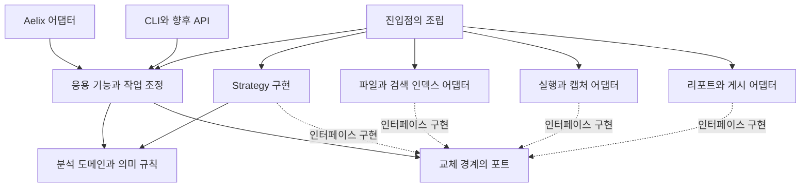

# 지속적으로 확장하는 분석 플랫폼의 아키텍처

작성: 2026-09-18 · 개정: 2026-10-06 · 상태: 구현을 위한 설계 제안. 제품의 장기 방향은 합의된 요구이며 아래 후보 인터페이스·모듈은 아직 구현되지 않았다. 이미 적용한 부분은 ADR-0001의 [적용 현황](decisions/0001-evolvable-platform-boundaries.md#적용-현황)에 있다. 예외: §11의 [계층과 의존 방향 검사](#계층과-의존-방향-검사)는 지금 코드에 적용한 표다(#43).
상위 목적은 [PRODUCT.md](PRODUCT.md), 채택한 결정은 [ADR-0001](decisions/0001-evolvable-platform-boundaries.md)(채택은 구현 완료가 아니다), 현재 동작은 [CONTRACTS.md](CONTRACTS.md)를 따른다.
공개·내부 명칭은 [용어집](TERMINOLOGY-AND-LANGUAGE.md)을 따른다. 아래 현재 소스 링크는 옛 이름이고, 후보 구조·인터페이스는 새 이름이다.

## 1. 베타 이후에도 유지할 기반

Aelix Analytics는 베타를 종착점으로 두지 않는다. 사람과 에이전트가 검증 가능한 분석 프로젝트를 이어 가는 도구·플랫폼으로 성장하고,
분석의 새로운 표준으로 자리 잡는 것을 지향한다. 첫 확장에서도 기록의 수명·교체 가능한 구현·공개 계약·기여자의 검증 기준을 설계한다.

핵심 방향은 **안정적으로 보존할 분석의 의미와, 발전에 따라 교체할 정책·기술을 분리하는 것**이다.
출발 구조는 책임과 의존 방향을 구분한 단일 배포 패키지다. 모듈 경계는 처음부터 마련하고,
별도 서버·분산 저장소·원격 worker는 실제 운영 요구가 생길 때 같은 계약 뒤로 확장한다.

Strategy 패턴은 동작 방식의 교체에 사용한다. 저장소·실행 환경·게시 서비스 같은 외부 기술과의 연결은 포트와 어댑터로 분리한다.
**모델이 작성하는 분석 알고리즘은 자유로운 Python 코드로 유지한다. 내부 Strategy 목록을 사용 가능한 분석법의 허용 목록으로 만들지 않는다.**

## 2. 현재 구조에서 유지하고 분리할 것

기존 동작 기준점 `7b205cd`의 코드를 확인했다. 아래는 그 시점의 리팩터링 출발점이며 최신 HEAD나 이미 분리된 구현을 뜻하지 않는다.

| 현재 위치 | 유지할 장점 | 분리할 책임 |
|---|---|---|
| [core.py](../src/aelix_analytics/core.py) | stdlib만으로 프로젝트 기록을 읽을 수 있음 | 파일·잠금·journal 쓰기, 의미 규칙, 상태/관계 계산, 맥락 선택·텍스트 표시 |
| [runner.py](../src/aelix_analytics/runner.py) | 자유 코드 실행과 실패·스냅샷·산출물 기록 | 실행 backend, 캡처, 작업 조정, 완료 기록·재실행 비교 |
| [workspace.py](../src/aelix_analytics/workspace.py)(kit 0.6.0 전 `report.py`) | 동일 기록에서 탐색 가능한 HTML 생성 | 공통 읽기 모델, 표시 형식, 공유 범위 투영, 파일 빌드 |
| [capture.py](../src/aelix_analytics/capture.py), [data.py](../src/aelix_analytics/data.py) | 관용 코드와 데이터 도구를 활용 | 라이브러리별 캡처·입출력 어댑터와 기록 의미 |
| [Aelix 어댑터](../extension/aelix_analytics.py) | 프로젝트별 분석 환경으로 실행 위임 | 호스트 이벤트·도구 표현, 프로젝트 선택 상태, core 연결·자원 경로 |

현재의 host/프로젝트 uv 환경 분리는 유지한다. `STATE`, 활성 캡처·연결 같은 상태는 향후 세션·프로젝트·실행 수명에 맞춰 소유한다.
이를 현재의 데이터 혼선 버그라고 단정하지 않으며, 다중 세션·환경으로 확장하기 전에 격리 계약을 검증한다.

## 3. 바뀌어도 보존해야 하는 의미

이 규칙들은 선택 가능한 Strategy가 덮어쓰는 설정이 아니다.

- 목적·질문·지표 정의·관측·발견·다음 판단의 관계와, 당시 버전·적용 범위의 정체성.
- 원래 기록의 보존, 정정·대체·철회 이유, 시간 순서와 현재 유효성의 구별.
- 실행 성공·기록 완료·재실행 비교·분석 검사·결론 검토의 구별.
- 관측·선언·추론·미확인, 내용 미보존·공유 제외·누락의 구별.
- 지표 등록·정형 분석법을 요구하지 않는 자유로운 탐색과 코드 실행.
- 원본 기록·보존한 보고서 본문·첨부와, 재생성 가능한 검색·그래프·프로젝트 탐색 HTML·공유용 표현의 구별.
- 보고서의 내용 버전·작성 시점·분석 기준과 게시본의 정체성·게시 시각의 구별. 화면 재생성으로 내용을 덮어쓰지 않음.
- 토큰 수치가 강제 실행 상한이 아닌 성능 측정 기준이라는 원칙.
- 내부 확장점의 증가와 모델에게 노출하는 도구 수의 구별.

이 의미가 바뀌는 변경은 단순 구현 교체로 처리하지 않는다. 계약 변경·전환·기존 기록의 해석을 함께 검토한다.
반면 검색 순위나 renderer를 바꿨다는 이유로 과거 지표·발견·계산 결과의 의미를 새로 쓰지 않는다.

## 4. 핵심 계층과 의존 방향



실선은 소스 의존·조립 관계, 점선은 포트 구현을 나타낸다. 실행 중 응용 기능은 주입받은 포트를 호출한다.

**분석 도메인:** 지표·초점·근거·버전·상태 규칙과 자료형. Aelix·HTML·DuckDB·Polars·저장 backend를 import하지 않는다.

**응용 기능:** 읽기, 기록, 실행 조정, build·publish의 사용 사례. 포트를 통해 필요한 I/O를 요청한다.
호스트·화면마다 같은 규칙을 다시 구현하지 않는다. 명령과 조회는 책임을 나누되 동일한 버전·ID를 사용한다.

**포트와 구현:** 저장·실행·검색·표시·게시와 교체 가능한 정책의 작은 인터페이스.
추상 계약의 입력·출력은 직렬화 가능한 메타데이터·참조·결과 자료형으로 표현하고, 큰 표는 artifact 참조로 넘긴다.
core 계약에 DataFrame·Aelix ToolResult·브라우저 DOM·특정 클라우드 응답 타입을 넣지 않는다.

**조립:** CLI/호스트/worker 진입점에서 설정에 맞는 구현을 만들고 명시적으로 전달한다.
core가 전역 registry나 환경 변수를 찾아 스스로 provider를 import하는 구조를 피한다.
예외는 OS마다 동작이 다른 플랫폼 포트다. core가 이 프로세스의 구현을 기본값으로 한 번 고르고(`core.PLATFORM`) 호출자가 `Project(root, platform=…)`로 바꿔 넣는다([ADR-0001](decisions/0001-evolvable-platform-boundaries.md#os마다-다른-구현의-기본값)).
설정·상태는 프로젝트별로 관리하고, 시작한 작업에서 사용하는 구현·설정 버전은 끝날 때까지 일관되게 유지한다.

### 사람과 에이전트의 공통 작성 경로

사람용 CLI·Python SDK와 Aelix 도구는 같은 응용 기능을 호출한다. 프로젝트 생성·가져오기·SQL·실행·기록·보고서 저장을 호스트마다 따로 구현하지 않는다.
사람용 설치·시작·실행 경로는 Aelix 패키지·세션·모델 설정을 요구하지 않는다. 분석에 필요한 runtime·라이브러리는 프로젝트 환경에서 사용한다.
모델 기반 작성·요약은 선택한 adapter로만 연결하고, 기본 기록·렌더 경로가 숨은 모델 호출을 하지 않게 한다.

실행 시작·완료, 코드·입력·환경·산출물 보존과 실패 상태는 공통 실행 경로에서 조정한다. 활성 run 밖의 SDK 호출은 자동으로 완전한 기록이 되지 않는다.
후속 노트북 adapter도 이 경계를 사용하며 셀의 실제 실행 순서·범위 밖 상태를 별도로 표현해야 한다. 기존 자유 코드를 정형 DSL로 다시 쓰게 하지 않는다.
작성·요청 주체와 실행 수단은 진입점에서 명시적으로 전달하고 보존한 기록의 출처를 덮어쓰지 않는다. 호스트 세션 참조는 선택적이며 필드 계약은 B1-c에서 확정한다.
같은 분석을 교대로 이어받을 때 원본 ID·버전·근거를 공유하고 새 작업만 새 기록으로 추가한다. [직접 분석 설계](DESIGN-CONTINUITY-AND-REUSE.md#사람이-직접-분석하는-경로)를 따른다.

## 5. Strategy를 적용할 변경 축

Strategy는 공통 입력·출력과 의미를 유지하면서 정책·알고리즘을 교체하는 용도로 쓴다.
아래 이름은 인터페이스 후보이며 현재 API가 아니다.

| 경계 | 첫 구현의 후보 | 이후 교체·확장 | 모든 구현에 공통인 조건 |
|---|---|---|---|
| `ContextSelectionStrategy` | 현재 초점·정의·질문과 섹션 우선순위 | 과제·모델 특성에 따른 맥락 선택 | 빠진 내용을 더 읽을 수 있음, 정의 버전 유지, 토큰 목표로 필요한 정보를 강제 절단하지 않음 |
| `RetrievalStrategy` | ID·키워드·상태·관계 기반 검색 | 의미 검색·hybrid·재순위 | 실제 원본 ID·기록 기준 반환, 없는 근거를 생성하지 않음 |
| `ProposalPolicy` | 요청 시 / 기준을 통과한 상시 제안 | 사용자별 선호·관측 효과에 따른 제안 판단 | 모드·중복·거절·빈도 준수, 제안 비용 측정, 자동 등록으로 승격하지 않음 |
| `PublicationProjection` | read / evidence의 선택 범위 | 조직별 공유 프로필 | 선택한 범위를 실제 payload·파일에 반영, 제외와 원본 누락을 구별 |

첫 교체 사례는 이미 요구가 있는 두 제안 모드 또는 두 공유 프로필에서 검증한다.
`PublicationProjection`의 계약·계약 시험과 공유 build의 흐름은 [공유 build 설계](design/PUBLICATION-BUILD.md)(#20, Proposed, 현재 코드 아님)가 제안한다.
수십 개의 미래 Strategy와 추상 base class를 먼저 만들지 않는다. 현재 구현 하나와 다른 테스트 구현으로 경계를 먼저 입증할 수도 있다.
의미가 다른 기능을 Strategy 하나의 거대한 `mode`·`action` 분기로 묶지 않는다.

### Strategy와 어댑터의 구별

| 외부 기술 경계 | 책임 | 첫 구현과 향후 후보 |
|---|---|---|
| `RecordStore`, `ArtifactStore` | 원본 기록·바이트의 보존과 읽기·쓰기 계약 | 파일/JSONL → 요구가 생기면 다른 저장 backend |
| `ReadIndex` | 재생성 가능한 검색·관계 인덱스 | 파일 조회·SQLite → 필요할 때 다른 인덱스 |
| `ExecutionBackend` | 코드 실행·취소·결과·환경의 전달 | 프로젝트 uv 환경 → 별도 worker/원격 실행 |
| 데이터·캡처 어댑터 | 입력·출력·그림의 라이브러리별 관측 | DuckDB/Polars/matplotlib/Plotly → 추가 라이브러리·데이터 소스 |
| `WorkspaceRenderer` | 공통 읽기 모델로 분석 인터페이스 표현 | Visualizations·Reports를 포함한 정적 HTML → 다른 독자 화면 |
| `ReportRenderer` 등 보고서 형식 어댑터 | 보존한 본문·첨부의 표현과 지원 능력 | Markdown/HTML 보기·일반 파일 다운로드 → 선택적 PDF·슬라이드 변환 |
| `Publisher` | 고정된 빌드를 대상에 전달하고 결과 확인 | 공유 폴더 → 사내 호스팅·스토리지 |

이 구현들은 포트를 만족하는 어댑터다. 파일·네트워크와 무관한 분석의 의미를 어댑터 안에 복제하지 않는다.
특히 원본 저장소와 지워도 되는 읽기 인덱스를 같은 저장 인터페이스 뒤에서 혼동하지 않는다.
자유 형식 보고서의 작성·생성은 기존 자유 코드·실행 경로를 사용하고, 템플릿은 선택적 입력으로 둔다.
형식별 adapter는 지표·버전 의미를 바꾸거나 모델 도구를 추가하지 않는다. [보고서 설계](REPORT-ARTIFACTS.md)의 ID·보존·시점 규칙은 공통 응용 경로에서 검증한다.
Visualization의 ID·버전·첨부 범위는 도메인이 소유하고, 차트·지도·파일 등의 캡처·표시는 adapter가 담당한다. 유형·backend·파일 형식을 같은 enum으로 합치지 않는다.

## 6. 구현 방식과 교체 계약

Python에서는 작은 `typing.Protocol`, 자료형, 함수·객체의 조합을 우선한다.
인터페이스를 만족하기 위해 거대한 상속 계층·DI 컨테이너·전역 서비스 탐색기를 도입할 필요는 없다.

개념적인 타입 경계 예시이며 아래 타입·메서드는 아직 확정된 SDK가 아니다.

```python
from __future__ import annotations

from typing import Protocol


class ContextSelectionStrategy(Protocol):
    def select(self, request: ContextRequest, snapshot: ReadSnapshot) -> ContextSelection: ...


class Publisher(Protocol):
    def publish(self, artifact: BuiltPublication, target: PublishTarget) -> PublishReceipt: ...
```

실제 구현 전에 입력·출력 형식뿐 아니라 다음 행동을 정의한다.

- 어떤 리비전·설정·artifact에 대한 결과인지, 어떤 기능을 지원하는지.
- 읽기만 하는지 또는 외부 상태를 바꾸는지, 취소·실패·부분 성공을 어떻게 표현하는지.
- 같은 입력으로 재시도할 때의 의미와 지원하지 않는 기능의 응답.
- 기본값·생략·unknown의 의미. 가능한 결과와 실제로 관측한 결과의 구별.

Protocol 타입 검사만으로 이 계약이 보장되지는 않는다. schema 검사와 구현들이 공유하는 계약 시험을 둔다.
선택한 구현이 없거나 호환되지 않으면 사유를 명시한다. 의미·공유 범위가 달라지는 backend로 조용히 대체하지 않는다.
허용된 대체 경로가 있으면 무엇으로 바뀌었는지와 동일하게 유지되는 보장을 결과에 남긴다.

정책 선택은 검토한 설정·등록된 구현 ID로 한다. 프로젝트 데이터나 모델이 만든 문자열을 임의 import 경로로 실행하지 않는다.
이는 어댑터 로딩의 경계이며, 분석 프로젝트에서 작성하는 자유 Python의 방법 선택을 제한하는 규칙이 아니다.

## 7. 기록 쓰기·읽기·후속 작업의 분리

**원본 쓰기는 하나의 응용 경로에서 조정한다.** 파일 adapter나 renderer마다 버전·참조·상태 규칙을 재구현하지 않는다.
읽기는 동일한 원본의 특정 기준으로부터 지표·맥락·관계·리포트에 필요한 읽기 모델을 만든다.
CLI·HTML·에이전트 응답은 이 읽기 모델을 사용하므로, 화면만 최신 정의를 쓰거나 모델만 다른 근거를 받는 일이 없어야 한다.
공통 기록 계약(정체성·참조와 해석 상태·읽기 기준·저장 완료)은 [ADR-0006](decisions/0006-common-record-contract.md)이 정했다.
정본을 먼저 확정하고 journal의 완료 이벤트를 마지막에 쓰며, 실행·기록·표시 상태를 따로 둔다.
이 응용 경로인 #13의 공통 writer와 원본 보존 프로젝트 전환은 [기록 writer와 프로젝트 전환 설계](design/RECORD-WRITER-AND-MIGRATION.md)(#13)가 정했고, 구현 PR 넷이 구현했다. ⓪(kit 0.6.0)은 내부 이름을, 첫 구현 PR(①, kit 0.7.0)은 표식 판정과 모든 쓰기 진입점의 게이트, 작성 출처 `Origin`의 전달, 새 기록 가족의 읽기를 구현했고(모듈 `writer`, §11), 둘째 PR(②)은 전환 엔진을 더했다(모듈 `migration`). 셋째 PR(③, kit 0.8.0)은 새 형식의 공통 writer(`writer.Writer`: journal 줄·run·가져오기 기록, 잠금 안의 표식 재판정과 상태 재생, 쓰는 시점의 참조 결박)를 더하고 모든 쓰기 진입점을 그 writer로 옮겼으며, 쓰는 형식을 `analytics.project/2`로 바꾸고(`lab.json` 프로젝트는 읽기만 함) 전환을 명령 `analytics migrate`로 열었다. 지금 동작은 [현재 계약](CONTRACTS.md)이 설명한다.

검색·관계 인덱스는 원본과 별도 수명을 가진다. 삭제·교체·재구축해도 분석 기록이 사라지지 않는다.
읽기 모델 재생성은 Python 분석·외부 API 호출·publish의 재실행을 뜻하지 않는다.
보존한 보고서의 내용·첨부도 재생성 대상이 아니다. 본문 생성, 버전 저장, 프로젝트 화면 갱신, 공유 빌드·게시를 각각 구별한다.
현재 journal·run·CONTEXT·artifact는 각각 원본을 이루므로 journal 하나만 replay하면 모든 상태가 복원되는 완전한 event sourcing이라고 부르지 않는다.

리포트 갱신·인덱싱·선택적 skill 검토·자동 publish는 작업의 원본 기록과 분리한다.
완료한 분석에 대한 부가 처리 실패는 그 분석을 자동 재실행하는 이유가 아니다.
후속 처리에는 원인 이벤트·source revision·작업 ID와 실패 상태를 연결한다. 재처리는 이미 수행한 외부 작업을 중복 실행하지 않도록 설계한다.
베타에서 필요한 로컬 callback·명시적 작업 큐부터 시작하고, 이벤트 버스·분산 broker의 도입은 별도 필요가 생길 때 결정한다.

### 복구·멱등성의 공통 소유자

쓰기 조정 계층이 관리 산출물의 준비·게시·완료와 요청의 정체성을 담당한다.
Strategy는 결과나 정책 결정을 반환하며 공통 완료 기록·검증을 우회해 직접 journal의 과거를 수정하지 않는다.
작업 식별·취소·실패·부분 성공의 표현은 첫 인터페이스부터 둔다.
다중 파일 commit·durable job·멱등 key·복구의 실제 보장은 해당 구현과 중단 시험이 끝난 단계에서 선언한다.
베타가 보장하기로 한 재시도는 Report 저장(`request_id`)과 게시(`publication_id`와 대상)뿐이며, run·일반 기록 쓰기의 멱등성은 베타 뒤다(ADR-0006 8절).

파일 저장소와 DB 저장소가 같은 메서드 이름을 가진다는 이유로 같은 트랜잭션 보장을 제공한다고 간주하지 않는다.
지원하는 쓰기·동시성·복구 능력을 드러내고, 그 능력이 필요한 기능의 제공 범위와 연결한다.
임의 분석 코드의 외부 부작용과 확장이 관리하는 기록·산출물의 복구 범위는 계속 구별한다.

## 8. 장기 호환성과 공개 계약

분석 프로젝트는 실행한 모델·호스트·kit 버전보다 오래 살아야 한다.
내부 구현 교체와 기존 프로젝트·게시본·스크립트의 호환성을 별도 축으로 관리한다.

| 계약 | 버전·안정성을 관리할 대상 | 변경 시 필요한 증거 |
|---|---|---|
| 프로젝트 기록 | project/event/run/dataset, 지표·초점·근거 참조, 보고서 버전 manifest·묶음 | 오래된 fixture 읽기, 명시적 전환, 실패 복구, 미래 형식의 거절·부분 읽기 안내 |
| 스크립트 API | 목표 `import aelix_analytics as analytics`와 공개 함수의 의미 | 작업 스크립트의 명시적 전환, 과거 스냅샷·환경 보존, 실행·기록·오류 복구 동등성 |
| 읽기 계약 | ID·버전·페이지·관계·누락·계측 상태 | 사람과 에이전트의 같은 근거·상태, 구버전 consumer와의 호환 |
| 게시 형식 | publication manifest·자원·고정 버전·기능 | 원본 환경과 최신 renderer 없이 이전 게시본 읽기 |
| 내부 포트·Strategy | 입력·출력·지원 능력·실패 의미 | 같은 계약 시험을 통과하는 대체 구현, 실제 조립 시험 |
| 배포 계약 | Aelix manifest/API level·kit 자원·의존성 | 깨끗한 설치·삭제·업그레이드, host와 분석 환경 분리 |

모든 내부 포트를 즉시 외부 plugin API로 공개하지 않는다.
안정성은 `internal` / `experimental` / `public`로 명시하고, 최소한 서로 다른 구현에서 의미가 유지되는지를 확인한 경계부터 공개한다.
지원·폐기·전환 정책과 예제를 함께 제공한다. 베타라는 이유로 기록 해석을 예고 없이 바꾸거나 과거 파일을 버리지 않는다.

기존 필드의 뜻을 바꾸는 변경은 schema/계약 버전과 전환으로 다룬다.
단순 표시·성능 개선, 새 구현 ID의 추가, 새 기록 종류·필수 의미의 추가를 같은 종류의 변경으로 처리하지 않는다.
모르는 미래 필드는 존재와 지원 범위를 알리고, 이를 해석한 것처럼 쓰기 작업을 계속하지 않는다.
파생 캐시에는 원본 기준·인덱스 형식·관련 정책 버전을 기록해 오래된 해석을 현재 결과로 재사용하지 않게 한다.

표준이 되기 위한 기반은 읽을 수 있는 공개 형식, 안정된 정체성, 손실·보존 범위가 명확한 교환 계약,
구현과 독립된 예제와 적합성 시험이다. 상호운용 포맷·외부 표준 연결은 이 의미를 보존하는 어댑터로 추가한다.
새 표준 언어를 모든 Python 분석에 강제하거나 현재 상태를 이미 업계 표준이라고 선언하는 방식은 취하지 않는다.

## 9. 패키지와 실행 경계

기존 후보 구조를 다음 책임으로 구체화한다. **구현 시 모든 이름을 독립 파일로 만들라는 지시는 아니다.**
먼저 대표 사용 사례에서 의존 방향을 검증하고 변경 이유가 다른 책임을 분리한다.

```text
src/aelix_analytics/
  __init__.py, __main__.py          부작용 없는 SDK·CLI 진입점
  extension.py, aelix-plugin.toml   Aelix 접점과 배포
  core/
    domain/                        지표·초점·Visualization·Report·근거·버전
    application/                   명령·조회·작업 조정
    ports.py                       교체 가능한 경계의 계약
    policies/                      기본 Strategy 구현
    projections/                   맥락·관계·지표·산출물의 읽기 모델
    storage/                       stdlib 파일·JSONL·SQLite·legacy reader
  runtime/
    composition.py                 프로젝트 환경 쪽 조립
    runner.py, capture.py           실행·캡처 구현
    data.py                        분석 데이터 어댑터
  workspace/                       분석 인터페이스·영어 label·assets
  reports/                         문서 산출물의 형식별 처리
  publishing/                      독립 build·게시 구현
  templates/                       영어 기본 프로젝트 파일
```

`publishing/`의 첫 구현(#20 공유 build)의 모듈과 계층 배치 제안은 [공유 build 설계](design/PUBLICATION-BUILD.md) 3절에 있다. 제안이며, 계층은 구현 PR이
§11의 표와 `tests/test_layers.py`에 등록할 때 정해진다.

도메인·공유 응용 계약에는 표준 라이브러리만 사용하고 host/프로젝트가 지원하는 Python 문법의 공통 범위를 검증한다.
무거운 분석·그림 의존성은 프로젝트 uv 환경에서 로드한다.
host 쪽 조립은 가벼운 `core` 읽기와 runtime 호출 bridge만 사용하며, 프로젝트 환경의 조립이 분석 구현을 연결한다.
`__init__`의 부작용이나 포트 타입 import 때문에 Aelix가 Polars·DuckDB·그림 라이브러리를 로드해서는 안 된다.

배포된 확장의 실행 자원 경로만 자식 환경에 전달하고 host의 전체 `site-packages`를 노출하지 않는다.
#9의 첫 PR(2026-10-06)부터 kit이 package `aelix_analytics`이고, 자식은 그 package 하나만 담은 실행 루트(체크아웃의 `src/`, 설치본의
`aelix_analytics/kit/` 사본)를 받으며, 설치된 package 자신의 `python -m`은 거절한다([ADR-0004](decisions/0004-minimal-distribution-and-entry-points.md) 결정 1·9).
한 패키지 이름을 사용하더라도 `aelix_analytics.core`의 import가 `runtime`·Workspace·분석 라이브러리를 로드하지 않도록 SDK 진입점은 지연 연결한다.
설치 위치는 resource API로 찾는다. 프로젝트 루트·세션·현재 작업·정책 선택은 명시적 수명으로 관리한다.
전역 상태가 필요한 캡처 훅은 실행 worker 안에 가두고 설치·해제를 보장한다. 이를 여러 프로젝트가 공유하는 mutable 상태로 확장하지 않는다.

## 10. 확장을 실제로 증명할 시나리오

| 변화 | 핵심 의미를 유지하며 바뀌어야 하는 부분 | 실패로 볼 사례 |
|---|---|---|
| 키워드 검색에 의미 검색 추가 | 검색 구현·설정·성능 측정 | journal을 다시 쓰거나 `analytics_*` 도구를 검색 방법마다 추가 |
| 요청 시/상시 skill 정책 전환 | 주입한 정책·상태·기록 | 새 정책이 사용자 선택·거절 이력을 우회 |
| 공유 폴더에서 원격 게시로 확장 | Publisher와 대상 설정 | 지표·run·발견 형식까지 provider에 맞게 변경 |
| HTML 외 다른 읽기 화면 추가 | 같은 읽기 모델의 renderer | 새 화면에서만 근거·현재 버전의 의미가 달라짐 |
| 보고서에 새 파일 형식·템플릿 추가 | 형식 adapter 또는 자유 생성 코드·템플릿 | 과거 본문을 다시 생성해야 열리거나 형식마다 core·상시 도구 schema를 수정 |
| 새 Visualization 유형·UI 언어 추가 | 표시·캡처 adapter 또는 message catalog | 과거 근거 ID·사용자 내용을 다시 쓰거나 유형·언어마다 도구를 추가 |
| 원격 실행 환경 추가 | 실행·환경·artifact 전송 어댑터 | 기존 자유 Python을 전부 정형 DSL로 다시 작성해야 함 |
| 저장소·인덱스 규모 확장 | 원본 저장 계약 또는 파생 인덱스 구현 | 캐시를 정본으로 바꾸거나 구버전 프로젝트를 읽을 수 없음 |
| 더 강한 모델 사용 | 호스트/실행 설정과 선택적 정책 | 과거 하단 모델의 한도·기능 목록에 분석을 영구 제한 |

모든 미래 backend를 베타에 구현하지는 않는다.
대표 경계의 대체 구현·테스트 어댑터로 실제 교체 가능성을 확인하고, 나머지 인터페이스는 추정한 요구와 미검증 항목을 표시한다.
성능·운영·비용이 필요성을 입증하기 전에 분산 서비스를 필수 의존성으로 만들지 않는다.

## 11. 구현 순서와 기여 기준

N0의 명칭·기본 언어 전환을 A0의 경계 정리와 조율한다. 현재 동작의 공개 가능한 회귀 fixture를 확보하고, 기록 의미·I/O·표시·호스트의 의존 경계를 정리한다.
작은 대표 흐름 하나를 포트·주입 구조로 옮겨 기존 CLI·스크립트·Aelix 경로에서 동일한 기록을 읽는지 확인한다.
저장 위치 이동, 스키마 변경, 새 기능은 서로 검토할 수 있는 변경 단위로 나눈다.
이후 B1의 지표·참조·보고서 버전 계약, B2의 메모리, B3의 제안, B4의 UI·보고서·게시를 같은 경계 위에 구현한다.

각 확장 PR은 무엇이 변하는 축인지, 어떤 계약이 유지되는지, 왜 기존 함수·구현만으로 충분하지 않은지를 설명한다.
추상화의 수·디자인 패턴의 수를 개선 지표로 쓰지 않는다. 새 경계는 변경의 격리와 실제 사용 사례로 정당화한다.
채택된 결정은 ADR과 계약 문서에 반영하고, 임시 기술 부채에는 제거 조건을 남긴다.

초기 아키텍처 검증은 다음을 포함한다.

- 도메인·공유 응용 코드에서 host/UI/분석 라이브러리로의 역방향 import를 검사한다.
- Aelix·분석 라이브러리가 없는 환경에서도 core의 읽기·의미 규칙을 시험한다. import 성공뿐 아니라 대표 기능 호출까지 확인한다.
- 분석 라이브러리를 준비한 Aelix·모델 없는 환경에서 CLI·SDK의 직접 분석을 실행하고, 사람 → 에이전트 → 사람의 인계는 [Q17](BETA-QUALITY-GATES.md#사람의-직접-분석과-작성-주체-전환-검증)로 별도 검증한다.
- 주입한 대체 Strategy·adapter가 같은 핵심 계약을 만족하고, 선택되지 않은 구현을 불필요하게 로드하지 않는지 확인한다.
- 서로 다른 프로젝트·세션의 초점·정책·연결·캐시가 섞이지 않는지 확인한다.
- 이전 프로젝트·스크립트·게시본을 읽고 필요한 전환·지원 한계를 명시한다.
- 새 이름만 기본 노출하되 legacy reader·보존 스냅샷을 유지하고, 영어 UI에서 한국어 분석·Unicode 데이터를 그대로 읽는지 확인한다.
- 기존 실사용 흐름의 자유 코드·오류 복구·그림 확장과 토큰/도구 표면의 의미를 보존한다.

### 계층과 의존 방향 검사

§4의 계층과 §9의 목표 배치는 아직 디렉터리로 나뉘지 않았다. [ADR-0001](decisions/0001-evolvable-platform-boundaries.md#배치)대로
기존 모듈을 옮기지 않고, 지금 모듈마다 책임에 맞는 계층을 정했다(#43). 정본은 `tests/test_layers.py`의 `LAYERS`·`MODULES`·`EXTERNAL`·`ALLOWLIST`이고,
같은 파일의 시험이 아래 세 표가 그 값과 같은지 확인한다. 검사는 저장소 CI의 저장소 시험 레그에서 돈다.

| 계층 | 수준 | 역할 | 모듈 | import해도 되는 계층 | 외부 모듈 |
|---|---|---|---|---|---|
| `ports` | 0 | 플랫폼 포트와 OS별 구현([ADR-0003](decisions/0003-portable-boundaries-and-in-process-kit-loading.md)) | `src/aelix_analytics/_platform.py` | 없음 | stdlib |
| `read_model` | 0 | 기록의 읽기 모델(§9 `projections/`)·자산의 순수 값/점수 계약·주입한 reader로 평가하는 checkpoint 값 | `src/aelix_analytics/relations.py`, `src/aelix_analytics/asset_policy.py`, `src/aelix_analytics/checkpoints.py` | 없음 | stdlib |
| `report_view_contract` | 0 | 선택 파일 바이트만 받는 ReportRenderer와 불변 보기 값 | `src/aelix_analytics/report_renderer.py` | 없음 | stdlib |
| `report_views` | 3 | 원시 기록·프로젝트·네트워크를 읽지 않는 보수적인 Report 형식별 보기 | `src/aelix_analytics/report_renderers.py` | `report_view_contract` | stdlib, 표시 |
| `distribution` | 0 | 설치본의 실행 루트 위치 | `src/aelix_analytics/_install.py` | 없음 | stdlib |
| `messages` | 0 | Workspace의 kit 문구를 message key로 찾는 카탈로그(#96) | `src/aelix_analytics/i18n.py` | 없음 | stdlib |
| `share_model` | 0 | 원시 기록·Project·I/O 객체 없는 불변 공유 자료형 | `src/aelix_analytics/publishing/__init__.py`, `src/aelix_analytics/publishing/model.py` | 없음 | stdlib |
| `publication_policy` | 1 | 순수 read/evidence 투영, 공통 닫힘, 허용 필드·출처 판정 | `src/aelix_analytics/publishing/projection.py`, `src/aelix_analytics/publishing/scope.py`, `src/aelix_analytics/publishing/field_policy.py`, `src/aelix_analytics/publishing/basis.py`, `src/aelix_analytics/publishing/checks.py`, `src/aelix_analytics/publishing/inspections.py` | `read_model`, `share_model`, 같은 `publication_policy` | stdlib |
| `share_render` | 1 | SharedModel only, pure HTML | `src/aelix_analytics/publishing/render.py` | `share_model` | stdlib, 표시 |
| `publishing` | 3 | 투영 전 읽기·digest·형식 판정을 고정하는 snapshot adapter; Workspace와 분리 | `src/aelix_analytics/publishing/snapshot.py`, `src/aelix_analytics/publishing/build.py`, `src/aelix_analytics/publishing/package.py`, `src/aelix_analytics/publishing/extract.py` | `core`, `ports`, `read_model`, `writer`, `share_model`, `publication_policy`, `share_render`, 같은 `publishing` | stdlib, 분석 |
| `writer` | 1 | 기록 writer: 표식 판정과 쓰기 게이트, `Origin`, 오류 클래스, 기록 헬퍼, 새 형식의 공통 `Writer`(#13) | `src/aelix_analytics/writer.py`, `src/aelix_analytics/asset_contract.py` | `ports`, `read_model` | stdlib |
| `core` | 2 | 도메인·공유 응용(아직 나뉘지 않음, §2) | `src/aelix_analytics/core.py` | `ports`, `read_model`, `writer`, `asset_application`, `report_application` | stdlib |
| `asset_application` | 2 | 주입한 Writer로 자산 검토·승격·등록·프로젝트 제안 정책을 처리하며 core/host를 import하지 않음 | `src/aelix_analytics/asset_app.py`, `src/aelix_analytics/asset_suggestions.py` | `ports`, `read_model`, `writer`, 같은 `asset_application` | stdlib |
| `report_application` | 2 | 주입한 Writer로 불변 Report 저장·재시도·조회·철회·prepared 정리를 조정하며 core/renderer/host를 import하지 않음 | `src/aelix_analytics/report_app.py` | `ports`, `read_model`, `writer` | stdlib |
| `runtime` | 3 | 실행·캡처·데이터 어댑터와 데모 채우기(§9 `runtime/`) | `src/aelix_analytics/runner.py`, `src/aelix_analytics/capture.py`, `src/aelix_analytics/data.py`, `src/aelix_analytics/demo.py` | `core`, `ports`, `read_model`, `runtime`, `writer` | stdlib, 분석 |
| `workspace` | 3 | Workspace 렌더러(§5 `WorkspaceRenderer`) | `src/aelix_analytics/workspace.py`, `src/aelix_analytics/workspace_relations.py`, `src/aelix_analytics/workspace_map.py`, `src/aelix_analytics/workspace_versions.py`, `src/aelix_analytics/workspace_provenance.py`, `src/aelix_analytics/workspace_reports.py` | `core`, `messages`, `ports`, `read_model`, `writer` | stdlib, 분석, 표시 |
| `migration` | 3 | `lab.json` 프로젝트를 새 형식으로 옮기는 복사 전환(#13) | `src/aelix_analytics/migration.py` | `core`, `ports`, `read_model`, `writer` | stdlib |
| `sdk` | 4 | 스크립트 API 진입점 | `src/aelix_analytics/__init__.py` | `core`, `ports`, `read_model`, `runtime`, `workspace`, `writer` | stdlib, 분석 |
| `kit_entry` | 4 | 프로젝트 환경의 kit 명령줄 진입점 | `src/aelix_analytics/__main__.py` | `core`, `migration`, `ports`, `read_model`, `runtime`, `workspace`, `writer`, `publishing`, `publication_policy`, `share_model` | stdlib, 분석 |
| `launcher` | 4 | 사람용 `analytics`(호스트 쪽, 3.11) | `src/aelix_analytics/cli.py` | `distribution`, `ports` | stdlib |
| `host_adapter` | 4 | Aelix 어댑터(aelix 프로세스 안) | `extension/aelix_analytics.py` | `distribution`, `core`, `ports`, `read_model` | stdlib, 호스트 |
| `user_scripts` | 5 | 프로젝트에 복사되는 예제 사용자 스크립트 | `src/aelix_analytics/demo_scripts/*.py` | `sdk` | stdlib, 분석 |

`writer`는 #13의 첫 구현 PR(①)이 더했고, 셋째 PR(③)이 그 안에 새 형식의 공통 `Writer`를 더했다. writer가 `core`를 import하지 못하게 `core` 아래의 새 계층으로 두었고(같은 계층이면 이 검사가
writer → core의 순환을 잡지 못한다), 그래서 `core` 이상의 수준이 하나씩 올랐다([설계](design/RECORD-WRITER-AND-MIGRATION.md) 3.2절).
aelix 프로세스의 확장은 writer를 직접 import하지 않고 `core`가 다시 내보낸 이름(`core.AnalyticsError`·`core.Origin`·`core.present_marker` 등)을 쓴다. `writer.py`는
`core.py`의 형제로 합성 package에서 함께 로드된다.

`migration`은 #13의 둘째 구현 PR(②)이 더했다. `core` 위 수준 3의 계층이라 `core`·`writer`·`ports`·`read_model`만 쓰고 stdlib뿐이며,
`core`가 import하지 않으므로 aelix 프로세스는 로드하지 않는다. 그것을 부르는 진입점은 kit 명령줄(`kit_entry`)의 `migrate`이고(셋째 PR ③,
kit 0.8.0), 사람용 `analytics`(`launcher`)와 `bin/analytics`는 그것을 프로젝트의 환경 없이(`uv run --no-project`) 부른다. 원본의 uv 환경을
만들거나 바꾸지 않기 위해서다([설계](design/RECORD-WRITER-AND-MIGRATION.md) 3.2·6.1·10절).

외부 모듈은 아래 분류로 나눈다(`EXTERNAL`). 분류에 없는 서드파티는 위반이다.

| 외부 분류 | 모듈 |
|---|---|
| stdlib | `sys.stdlib_module_names`에 있는 모듈 |
| 분석 | `polars`, `duckdb`, `numpy`, `pyarrow`, `pandas`, `matplotlib`, `plotly` |
| 표시 | `pygments`, `markdown_it` |
| 호스트 | aelix의 API: `aelix`, `aelix_agent_core`, `aelix_ai`, `aelix_coding_agent` |

검사가 보는 것: 출하 코드(`src/aelix_analytics`와 `extension/`)의 모든 `.py`에서 모듈 수준, 함수·메서드 안, `if`·`try`·`with`·반복문 안,
`if TYPE_CHECKING:` 안의 import 문, 그리고 `DYNAMIC_CALLS`가 이름을 든 로더(`spec_from_file_location`·`import_module`·`__import__`·
`resolve_name` 등)의 사용이다. 로더의 사용은 그 이름으로 부르는 호출과, 다른 이름으로 가져온 것(`from importlib import import_module as load`),
부르지 않고 값으로 둔 것(`_im = importlib.import_module`), 문자열로 이름을 댄 것(`getattr(importlib, "import_module")`)이다. 위반 메시지는
위치(파일·줄·함수·`inside try` 등), 간선(`core → workspace`, 파일 둘)과 규칙 이름을 말한다.

- `registration`: 출하 코드의 `.py`는 모두 표에 있다. 표의 항목은 실제 파일이다.
- `layer-direction`: 패키지 모듈 사이의 import는 가져오는 계층이 허용한 계층으로만 간다. 낮은 수준이 높은 수준을 가져오는 역방향, 같은
  수준의 형제 계층끼리(어댑터는 진입점이 조립한다), 호스트 쪽이 프로젝트 환경의 계층을 가져오는 것은 아래 허용 목록에 없으면 실패한다.
- `external-library`: 외부 모듈은 계층이 허용한 분류만. 도메인·공유 응용(`core`)과 그 아래(`ports`·`read_model`·`distribution`)는 stdlib뿐이다.
- `import-time`: aelix가 설치본 확장을 로드할 때 실행되는 `src/aelix_analytics/__init__.py`의 모듈 수준은 stdlib만 가져온다. 선언한 동적 로드도
  같다(함수 안은 `sdk` 계층의 규칙).
- `dynamic-load`: 로더의 사용은 `DYNAMIC_LOADS`에 (파일, 함수, 로더)로 무엇을 로드하는지 선언한다(확장 → `core`, 런처 → `_platform`,
  `capture`의 import hook과, 전환의 스크립트 제안이 옛 SDK의 동적 import를 찾으려고 로더 이름을 적는 `migration._imports_by_name`은
  로드하는 것이 없음). 선언은 그 함수 안의 로드 하나를 덮는다: 그 함수가 로더를 한 번만 쓰고, 함수의 문자열이
  선언한 파일을 파일 이름(`"core.py"`)이나 점 이름(`"aelix_analytics.core"`)으로 가리키며 패키지의 다른 모듈은 가리키지 않아야 한다. 그러면
  그 파일을 import처럼 판정한다. 선언은 표의 예외가 아니라 의도한 간선(확장의 `core` 로드는 ADR-0003 결정 3)의 기재라 제거 조건이 없다.
  표가 허용하지 않는 간선이면 허용 목록에 따로 올린다.
- `allowlist`: 허용 목록의 항목마다 import가 있는 함수(아래 표의 위치), 이유와 제거 조건이 있고, 그 함수마다 간선이 아직 있으며, 표가 이미
  허용하는 간선이 아니다. 같은 두 파일 사이라도 적힌 함수 밖의 import는 `layer-direction`으로 실패한다.

`if TYPE_CHECKING:` 안의 import도 방향 규칙의 대상이다(타입으로도 결합하지 않는다). 검사가 보지 못하는 것: 문자열로 만든 코드의
`exec`·`eval`·`compile`, `DYNAMIC_CALLS`에 없는 로더와 이름을 실행 중에 만든 로더(`getattr(importlib, name)`), 선언한 로드가 함수 밖에서
받는 경로(비교하는 것은 docstring을 뺀 그 함수의 문자열이다), 이미 import된 모듈의 `importlib.reload`, 자원 읽기, 실제로 로드된 모듈 —
마지막은 aelix 프로세스의 `sys.modules`를 보는 런타임 시험(`tests/test_platform.py`)이 함께 확인한다.
`tools/`(저장소 측정 도구)와 `tests/`는 범위 밖이다.

지금 코드에 남은 예외는 열이고, 항목마다 제거 조건이 있다.

| 허용 간선 | 위치 | 이유 | 제거 조건 |
|---|---|---|---|
| `workspace.py` → `workspace_relations.py` | `workspace.Site.__init__` | 같은 Workspace에서 선택 버전 관계 페이지 renderer를 구성한다. helper는 Site·ReadModel을 받아 역방향 import 없이 표시한다 | build coordinator가 renderer를 주입하면 |
| `workspace.py` → `workspace_map.py` | `workspace.Site.__init__` | 같은 read로 Overview의 분석 상태와 Analysis map을 구성한다(#98). helper는 Site를 받아 역방향 import 없이 표시한다 | build coordinator가 이 보기들을 주입하면 |
| `workspace.py` → `workspace_versions.py` | `workspace.Site.__init__` | 같은 read로 페이지들이 보이는 버전 이력을 구성한다(#99). helper는 Site를 받아 역방향 import 없이 표시한다 | build coordinator가 이 보기를 주입하면 |
| `workspace.py` → `workspace_provenance.py` | `workspace.Site.__init__` | 같은 read로 관계 페이지가 보이는 출처 경로를 구성한다(#100). helper는 Site를 받아 역방향 import 없이 표시한다 | build coordinator가 이 보기를 주입하면 |
| `workspace.py` → `workspace_reports.py` | `workspace.Site.__init__` | 같은 read로 Reports 탭과 Report 페이지를 구성한다(#19 PR3). helper는 Site를 받아 역방향 import 없이 표시한다 | build coordinator가 이 보기를 주입하면 |
| `workspace.py` → `report_renderers.py` | `workspace.default_report_renderer` | ReportRenderer를 주지 않은 빌드는 kit의 `StaticReportRenderer`를 쓴다(ADR-0013 §7). 지금은 부르는 곳(kit CLI, run의 끝 `runner._finalize`, 데모)이 모두 그렇고 시험만 주입한다 | `workspace.build`를 부르는 곳이 모두 renderer를 주입하는 진입점이 되면(`runner.py` → `workspace.py`, `demo.py` → `workspace.py`와 같은 조건) |
| `runner.py` → `workspace.py` | `runner._finalize` | run이 끝나면 Workspace를 다시 빌드해 결과에 싣는다 | Workspace 갱신을 진입점이나 공통 쓰기 경로의 후속 처리(§7)가 부르게 되면 |
| `workspace.py` → `runner.py` | `workspace.fingerprint` | Workspace 지문에 kit의 해시 `runner.kit_sha()`가 들어간다 | `kit_sha`가 둘 다 import해도 되는 계층(`core` 등)으로 옮겨지면 |
| `workspace.py` → `data.py` | `workspace.dataset_page`, `workspace.Site.frame_preview` | dataset 페이지가 데이터 어댑터로 프로필을 만들고 셀을 서식화한다 | Workspace가 프로필·셀 서식을 읽기 모델이나 진입점이 넘긴 값으로 받게 되면 |
| `demo.py` → `workspace.py` | `demo.populate` | 데모가 끝에서 Workspace를 빌드해 결과에 싣는다 | 진입점의 `demo` 명령이 populate 뒤에 빌드하면(`import`·`record`처럼) |

새 모듈을 더하는 PR은 그 파일을 `tests/test_layers.py`의 `MODULES`와 위 계층표에 등록한다. 등록하지 않으면 `registration`으로 실패한다.
기존 계층에 맞지 않는 책임이면 계층을 더하는 것이 그 PR의 설계 결정이고 `LAYERS`와 표에 수준·허용 계층·외부 분류를 함께 적는다.
표가 허용하지 않는 import는 먼저 의존을 뒤집거나(진입점이 값을 넘김) 코드를 옮기고, 그래도 남기면 `ALLOWLIST`와 위 표에 그 import가 있는
함수, 이유와 제거 조건을 적는다. 새 외부 라이브러리는 `EXTERNAL`에 분류를 적는다. #12의 `relations`는 #43이 등록했고, #13(공통 writer)부터는 자기 모듈을 등록한다.
#13의 `writer`는 첫 구현 PR(①)이, 전환 엔진 `migration`(수준 3, [기록 writer와 프로젝트 전환 설계](design/RECORD-WRITER-AND-MIGRATION.md)
3절)은 둘째 PR(②)이 위 표에 등록했다.

교체 가능한 구현의 공통 계약 시험은 `tests/test_contracts.py`다. 지금 대상은 플랫폼 포트 넷의 세 구현(POSIX·Windows·시험 adapter)이고,
포트의 계약과 조립(주입한 구현만 쓰이고 기록이 같음)을 같은 사례로 확인한다. #13의 둘째 PR이 포트 안에 전환의 메서드 넷 —
`FileLocks.try_exclusive`, `AtomicFiles.publish_new`·`flush_handle`·`flush_dir` — 을 더하며 그 사례와 전환의 조립 사례를 같은 파일에 더했다. 새 구현은 그 파일의 구현 표에 지원 능력과 함께 등록한다.
Issue #15의 `relations.QueryPolicy`는 stdlib 어휘 순위·페이지 정책이고 `core.QueryIndex`는 SQLite 파생 캐시 어댑터입니다.
`core.retrieve`가 둘을 주입받아 조립하며 원래 reader의 상태·근거 판정을 유지합니다.
`tests/test_retrieval.py`는 직접 읽기/SQLite/FTS 없는 경로를 같은 원본·ID·상태·필드 페이지로 검증합니다.

정책 Strategy(#17의 `ProposalPolicy`, #20의 `PublicationProjection`)는 자기 구현 표와 사례를 같은 형태로 더한다.

## 참고와 적용 범위

[Cockburn의 Ports and Adapters](https://alistair.cockburn.us/hexagonal-architecture)는 UI·저장 기술과 응용 기능의 경계를,
[Fowler의 Monolith First](https://martinfowler.com/bliki/MonolithFirst.html)는 시작 단계의 배포 형태와 모듈 경계를 검토하는 참고다.
단일 패키지로 시작하면 자동으로 분리가 쉬워진다고 가정하지 않고 실제 의존 방향을 시험한다.
[PEP 544](https://peps.python.org/pep-0544/)의 Protocol은 Python의 구조적 타입 경계를 표현하는 수단이며 런타임 의미 검증의 대체물이 아니다.

이 패턴들을 이 프로젝트의 변경 축에 적용하는 방식과 인터페이스 이름은 본 문서의 설계 제안이다.

Issue #20 PR1은 순수 공유 모델·투영·공통 범위 닫힘과 snapshot adapter를 더합니다. `analytics build`·preview·publication writer·manifest 결박·Report 범위는 아직 구현 전입니다. `publishing`의 수준은 현재 core2/Workspace3/진입점4에 맞춘3이며, 설계 문서의 옛 수준2 숫자를 그대로 따르지 않습니다.
