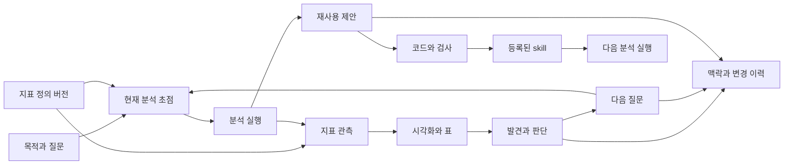

# 분석의 연속성·재사용·탐색 설계

작성: 2026-09-17 · 개정: 2026-09-19 · 상태: Proposal. 아래 파일 구조·필드·API·화면은 후속 구현 제안이다.
현재 동작은 [CONTRACTS.md](CONTRACTS.md), 설계 목적은 [PRODUCT.md](PRODUCT.md), 근거는 [조사 기록](RESEARCH-MEMORY-AND-SKILLS-2026-09-17.md)을 따른다.
새 명칭·영어 기본값은 [용어집](TERMINOLOGY-AND-LANGUAGE.md)을 따른다. Visualization은 상위 표현 객체이며 Chart는 그 한 유형이다.

이 설계는 **사람과 에이전트가 검증 가능한 분석 프로젝트를 이어 가는 도구·플랫폼**의 첫 확장을 구체화한다.
제한된 문맥·적은 도구·로컬 기록은 분석가의 이해와 통제, 이후의 선택 기반 후속 분석을 뒷받침하는 구현 원칙이다.

## 1. 하나의 기록, 두 가지 읽기 경험

사람은 편집기·CLI·SDK로, 에이전트는 도구로 같은 분석 프로젝트를 작성한다.
사람은 HTML·CLI에서, 에이전트는 짧은 구조화 응답에서 같은 분석 기록을 읽는다.
검색과 그래프를 별도 지식 저장소로 키우기보다, 원본 기록의 필요한 부분을 다시 찾는 기능으로 설계한다.
그 기록의 중심은 **목적·현재 지표·질문으로 구성된 분석 방향**이다. 지표가 미정이면 후보와 미정 사항을 포함한 초점에서 시작한다.
정의 수정·파생·조건별 관측·재계산의 구별은 [지표 중심 분석 설계](METRIC-DRIVEN-ANALYSIS.md)를 따른다.



이 그림은 제품의 흐름이다. 실제 기록에서 모든 화살표를 관측했다는 뜻은 아니다.
실제 관계에는 출처, 당시 버전, 관측·선언·추론·미확인의 구분이 붙는다.

### 사람이 직접 분석하는 경로

다음은 베타에서 검증할 사용 흐름이다. `analytics` 이름과 보고서 등록은 전환 목표이며, 현재 CLI는 `bin/lab`이다.

1. 사람이 CLI로 프로젝트를 만들고 목적·현재 질문을 적는다. 데이터를 가져와 SQL로 탐색한다. 지표가 미정이어도 시작할 수 있다.
2. 편집기에서 Python 스크립트를 작성하고 공통 실행 경로로 실행한다. SDK 또는 일반 분석 라이브러리를 사용하며 코드·관측된 입력·환경·결과를 run에 연결한다.
3. CLI·SDK로 발견·가정·판단·다음 질문을 기록하고 해당 run·Visualization·데이터 버전을 참조한다. CONTEXT는 자유롭게 편집하되 기존 버전 감지 경로로 변경을 남긴다.
4. Markdown·HTML 등으로 중간 보고서를 직접 작성하거나 코드로 생성하고, CLI·SDK로 본문·첨부·알려진 근거를 저장한다. 수정은 새 Report 버전으로 남긴다.
5. Workspace에서 결과·근거·이력을 확인하고, 종료 후 같은 프로젝트를 열어 분석을 계속한다. 이 전체 흐름에 모델 설정·인증·호출을 요구하지 않는다.

프로젝트·실행 선택과 기록 저장에는 짧은 명령과 API를 제공하고, 생성된 ID·시각·해시는 시스템이 채운다.
사람이 journal이나 run JSON을 직접 조작하지 않아도 핵심 작업을 마칠 수 있어야 한다. CLI는 상태·오류·다음 행동을 사람이 읽을 수 있게 안내한다.
모델을 사용하는 분석·본문 작성·재사용 제안은 선택 기능이다. 직접 작성한 내용의 저장이나 Workspace 갱신 때문에 모델을 호출하지 않는다.

| 실행 방식 | 현재 경계 | 설계에서 제공할 경로 |
|---|---|---|
| CLI로 스크립트 실행 | `bin/lab`은 Aelix 도구와 같은 kit를 실행 | 새 CLI·SDK의 공통 실행·기록 경로를 베타 필수로 검증 |
| 일반 Python·REPL·노트북에서 SDK 호출 | 데이터 접근 등은 가능하지만 활성 run 밖의 호출이 완전한 실행 기록을 만들지는 않음. 차트는 임시 저장될 수 있음 | 베타의 보존할 분석은 스크립트 실행 경로로 기록. 대화형 실행 범위 연동은 후속 설계 |
| Workspace에서 확인 | 저장된 기록을 읽는 정적 HTML | 베타에서는 결과·근거·이력 탐색. 브라우저 코드 편집·실행·공동 쓰기는 별도 범위 |

현재 SDK의 경계는 [구현](../kit/labkit/__init__.py)을 기준으로 설명한다. 외부 결과 파일을 등록해도 관측하지 않은 계산 과정까지 run으로 소급 복원하지 않는다.
노트북 연동은 실행 범위의 시작·종료, 실제 실행한 셀의 코드·순서, 입력·환경·출력, 실패·취소와 재실행 경계를 먼저 정의한다.
범위 밖 변수·선행 셀·외부 상태의 의존성을 보존하지 못하면 미확인으로 남긴다. 저장된 `.ipynb`나 마지막 셀 출력만으로 전체 재현을 보장하지 않는다.
공개 API 이름과 지원 방식은 후속 구현에서 확정하며, 이 설계로 노트북 자동 기록 지원을 선언하지 않는다.

### 사람과 에이전트가 교대로 이어받기

사람이 남긴 목적·발견·열린 질문과 근거를 에이전트가 프로젝트에서 읽고, 새 분석·기록을 추가한다.
에이전트 세션이 종료된 뒤 사람은 같은 프로젝트를 열어 그 작업을 확인·수정하고 새 버전을 남긴다. 대화 내용을 수동 복사하는 것을 인계의 전제조건으로 만들지 않는다.
인계 전 기록의 ID·내용 버전·근거 참조는 유지한다. 서로 독립된 실행에 같은 run ID를 재사용하지 않고, 새 실행·정정·보고서는 기존 기록과 연결한다.
기록은 작성·요청 주체와 CLI·SDK·스크립트·호스트 같은 실행 수단을 구별한다. CLI를 에이전트가 호출했다고 사람 작성으로 바꾸지 않으며, 과거 코드의 작성자를 재실행자로 덮어쓰지 않는다.
이는 출처 기록이며 신원 인증이나 결론의 승인 증거가 아니다. 에이전트 세션 참조는 선택적인 보조 정보로 유지한다.
첫 베타의 인계는 한 프로젝트에서 순차적으로 수행한다. 동시 편집 충돌 해결은 별도 계약이다.
[Q17](BETA-QUALITY-GATES.md#사람의-직접-분석과-작성-주체-전환-검증)에서 모델 없는 직접 분석과 실제 호스트·모델을 사용하는 인계를 구분해 검증한다.

### 자유로운 분석을 보존하는 계약

[참고 세션](REVIEW-REFERENCE-SESSION-2026-09-18.md)은 자유 Python과 일반 편집 도구를 사용해 방법을 바꾸고 오류를 복구하며 결과를 확장했다.
분석 방법·라이브러리·임의 함수·그림 구성을 사람과 모델이 선택하는 경로를 유지한다.
지표·메모리의 완성된 스키마나 정형 워크플로 통과를 실행 전제조건으로 만들지 않는다.
자주 쓰는 경로에는 자동 캡처와 간단한 API를 제공하고, 그 밖의 경로는 출처·관측 한계를 드러낸다.

활성 프로젝트·파일 위치·API 차이 때문에 발생하는 마찰은 짧은 오류 설명과 복구 방법으로 줄인다.
실패·수정·다른 방법의 재시도는 분석의 자연스러운 경로로 보존한다. 매 단계마다 확인·등록을 요구하지 않는다.
기존 프로젝트 신뢰·읽기 전용 SQL·관리 기록의 일관성 경계는 분석 알고리즘의 허용 목록과 구별한다.

## 2. 기록의 종류와 정본

| 계층 | 정본 또는 역할 | 보존할 내용 |
|---|---|---|
| 현재 맥락 | `CONTEXT.md`와 `.analytics/context/`의 버전 — 현재 `.lab/context/`에서 전환 | 목표, 정의, 제약, 현재 작업 방향. 자유 편집 유지 |
| 분석 방향·정의·지식 | `journal.jsonl` | 현재 초점·지표 정의의 버전·발견·결정·가정·질문·정정·재사용 제안·작업 구간 요약 |
| 실행 근거 | `runs/`, 가져오기 메타데이터, 보존된 Visualization·표·코드 | 실행 시점의 관측, 파일의 존재 여부, 재실행 비교 |
| 보고서 산출물 — 신설 제안 | 보고서 버전 manifest·보존 본문·첨부, journal의 저장·상태 이벤트 | 자유 형식 내용, 작성 시점·분석 기준·정확한 근거, 반복 묶음의 구성원 버전 |
| 재사용 산출물 | 프로젝트 모듈·검사·skill 파일 | 실제 코드·절차의 버전과 검증 결과 |
| 파생 조회 | 목표 `.analytics/cache/` 아래 검색·관계 인덱스, `workspace/` | 원본 ID로 돌아가는 읽기 모델. 제거 후 재구성 가능 |

CONTEXT를 journal의 복제본으로 자동 덮어쓰지 않는다. 요약에는 근거 이벤트를 연결하고,
에이전트 세션 파일 경로는 보조 참조로만 사용한다. 그 세션 파일이 없어져도 프로젝트의 핵심 발견과 근거는 이해할 수 있어야 한다.

### 발견을 남기는 최소 단위

`finding`은 “무엇을 알았나”와 함께 **관련 질문·지표 정의 버전, 적용 대상·기간, 근거, 한계, 다음 확인**을 남길 수 있어야 한다.
단순 메모에는 필드를 강요하지 않는다. 근거가 없는 발견은 허용하되 미연결 상태가 드러난다.
새 발견에서 차트를 선택하면 도구가 정확한 run·chart 버전 참조를 채우고, 모델이 복합 ID를 암기하지 않게 한다.

새 선택 필드의 개념 예시(아직 지원되는 입력 형식이 아님):

```json
{
  "schema": "analytics.event/2",
  "id": "e42",
  "seq": 42,
  "recorded_at": "2026-09-17T17:00:00+09:00",
  "kind": "finding",
  "actor": "agent",
  "text": "채널 구성을 통제한 후 지역 간 성장률 차이가 줄었다.",
  "refs": {
    "analysis_focus": "e40",
    "metrics": [{"metric_id": "m_region_growth", "definition_ref": "e37"}],
    "runs": ["20260917-160000-region-growth"],
    "evidence": [{
      "type": "visualization_version",
      "run_id": "20260917-160000-region-growth",
      "visualization_id": "region-growth",
      "relation": "supports",
      "basis": "declared"
    }]
  },
  "details": {
    "scope": "2026년 1~8월, sales_v2, 취소 주문 제외",
    "limitations": "원인을 증명한 결과는 아님",
    "next_check": "반품 반영 후 같은 차이를 확인"
  }
}
```

`refs.evidence`는 정확한 근거 버전의 권위 있는 참조이며, `refs.runs`는 실행으로 가는 보조 링크다.
`supports`는 작성자의 주장 관계다. 실행 시스템이 통계적 타당성이나 인과관계를 인증한 것으로 처리하지 않는다.
Visualization의 논리적 이름은 버전 모음의 식별자이고, 과거 근거는 `run_id + visualization_id`로 구별한다. 현재 chart 필드는 legacy reader에서 대응한다.
데이터 참조는 [기존 그래프 제안](PROPOSAL-EVIDENCE-GRAPH-2026-09-17.md)의 관측 ID·해시·보존 여부를 따른다.

### 정정·철회·시간 이력

- 정정은 새 발견과 `supersedes=<이전 이벤트>`로 남긴다. 원래 텍스트와 근거는 수정하지 않는다.
- 철회·복원·제안 상태 변경은 별도의 `record_update` 이벤트로 대상·사유·작성자를 남긴다. 내용 버전 `revision_id`와 구별한다.
- 질문·할 일의 `resolves`는 계속 완료 처리다. 기존 발견에 붙은 `resolves`도 과거의 닫힘 표시로 읽고, 철회·반박으로 재해석하지 않는다.
- 같은 발견에 서로 다른 대체 기록이 생기면 충돌을 표시한다. 최신 시각만으로 한쪽을 진실로 고르지 않는다.
- 상태 변경은 대상이 존재하고 같은 프로젝트에 있는지, 기대한 이전 상태가 맞는지 journal 잠금 안에서 검증한다. 이 검증은 전체 실행의 트랜잭션을 뜻하지 않는다.

기록 순서는 `seq`, 표시 시각은 새 이벤트의 `recorded_at`을 사용하며 기존 `ts`도 해석한다. 데이터가 설명하는 기간은 별도의 적용 범위다.
예를 들어 9월 17일에 기록한 “8월 매출”은 기록일과 대상 기간이 다르다.
`as_of_seq` 조회는 그 시점까지 알려진 판단을 복원한다. 향후 `valid_at` 조회는 명시된 적용 시점이 있는 항목에만 제공한다.
적용 시점을 알 수 없는 과거 기록에 날짜를 추정해 채우지 않는다.

### 작업 구간 요약 `checkpoint`

긴 대화 대신 “이 질문에서 어디까지 왔나”를 복원하는 짧은 요약을 남긴다.
필드는 목적·현재 분석 초점·지표 정의 버전·새 발견·바뀐 판단·열린 질문·다음 행동, 참조 이벤트, `through_seq`, CONTEXT 해시, 작성 주체다.
질문이 끝나거나 다른 작업으로 넘어갈 때 생성하며, 매 턴 추가 모델을 호출하지 않는다.
최초 구현은 구조화된 기존 기록의 결정적 요약 또는 현재 에이전트의 명시적 작성으로 충분하다.

요약은 근거 원문을 대체하지 않는다. 참조된 발견이 정정되면 `needs_review`, 단순히 새 기록이 추가되면 `updates_available`로 구별한다.
새 세션은 유효한 checkpoint와 그 뒤의 작은 변경 묶음을 읽고, 오래된 요약을 현재 결론처럼 사용하지 않는다.

## 3. 검색 가능한 프로젝트 메모리

| 공개 단계 | 기본 내용 | 상세로 가는 방법 |
|---|---|---|
| L0: 시작 맥락 | 목적, 현재 지표 묶음·정의 버전·미정 사항, 풀고 있는 질문, 다음 확인, 기록 기준 | 생략 수와 조회 방법 |
| L1: 찾기 | 검색된 이벤트·checkpoint·보고서·재사용 후보의 ID·짧은 요약·상태 | 선택한 ID·버전 읽기 |
| L2: 이해 | 선택한 발견의 전체 내용, 변경 이력, 정확한 근거 | 필요한 섹션·근거 버전 읽기 |
| L3: 검토 | 관계의 작은 주변, 코드·표·차트·비교 상세 | 방향·종류·페이지를 정해 확장 |

기존 읽기 표면을 확장하는 방안을 먼저 검토한다. 우선 후보는 이름을 전환한 `analytics_status`의 기본 현황을 유지하면서
선택한 기록·맥락·관계만 조회하도록 제한된 `part`, `query`, `id`, `cursor` 등을 추가하는 것이다.
구체적인 인자·분기는 비교 시험 뒤 결정한다. 기존 호출의 의미를 바꾸거나 현황을 전체 기억 덤프로 만들지 않는다.
이전의 `lab_recall` 신설안은 기본 채택하지 않는다. 별도 도구가 필요하면 아래 표면 검증을 통과한 대안으로 다시 제안한다.
명칭은 `lab_note → analytics_record`, `lab_run → analytics_run`으로 바꾸고 기록 쓰기와 실행의 역할은 유지한다.
보고서도 목록·요약·정확한 버전에서 필요한 섹션·파일로 내려간다. 본문·차트 전체를 시작 맥락에 주입하거나 checkpoint를 대신하는 것으로 처리하지 않는다.

모든 목록 응답은 결과뿐 아니라 `source_revision`, `returned`, `has_more`, 생략 사유, 후속 조회 위치를 포함한다.
총수를 싸게 계산할 수 없으면 `total=unknown`으로 두고, 제한된 결과 수를 전체 개수처럼 표시하지 않는다.
상세는 필요에 따라 섹션·필드 경계에서 페이지로 나누며, 다음 부분이나 더 큰 범위를 조회할 수 있게 한다.
토큰 측정 목표를 맞추기 위해 JSON·문장을 자르거나 필요한 근거를 숨기지 않는다.

검색은 프로젝트 범위 안에서 ID·키워드·종류·상태·기간·연결 대상을 먼저 좁힌다.
질문에 관련된 과거 발견이 최신 이벤트에 밀려 사라지지 않도록, 관련성·현재 유효성·근거 유무를 함께 사용한다.
정정된 항목도 과거 조회에는 남기고 최신 판단으로의 링크를 보여 준다. 검색되지 않았다는 이유로 “그런 발견은 없었다”고 단정하지 않는다.

파생 SQLite 인덱스는 선택한 기록의 ID·본문·상태·관계·출처 위치를 보관한다.
FTS5 미지원, 짧은 한국어, 코드 이름, 손상된 인덱스의 대체 경로를 품질 시험에 넣는다.
의미 검색·임베딩은 어휘 검색의 실패 사례와 비용을 확인한 뒤 추가한다.
맥락에 올릴 기억과 요약은 선택적으로 구성하지만, 원래 run·사건·발견을 검색 순위나 압축 편의 때문에 삭제하지 않는다.

### 도구 표면을 확장하는 기준

기본 노출 도구는 현재의 6개를 출발점으로 **순증 없이 기능을 확장**하는 것을 우선 목표로 삼는다.
이는 영구적인 숫자 제한이 아니라, 새 기능마다 상시 도구를 추가하지 않겠다는 설계 기본값이다.

| 기능 | 우선 검토할 표면 | 피할 확장 |
|---|---|---|
| 맥락·기록·관계 조회 | 기존 읽기 도구의 제한된 부분 조회 | 검색·기억·이력·노드·edge마다 각각 새 도구 |
| 발견·정정·재사용 제안 기록 | 기존 journal 쓰기 경로와 공통 참조 | 종류별 쓰기 도구와 반복되는 schema |
| 재사용 로직 실행 | 기존 Python 실행·의존성 관리 | 생성된 모든 함수·skill의 도구 등록 |
| 제안 모드 설정 | 프로젝트 설정·기존 사람 명령 | 기본 모델 프롬프트에 설정 전용 도구 추가 |
| 향후 선택 기반 후속 분석 | 선택을 입력 참조로 전달하는 기존 실행 경로 | 차트·선택·변환 조합마다 새로운 실행 도구 |

한 도구에 거대한 `action` 목록을 몰아넣어 개수만 줄이는 방식도 피한다.
비교 대상은 도구 수뿐 아니라 총 schema tokens, 의미가 비슷한 선택지, 인자 분기, 잘못된 선택·호출, 복구와 과제 전체 비용이다.
메뉴·버튼·그래프 노드의 개수와 모델 도구 개수는 별개다.

새 도구 제안은 기존 표면 활용, 작업에 맞춘 선택적 노출, 별도 도구의 세 경로를 비교한다.
선택적 노출도 정답 도구를 누락하면 성능을 떨어뜨릴 수 있으므로 검색 recall과 실제 과제 완수를 함께 본다.
호스트가 노출하는 다른 도구·skill 설명까지 포함해 시험하고, 지원하지 않는 동적 도구 로딩을 이미 가능한 기능처럼 가정하지 않는다.
프론티어 모델의 큰 문맥을 근거로 표면 비용 검토를 생략하지 않는다. [연구의 범위와 한계](RESEARCH-MEMORY-AND-SKILLS-2026-09-17.md#도구-표면과-프론티어-모델)를 참고한다.

### 토큰 사용 성능 측정 기준

아래 수치는 **성능을 비교·개선하기 위한 측정 목표이며 실행 시 강제하는 제한이 아니다**.
목표를 넘었다는 이유만으로 분석·조회·제안을 거절하거나 응답을 잘라내지 않는다.
필요한 정보와 과제 성공을 우선하고, 실제 사용량·목표 대비 차이·품질 효과를 측정해 설계를 개선한다.
기존 설계의 토큰·문자·응답 예산 수치도 이 의미로 구체화한다. 수치 초과 자체는 출시 실패 조건이 아니다.

주 지원 평가는 Qwen3.8 27B와 프론티어 모델의 실제 실행 설정으로 수행한다. 정확한 model ID·양자화·backend·context를 기록한다.
8,192 tokens의 작은 문맥과 16,384 tokens 이상의 비교 프로필은 별도의 진단 조건 예시다.
이 값은 Qwen의 문맥 크기나 기본 실행 한도를 정의하지 않는다. 축소 문맥 시험 때문에 정상 지원 범위의 분석을 제약하지 않는다.

| 항목 | 축소 문맥 진단 프로필 | 일반 비교 프로필 |
|---|---:|---:|
| 자동 시작 요약의 비교 목표 | 256 tokens | 512 tokens |
| 검색·관계 응답 한 페이지의 비교 목표 | 768 tokens | 1,024 tokens |
| 명시적 상세 조회 한 페이지의 비교 목표 | 1,536 tokens | 2,048 tokens |
| 기본 검색 결과의 시험 조건 | 6건 | 10건 |
| 기본 관계 깊이 | 1 hop | 1 hop |

대형 모델에서도 작은 기본 맥락을 출발점으로 효율을 비교한다. 필요한 상세는 더 조회할 수 있다.
확장이 추가하는 상시 입력 전체(도구 schema·지침·요약·등록 skill 설명)는
`min(2,048 tokens, 설정 context window의 15%)`를 초기 비교 기준으로 두며 시작 요약도 함께 센다.
이 값을 초과하면 비용과 품질을 검토하는 근거로 남긴다. 유용한 맥락을 버려 수치만 맞추지 않는다.
호스트 지침·대화·출력 예약분을 포함한 모델의 실제 context window는 별도의 실행 제약이다.
그 제약 안에서 요약·상세 조회·대화 압축을 조정하는 것과 위 측정 목표를 강제하는 것은 구별한다.

모델 tokenizer를 쓸 수 있으면 최종 직렬화 결과를 센다. 사용할 수 없으면 UTF-8 bytes를 별도 지표로 기록하고,
예를 들어 요약 1,536 bytes·일반 조회 3,072 bytes를 비교 기준으로 시험한다. bytes를 토큰으로 바꿔 표시하거나 강제 절단 기준으로 쓰지 않는다.
토큰을 측정할 수 없으면 미측정으로 표시한다. 작은 모델 지원은 설정한 실제 context window에서 검증한다.

헤더·ID·참조·생략 목록·다음 페이지 정보도 사용량에 포함한다. 고정한 섹션의 중요 내용과 필요한 근거를 우선한다.
요약·제목·읽을 위치를 사용하는 점진적 공개의 효과를 비교하되, 측정 목표에 맞추기 위한 정보 유실을 허용하지 않는다.
이미 전달한 변경은 같은 기준에서 불필요하게 반복하지 않는다.
차트 이미지의 모델 입력 비용과 생성된 요약·제안의 출력 비용도 과제 전체 측정에 포함한다.

정렬과 직렬화는 같은 기록 기준에서 안정적이어야 한다. 새 발견·정정·CONTEXT 변경이 있을 때 갱신하며,
프롬프트 캐시를 위해 오래된 판단을 계속 주입하지 않는다. 매 조회의 실제 기록 기준을 함께 제공한다.

## 4. 재사용 제안에서 라이브러리·skill까지

제안 기능은 [Skill 제안 정책](SKILL-PROPOSAL-POLICY.md)에 따라 **`on_demand` 기본값과 `always_on` 선택 옵션**으로 나눈다.
상시 모드도 필수 근거·가치 임계값·중복·cooldown 조건을 통과해야 제안한다. 제안의 토큰 사용량은 별도로 측정한다.
자동 제안을 사용하지 않는 분석에서도 발견·결정·맥락 기록은 계속된다.

재사용 후보는 함수 이름이 반복되었다는 사실보다, **같은 문제를 반복해서 해결한 이유와 조건**을 남기는 것이 중요하다.
예: 월별 데이터의 빈 구간 보완, 분모가 0일 때의 성장률 처리, 센서별 유효 구간 추출, 특정 지표 정의의 일관된 적용.

`reuse_proposal`의 최소 내용은 제목, 반복되는 문제, 적용 조건·제외 조건, 원래 run·코드·관련 gap,
제안 산출물(`function`, `module`, `package`, `skill`), 다음 검사다. 예상 절감 효과는 추정으로 표시한다.
데이터 처리 로직과 분석 방법 모두 후보가 될 수 있으며, 항상 라이브러리와 skill을 둘 다 만들 필요는 없다.

| 상태 | 의미 | 다음 단계의 증거 |
|---|---|---|
| `proposed` | 재사용 가능성 제안 | 구체적인 사용 사례와 출처 |
| `trial` | 일반화된 함수·절차를 별도 입력에 적용 중 | 입력·출력 계약, 비교할 기존 결과 |
| `validated` | 명시한 범위의 검사를 통과 | 성공 예·경계 조건·독립된 입력의 검사 기록, 코드 버전 |
| `registered` | 선택한 프로젝트 또는 배포 범위에서 사용 가능 | 등록된 파일·버전·로더 확인, 원래 후보로 가는 링크 |
| `deferred` / `rejected` | 비용·범위·근거 때문에 보류 또는 제외 | 사유와 재검토 조건 |
| `deprecated` | 이전 등록본의 사용 중단 권고 | 대체 버전 또는 이유, 과거 사용 기록 유지 |

같은 run의 단순 rerun은 독립 사용 사례로 세지 않는다. 두 개 이상의 다른 맥락에서 사용했으면 강한 후보가 되지만,
중요한 한 번의 발견도 단일 사례임을 표시해 제안할 수 있다. 유사 후보는 연결·통합하며 원래 근거를 지우지 않는다.

등록 전에는 다음을 확인한다.

1. 프로젝트에 특유한 경로·열 이름·기간을 매개변수로 분리하고, 단위·정렬·결측·중복·0 분모의 의미를 명시한다.
2. 기존 계산과의 동등성, 적용 가능한 별도 입력, 실패해야 하는 입력을 검사한다. “스크립트가 종료 코드 0”만으로 통과하지 않는다.
3. 코드·의존성·uv lock·검사 run을 연결한다. 프로젝트 helper와 설치 패키지의 재실행 보존 한계도 표시한다.
4. skill에는 사용 시점, 호출 방법, 해석, 검사, 실패 조건을 짧게 쓴다. 상세 예·참고는 별도 파일로 둔다.
5. 선택한 범위에 등록한 뒤 Aelix가 발견하는지 확인한다. 등록은 계산 방법의 보편적 타당성 인증이 아니다.

첫 베타는 후보 기록·조회와 이 승격 경로를 제공하는 것이 목표다. 무인 추출·검사·배포 전체를 약속하지 않는다.
후보 파일은 예를 들어 `reuse/candidates/<id>/`에 두어 자동 skill 탐색 대상과 구별한다.
등록을 선택하면 `.aelix/skills/<name>/`로 **복사**하고 원본 후보를 유지하며 원본·목적지·내용 해시를 기록한다.
프로젝트 밖의 공용 skill·공개 라이브러리는 별도의 배포 작업이다.

skill을 읽었다는 사실, 함수가 실제 실행된 사실, 그 결과가 유용했다는 판단도 구별한다.
현재 캡처는 Python 함수 호출 단위의 계보를 제공하지 않으므로, 단순 코드 유사성을 “이 방법 사용” 관계로 확정하지 않는다.
버전이 바뀌면 과거 검사를 새 버전의 통과 증거로 재사용하지 않는다.

## 5. 인사이트 중심 HTML과 점진적 공개

첫 전환에서는 `평가`를 **Insights**로 바꿔 Overview 다음에 배치하며 **Reports** 탭을 신설한다. 기존 Charts는 상위 객체명인 **Visualizations**로 전환한다.
기존 주소 `#evaluation`은 새 화면으로 이동하도록 호환한다. 전체 정보 구조를 동시에 바꿀 필요는 없다.
탭·메뉴·속성·빈 상태·접근성 label은 영어가 기본이며, 발견·시각화 제목·보고서 본문은 작성 언어를 유지한다.

| 화면 | 처음 보이는 것 | 필요할 때 펼치는 것 |
|---|---|---|
| Overview | 현재 분석 방향: 목적·지표 묶음·질문·다음 확인, 이어서 유효한 발견 | 지표 정의·관측·파생 관계, 각 항목의 근거·변경 이력 |
| Insights | Findings와 Reuse proposals의 구별, 상태·짧은 요약 | 근거, 대체·철회 이력, 코드·skill 후보 |
| Reports | 중간 요약·시각화 묶음 등 자유 형식 보고서의 제목·목적·시점·버전·완료 범위 | 본문·컬럼별 구성원·정확한 근거·이전 버전·생성 방법·선택 버전 공유 |
| Visualizations | 관련 지표 정의·분석 질문, 선택한 시각화의 버전·설명·연결된 발견 | 입력·첨부 데이터·실행 코드·이전 버전 |
| Data | 데이터 관측과 현재 파일의 차이, 관련 실행 | 스키마·미리보기·생산자 후보·관련 발견 |
| Runs | 어떤 지표·질문을 위한 작업인지, 실행·기록 완료 여부와 결과 | 실제 측정한 지표·코드·입출력·로그·환경·재실행 비교 |
| Timeline | 질문·지표 정의·분석 방향·판단이 바뀐 이유와 작업 구간, 보고서 작성·수정·게시 | import·run·도구 호출·보고서 묶음의 개별 생성 등 상세 사건 |
| Context | 현재 목표·정의·가정과 관련 근거 | CONTEXT 버전 diff, 과거 판단 |

기록 품질 신호·도구 사용은 Insights의 **Record coverage / Tool usage** 구역에 유지한다.
평상시에는 문제 수와 원래 항목으로의 링크를, 상세에서는 기존 지표를 보여 준다.
과거 gap은 **Workflow feedback**으로 표시한다. 반복 문제에서 재사용 제안으로 이동할 수 있으나 자동 분류하지 않는다.
텔레메트리가 없으면 미수집으로 표시한다. 0회 사용 또는 완전한 기록으로 간주하지 않는다.

### 탭 사이의 공통 동작

모든 주요 항목에는 `Evidence`, `Related items`, `History`로 가는 동일한 동작을 둔다.
선택한 항목의 종류·버전·현재/과거 구분을 유지한 채 관계 패널을 열고, 연결된 대상을 선택하면 상세로 이동한다.
되돌아오면 같은 항목·탭·필터·스크롤 위치를 복원한다. URL의 안정된 ID와 브라우저 뒤로 가기가 기본이며 저장소 상태만 의존하지 않는다.

예: 발견 e42 → 당시 차트 → 플롯 표 → 실행 코드 → e42로 돌아오기.
각 단계에 원래 발견으로 돌아가는 링크가 있고, `View latest version`은 별도 선택이다.
현재 데이터로 바뀌었거나 옛 파일이 없으면 기록과 한계를 보여 주며 다른 버전으로 조용히 이동하지 않는다.

### 분석 도중의 보고서 산출물

Reports는 분석 완료 전에도 중간 보고·특정 질문의 검토·컬럼별 반복 차트 문서를 모으는 화면이다.
본문·목차·그림 형식은 자유롭게 두고, 저장한 버전과 당시 근거를 보존한다. 현재의 프로젝트 탐색 화면 `report/`와는 다른 수명이다.
한 보고서의 여러 섹션과 여러 보고서의 묶음을 모두 지원하며, 묶음은 구성원 버전을 고정하고 부분 생성 상태를 표시한다.
보고서 → 당시 차트/발견/지표 → 같은 보고서 버전·섹션으로 돌아오고, 차트 쪽에서도 인용한 보고서를 찾을 수 있게 한다.
작성·분석 기준·대상 기간·게시 시각을 구별한다. 저장·조회·화면 재생성은 본문을 자동 수정하거나 분석·모델을 다시 실행하지 않는다.
형식별 보기·본문의 보존·버전 전환·비용·공유 경계는 [보고서 산출물 설계](REPORT-ARTIFACTS.md)를 따른다.

### 각 요소의 관계 그래프

기본은 선택 항목의 1-hop 주변이다. 그래프 옆에 같은 내용의 텍스트 관계 목록을 제공한다.
방향·관계 종류·관측 범위·원본 기록을 확인할 수 있고, 작은 화면과 키보드만으로도 상세를 열 수 있어야 한다.
전체 그래프는 선택 기능이다. 복잡해지면 관련 종류·방향을 좁히거나 한 단계씩 확장한다.

기존 그래프 제안 0.2의 노드 정체성·보존 한계·관계 의미는 유지한다.
보고서 버전·반복 묶음은 인용·생성 실행·이전 버전·구성원·게시본 포함 관계로 연결한다. 본문에서 인용했다는 사실을 결론의 검증으로 바꾸지 않는다.
그 제안의 50 nodes / 100 edges는 이번 설계에서 **최대 요청 후보값**으로 다루고,
초기 화면은 20 nodes / 30 edges의 작은 주변부터 시험한다. 에이전트 응답은 관계의 회수율과 직렬화 사용량을 함께 비교한다.
이 숫자는 초기 표시·측정 조건이며, 필요한 관계를 더 조회하는 것을 막는 토큰 제한이 아니다.
순환 참조, 입력 503개, 생산자 복수 후보는 생략·다음 페이지·불확실성을 보존한다.

정적 `file://` 열기를 계속 지원한다. 관계의 작은 데이터는 생성된 HTML에 포함하거나 별도 정적 페이지로 연결하고,
기본 탐색에 로컬 서버·원격 CDN·전체 프로젝트 JSON의 브라우저 로딩을 요구하지 않는다.
JavaScript를 사용할 수 없을 때도 링크와 관계 목록으로 내용을 읽을 수 있어야 한다.

자유로운 그림의 첨부 표가 요약 통계이거나 일부 계열만 담을 수 있다. 첨부가 존재한다는 사실만으로 모든 플롯 요소와의 완전한 대응을 표시하지 않는다.
첨부의 역할·범위와 입력·코드로의 연결을 보여 주고, 행 대응이 없는 그림도 계속 사용할 수 있게 한다.

### 팀원을 위한 렌더·빌드·게시

진행 중인 분석도 현재 목적·지표·질문·발견·미정 사항을 공유할 수 있어야 한다.
작업 프로젝트에 연결된 로컬 report와, 특정 시점·범위로 묶은 독립 build, 그 build를 선택한 위치에 전달하는 publish를 구별한다.
공유본은 원본 환경 없이 읽을 수 있고, 포함된 지표·차트·관계·근거는 같은 버전에 고정된다.
개별 보고서의 특정 버전만 선택하거나 다른 분석 기록과 함께 공유할 수 있다. 보고서 내용 버전과 게시본 ID는 서로 대응하는 별도 기록이다.
게시된 상태가 분석의 완료·검증·승인을 뜻하지 않으며, 제외한 근거의 범위를 표시한다.

공유본은 공통 읽기 모델에서 선택한 내용으로 생성한다. 원래 report를 복사하고 탭만 숨기지 않는다.
최신 게시 주소와 고정 버전 주소, 실제 접근 범위, 갱신·실패·재시도 계약은 [빌드·공유·게시 설계](PUBLISH-AND-SHARING.md)를 따른다.
새 상시 모델 도구를 추가하기보다 `/analytics`·CLI의 명시적 게시 경로를 우선한다.

### 향후 선택 기반 후속 분석

후속 분석은 현재 지표의 새 범위인지, 새 지표·질문을 만드는지 기록하고 원래 분석 초점과 연결한다.
팀원이 게시본에서 만든 질문·선택도 게시 ID와 당시 지표·차트·데이터 버전에 묶어서 이 흐름으로 가져올 수 있게 한다.
이 피드백 경로는 후속 기능이며 읽기 전용 정적 게시만으로 원본 프로젝트에 쓰기가 가능하다고 가정하지 않는다.
제품의 흐름은 “근거를 확인한다”에서 “이 대상을 더 분석한다”로 이어질 수 있어야 한다.
기존 `../aelix-analytics-engine`의 계약 0.3과 코드(`860756691a21a7fcae1a0bd4b84de6449681b6b9`)에는
저장된 선택을 데이터 스냅샷에 결박하고 뷰 또는 transform의 입력으로 사용하는 경로가 있다.
[SelectionRef 계약](https://github.com/handochan/aelix-analytics-engine/blob/860756691a21a7fcae1a0bd4b84de6449681b6b9/docs/contracts/03-core-contracts.md),
[선택 저장·입력 결합 코드](https://github.com/handochan/aelix-analytics-engine/blob/860756691a21a7fcae1a0bd4b84de6449681b6b9/src/aelix_analytics_engine/project.py).

후속 제품 흐름의 제안은 **차트/관계에서 대상 선택 → 대상과 단위 확인 → 선택 저장 → 새 질문과 실행 → 새 발견 → 원래 질문·선택으로 복귀**다.
새 실행과 발견은 원래 분석을 덮어쓰지 않고 연결된 후속 기록으로 남는다. 선택을 저장한 것과 실제 분석 실행도 별도 상태다.

| 조건 | 필요한 계약 |
|---|---|
| 어느 결과에서 골랐는가 | `run + visualization` 버전, 플롯 표 해시·스키마, 연결 데이터의 버전·해시 |
| 무엇을 골랐는가 | 안정된 plotted row ID 또는 해시로 고정한 행 집합, 선택 표현·단위·작성자 |
| 원본과 어떻게 대응하는가 | 명시적 row map 또는 검사 가능한 집계 그룹 규칙. 연결 대상 데이터셋의 행과 더 이전 원천 행을 구별 |
| 다음 분석에 무엇을 넘기는가 | 저장된 선택 ID·데이터 버전·질문·방법. 화면 좌표나 변경 가능한 필터 문자열만 전달하지 않음 |
| 변경·실패 시 어떻게 하는가 | 다른 스냅샷 결합 거절, 과거 파일 누락 표시, 저장·실행의 멱등성과 복구 경계 |

현재 이 확장에는 일반적인 행 ID·row map 계약이 없다. `lab.chart(data=...)`의 첨부 표만으로 모든 그림과 원본 행의 대응이 성립하지 않는다.
초기 후속 범위는 명시적 행 대응을 기록한 차트·표부터다. 일반 PNG, 임의 Python 집계·조인에는 자동 원본 행 계보를 주장하지 않는다.
집계 막대의 선택은 그룹 전체인지, 플롯 표의 한 행인지 표시한다. 파생 표에서의 선택은 그 파생 표의 행을 가리키며 원시 데이터까지 자동 확장하지 않는다.

관계 그래프는 향후 `selection`과 `follow_up_of` 관계를 추가할 수 있게 종류를 확장 가능하게 두되,
이번 베타에서 존재하지 않는 선택 노드·버튼을 동작하는 기능처럼 보여 주지 않는다.
읽기 전용 정적 HTML과 선택을 저장하는 연결 모드/명시적 전달 파일의 경계는 별도 계약으로 설계한다.
선택 저장은 사람과 에이전트가 같은 검증 경로를 사용하고, 후속 계산은 기존 실행·입력 참조를 우선 활용한다.

기존 그래프 제안의 G0·G1·G2 뒤에 **F1: 버전에 묶인 선택**, **F2: 선택을 입력으로 하는 후속 분석**을 둔다.
행 대응·스냅샷 보존·변경 거절·쓰기 복구가 선행 조건이며, 이식할 계약의 범위는 분석의 의미와 실제 비용을 기준으로 결정한다.

## 6. 같은 기준으로 만든 검색·그래프·화면

검색·관계·프로젝트 탐색 HTML은 공통 읽기 모델을 사용한다. 보존한 보고서 본문·첨부는 이 화면의 입력이다. 새 graph DB나 별도 수동 관계 파일을 정본으로 만들지 않는다.
생성 기준은 journal의 유효 범위, CONTEXT 해시, run·데이터·보고서 버전 manifest의 내용 지문, 인덱스 형식 버전으로 구성한다.
여기서 `source_revision`은 새로 설계할 읽기 기준이며, 현재 구현에 그런 필드가 있다는 뜻은 아니다.

run은 finalize 중 바뀔 수 있으므로 journal의 마지막 seq만으로 전체 일관성을 판단하지 않는다.
읽기 전후 기준이 다르면 제한된 횟수만 다시 읽고, 계속 바뀌면 `updating`과 관측 기준을 반환한다.
페이지 cursor도 기준에 묶는다. 기준이 달라진 cursor로 서로 다른 순간의 결과를 이어 붙이지 않는다.
이는 파생 읽기의 기준 확인이다. 프로젝트 밖의 직접 파일 수정까지 막는 원자적 스냅샷이나 변조 방지 보장은 아니다.

새 이벤트의 증분 색인과 영향받은 페이지의 갱신을 목표로 한다. 첫 구현에서 전체 재생성을 쓰는 범위는 실측하여 표시한다.
데이터 내용의 해시 재검사와 프로파일 전체 스캔은 별도 비용이다. 화면을 열 때마다 무조건 전체를 수행하지 않고,
캐시의 확인 시점·부분 결과·명시적 재검사 경로를 보여 준다. 기록 그래프 생성은 대형 데이터 본문을 읽지 않아야 한다.

인덱스 손상·삭제 시 원본을 다시 읽는다. 재구축 중에는 기본 상태·직접 ID 조회를 제공하고, 불완전한 검색을 전체 결과처럼 표시하지 않는다.
리포트 실패 때문에 이미 성공한 분석 실행을 다시 돌리지 않는다. 둘의 완료 상태와 재시도 단위가 달라야 한다.

## 7. 기록 형식과 호환성

G0의 기존 기록 탐색은 `/1`을 그대로 읽는 파생 기능으로 구현할 수 있다.
지표 정의·분석 초점·정정·재사용 제안·checkpoint·보고서 버전 등 새 의미를 쓰는 시점에는 `analytics.event/2`와 `analytics.project/2`를 도입하는 방안을 우선 검토한다.
`lab.*` namespace의 과거 기록과 새 `analytics.*` 기록은 가족 이름까지 명시적으로 해석한다. run·dataset 등은 의미 변경 범위에 따라 버전을 정하고 일괄 증분하지 않는다.

전환 절차의 제안:

1. 변환 계획과 영향을 먼저 보여 주고 원본·백업 위치를 기록한다. 조회만으로 프로젝트를 자동 전환하지 않는다.
2. 새 reader가 지원하는 schema 가족과 버전을 모두 읽게 한다. 기존 journal 줄은 그대로 보존하고 새 이벤트만 확정한 형식으로 추가한다.
3. project 표식·schema 가족·최소 reader/writer 요구를 함께 전환하고 구버전의 일반 쓰기 경로가 새 프로젝트를 수정하지 못하게 검증한다. namespace 변경만으로 거절된다고 가정하지 않는다.
4. 기존 논리적 차트·경로 참조는 `version_unbound`로 읽는다. 최신 버전이나 이벤트 직전 run을 확정 근거로 채우지 않는다.
5. 전환 실패·구버전 열기·알 수 없는 이벤트에는 누락과 복구 방법을 알린다. 원본을 버려 구버전으로 되돌리는 방식은 쓰지 않는다.

새 writer를 열기 전에 혼합 journal·오래된 프로젝트·미래 스키마를 시험한다.
선택 필드만 `/1`에 더하는 대안은 구버전이 새 상태를 무시하고 잘못 쓸 수 있는지를 먼저 검토해야 한다.
최종 선택은 구현 PR의 계약 변경으로 확정하고, 이번 문서만으로 현재 저장 형식을 바꾸지 않는다.

## 8. 배포와 저장소 구조

장기 책임·의존 방향·Strategy/adapter 경계는 [플랫폼 아키텍처](ARCHITECTURE.md)를 따른다.
지표·근거·버전의 의미와, 교체 가능한 검색·맥락·제안·공유 정책을 구별한다.
아래 구조는 배포 관점의 개요이며 상세한 모듈 책임은 아키텍처 문서에서 관리한다.

현재의 stdlib 전용 core와 프로젝트별 분석 환경의 분리는 유지한다.
리팩터링은 기록 의미를 바꾸는 PR과 분리한다. 공개 표면은 `aelix_analytics`·`analytics`로 통일하고, 과거 형식은 별도 reader·명시적 전환으로 보존한다.
구·신 도구를 동시에 상시 노출하지 않는다. [전체 용어 점검](REVIEW-TERMINOLOGY-2026-09-18.md)의 namespace·marker·스냅샷·언어 이행을 함께 검증한다.

패키징 이후의 후보 구조:

```text
src/aelix_analytics/
  __init__.py, __main__.py  부작용 없는 SDK·CLI 진입점
  extension.py             Aelix 어댑터
  aelix-plugin.toml         배포 manifest
  core/                    stdlib: domain, application, ports, policies, projections, storage
  runtime/                 runner, capture, data, 프로젝트 환경의 조립
  workspace/               분석 인터페이스·영어 label·CSS·JS
  reports/, publishing/    문서 산출물·독립 build·게시
  templates/               새 분석 프로젝트의 영어 기본 파일
tests/
  contracts/ architecture/ records/ memory/ relations/ integration/ packaging/
docs/
  PRODUCT.md, ARCHITECTURE.md, CONTRACTS.md, 설계·조사·출시 기준
  decisions/               Proposed/Accepted 상태가 명시된 설계 결정
```

이 구조는 하나의 배포 패키지 안에 core·runtime·표시·template 자원을 포함하는 제안이다.
호스트는 stdlib `core`와 Aelix 어댑터만 로드하고, 자식 프로세스에는 정확한 확장 실행 자원 경로만 전달한다.
호스트의 전체 `site-packages`를 `PYTHONPATH`로 노출해 분석 환경 분리를 무너뜨리지 않는다.
설치 자원은 resource API로 찾고, 소스 체크아웃의 상대 위치나 개인 절대 경로에 기대지 않는다.
wheel·sdist에 template·assets·manifest가 실제로 들어가는지 설치 후 검사한다.

새 개념이 안정되기 전 모듈을 잘게 나누는 것 자체를 목표로 하지 않는다.
분리 기준은 원본 기록 쓰기, 파생 읽기, 실행, HTML 표시, 호스트 접점의 변경 이유가 다른가다.
라이선스·배포 이름·관리자·보안 신고 경로·지원 플랫폼·버전 정책은 출시 준비에서 명시한다.

## 9. 재실행·복구·멱등성의 후속 계약

이 영역은 베타 뒤의 우선 과제다. 첫 베타에서 완전 복구를 약속하지 않더라도 아래 경계를 설계에 남긴다.

| 과제 | 제공할 계약 후보 | 실패 사례 |
|---|---|---|
| 재실행 | 주 스크립트·helper·환경·입력의 당시 버전과 현재 상태를 비교 | helper만 바뀜, env drift, 과거 입력 바이트 없음 |
| 멱등 요청 | 프로젝트·작업 종류·요청 키 → 하나의 작업 영수증 | 같은 키 같은 의도는 기존 상태, 다른 의도는 충돌 |
| 관리 산출물 commit | staging → 준비 기록 → 산출물 게시 → 완료 기록 | 파일은 있으나 완료 기록 없음, 완료했으나 journal 연결 누락 |
| 복구 | 미완료 단계 분류, 조회·격리·안전한 마무리 | 프로세스 종료, 디스크 오류, 복구 재호출 |
| 리포트 갱신 | 분석 완료와 리포트 공개를 분리해 재시도 | 보고서 생성 실패 때문에 분석 재실행 |

멱등성의 요청 지문은 코드 버전·명시 입력·파라미터·환경 선택 등 **사용자가 요청한 의도**를 정규화해 만든다.
실행 후에만 감지되는 입력을 이미 알고 있었다고 가정하지 않는다. 같은 키의 불확실한 작업은 자동으로 다시 실행하지 않고 기존 영수증을 돌려준다.
내용 해시가 같은 두 번의 의도적 실행을 자동으로 하나로 합치지 않는다.

복구가 다룰 수 있는 범위는 확장이 관리하는 기록과 산출물이다. 임의 Python이 외부 API를 호출하거나 외부 파일을 바꾼 부작용까지 되돌릴 수는 없다.
`lab.save` 등 관리 경로부터 staging·게시 계약을 도입하고, 관용 코드의 직접 쓰기는 보장이 다른 경로로 표시한다.
각 commit 경계에서 강제 중단하고 복구를 두 번 수행해 결과가 더 바뀌지 않는지 검증한다.

재실행도 현재 환경에서의 결과 비교와 역사적 환경의 복원을 구별한다.
과거 바이트·helper·환경을 복원할 수 없으면 그 이유를 남기고, 단순 `match`를 완전 재현이나 분석 결론 검증으로 승격하지 않는다.

실행 순서·베타에 앞서 필요한 최소 관측·후속 완료 조건은 [베타 품질 기준](BETA-QUALITY-GATES.md)에 연결한다.
