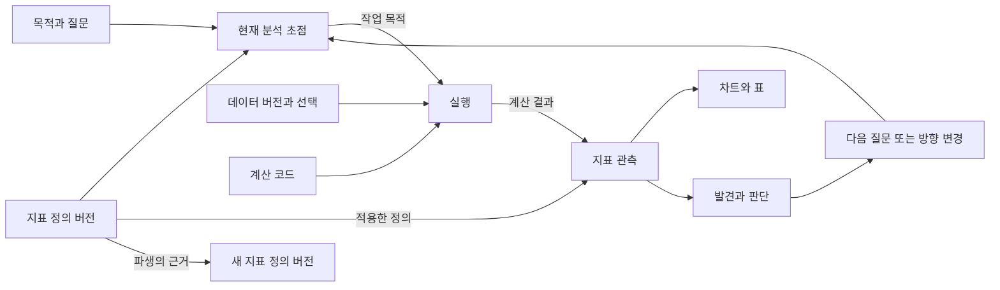

# 지표를 중심으로 방향을 유지하는 분석 프로젝트

작성: 2026-09-18 · 상태: 설계 제안. 아래 객체·참조·화면은 현재 구현에 없는 후속 계약이다.
[제품 비전](PRODUCT.md)과 [맥락·근거 설계](DESIGN-CONTINUITY-AND-REUSE.md)를 보완한다.

## 1. 지표는 분석 방향의 중심이다

프로젝트는 **무엇을 알고 판단하려는가 → 무엇을 어떤 지표로 볼 것인가 → 지금 어떤 질문을 풀 것인가**를 유지한다.
이력은 그 방향 아래에서 수행한 탐색·계산·검사·발견·판단 변화의 근거가 된다.
지표 목록을 별도 화면에 모으는 데 그치지 않고, 다음 분석을 선택하고 기존 결과를 해석하는 기준으로 사용한다.

처음에는 “품질이 나빠진 것 같다”처럼 관심 대상만 있을 수 있다. 이름·식·목표값을 모두 채운 뒤에야 분석을 허용하지 않는다.
질문과 후보 지표, 아직 정하지 못한 의미를 먼저 기록하고 데이터를 보면서 구체화한다.
한 프로젝트에는 여러 지표와 질문이 공존할 수 있고, 현재 질문에서 중요한 지표 묶음을 명시한다.

[참고 세션](REVIEW-REFERENCE-SESSION-2026-09-18.md)에서도 EDA 이후 스텝·시점별 점수와 주요·보조 지표가 생겼다.
이 경로를 보존한다. 지표 기록은 모델이 새로운 방법을 시도하기 전에 통과해야 하는 등록 절차가 아니다.
탐색에서 생긴 정의를 나중에 연결할 때는 그 작성 시점과 선언의 출처를 남기며, 처음부터 확정되어 있던 정의처럼 소급하지 않는다.

지표는 분석의 대상을 표현한다. 목표값을 정하거나 그 수치를 최적화해야만 분석이 성립하는 것은 아니다.
원인을 탐색하거나 차이를 설명하는 분석에서는 “무엇을 확인하면 질문에 답할 수 있는가”가 완료 기준이 될 수 있다.
이 문서의 지표는 분석 대상의 지표이며, 토큰·지연 같은 확장의 성능 측정 지표와 구별한다.

## 2. 목적·정의·계산·결과를 연결한다

| 요소 | 답하는 질문 | 예 |
|---|---|---|
| 목적과 질문 | 왜 분석하고 무엇을 결정하거나 이해하려는가? | 품질 악화가 특정 장비에 집중되는지 확인 |
| 지표의 정체성 | 지속적으로 같은 이름 아래에서 무엇을 관찰하는가? | 불량률 `m_defect_rate` |
| 지표 정의의 버전 | 무엇을 세고 어떤 규칙으로 계산하는가? | 검사한 고유 제품 중 불량 제품의 비율 |
| 계산 구현·적용 | 어떤 코드와 데이터로 그 정의를 구현했는가? | 특정 run의 Python 코드·열 매핑·필터·입력 버전 |
| 관측 결과 | 어느 대상·기간·조건에서 무엇이 계산되었는가? | 장비 A의 주별 불량률 표, 분자·분모, 관련 검사 |
| 발견과 판단 | 그 결과로 무엇을 알았고 다음에 무엇을 볼 것인가? | 장비 A의 변동이 커 조건별 구분이 필요 |

지표 정의는 계산 결과나 차트가 바뀔 때마다 새로 만드는 것이 아니다.
반대로 동일한 이름·코드를 썼다는 이유만으로 같은 지표 정의라고 간주하지 않는다.
결과는 당시 정의 버전, 계산 코드, 입력 데이터, 기간·필터·집계 단위에 연결한다.
수치 하나뿐 아니라 시계열·그룹별 표·분포·모델 평가 결과도 지표 관측으로 표현할 수 있다.
차트 제목이나 열 이름만으로 지표 연결을 확정하지 않는다. 작성자의 명시적 연결과 실행 중 수집한 연결을 구별한다.
연결된 코드가 실제 정의대로 계산했는지는 별도의 검사이며, 참조 ID가 있다는 사실만으로 검증 완료로 표시하지 않는다.

### 정의는 필요한 만큼 구체화한다

처음에는 이름 또는 관심 대상, 관련 질문, 미정 사항이면 충분하다.
계산과 비교를 반복하면서 다음 내용을 명시한다. 모든 종류의 지표에 모든 필드를 강요하지 않는다.

| 정의할 내용 | 예 또는 확인할 질문 |
|---|---|
| 의미와 적용 목적 | 불량 제품 비율인가, 불량 사건의 발생 빈도인가? |
| 식과 구성요소 | 분자·분모·집계·계산식, 참조하는 다른 지표의 정확한 버전 |
| 기준 모집단과 통계 단위 | 같은 `z`라도 기준이 트레이스 평균들의 분포인지, 스텝 내 샘플 분포인지, 시점별 분포인지? |
| 기준 추정·적용 범위 | 어떤 데이터로 프로파일·모델을 추정했고 어디에 적용했는가? 학습 내 결과와 별도 검증 결과인가? |
| 관찰 대상과 기본 단위 | 제품, 주문, 사용자, 설비, 검사 사건 등 무엇을 한 개로 세는가? |
| 단위와 시간 의미 | %, 건, 초, percentage point; 사건 시각·시간대·관측 창 |
| 포함·제외와 결측 | 재검사·취소·중복·미관측·분모 0의 처리 |
| 구분해서 볼 축 | 장비·제품·지역 등 허용된 차원과 집계 가능 범위 |
| 비교·해석 조건 | 어떤 기준과 비교하는가, 어떤 조건에서 해석이 달라지는가? |
| 미정 사항과 변경 이유 | 아직 모르는 것, 대안, 왜 이 정의를 선택했는가? |

목표값·기준선·원하는 방향은 지표의 계산 정의와 별도로 연결한다. “불량률 2% 이하”라는 목표가 바뀌어도 불량률 계산식이 바뀐 것은 아니다.
`draft`/`specified` 같은 정의의 구체화 상태, 현재 질문에서의 사용 여부, 결과의 검사 상태도 구별한다.
정의가 상세하다는 사실을 분석 방법 검증이나 결론 승인으로 표시하지 않는다.

## 3. 현재 분석 방향을 짧게 유지한다

기존 맥락·checkpoint에 **현재 분석 초점**을 추가한다. 초점은 다음 정보를 연결하는 짧은 기록이다.

- 목적과 현재 질문.
- 지금 보는 지표 또는 후보의 정확한 정의 버전, 질문 안에서의 역할.
- 이번 작업의 의도: 정의 구체화, 데이터 확인, 측정, 비교, 원인 탐색, 검증 등.
- 확인할 가설·모르는 부분과 다음 확인 작업.
- 어떤 근거가 생기면 질문에 답했거나 분석 방향을 바꿔야 하는가.

지표의 역할은 질문에 따라 달라진다. 같은 지표가 한 질문에서는 주요 대상이고 다른 질문에서는 보조 설명·품질 확인에 쓰일 수 있다.
역할을 프로젝트 전체에서 영구 고정하거나, 여러 주요 지표를 반드시 하나로 줄이지 않는다.
지표 사이에 상충이 있으면 그 관계와 판단 기준을 남기며 임의의 종합 점수로 숨기지 않는다.

분석 초점의 개념 예시(현재 도구의 입력 형식이 아님):

```json
{
  "goal": "품질 악화의 범위를 파악해 추가 점검 대상을 정한다",
  "question_ref": "e12",
  "metrics": [
    {"metric_id": "m_defect_rate", "definition_ref": "e18", "role": "주요 대상"},
    {"metric_id": "m_inspected_count", "definition_ref": "e19", "role": "표본 규모 확인"}
  ],
  "activity": "장비별 차이 탐색",
  "hypothesis": "변화가 특정 장비에 집중될 수 있다",
  "next_check": "동일한 검사 기준으로 장비별 주간 값과 표본 수를 비교",
  "unresolved": ["재검사 제품의 집계 규칙을 확인해야 한다"]
}
```

새 세션과 후속 작업은 이 초점, 유효한 발견, 남은 질문에서 시작한다.
run 시작 시 적용된 초점의 버전을 연결하고, 실행 중이나 이후에 현재 초점이 바뀌어도 과거 run의 목적을 바꾸지 않는다.
다만 **분석 목적으로 연결됨**과 **실제로 그 지표를 계산함**은 별개다. 스키마를 살펴본 run을 불량률 측정으로 기록하지 않는다.

작업 결과는 현재 질문에 연결해 해석한다. 예를 들어 “차트 3개 생성”보다 “장비별 분모 차이를 확인했으며 같은 조건의 비교가 다음 작업”을 남긴다.
필요한 발견이 없거나 가설이 지지되지 않았다는 결과도 유효한 진전이다. 매번 새로운 수치·차트·skill을 만들 필요는 없다.
새 주제로 이동할 때는 무엇이 바뀌었고 왜 필요한지를 초점 변경과 checkpoint에 남긴다.
이는 분석의 안내와 기록이며, 관계가 미정인 탐색을 금지하거나 매 실행마다 사용자 확인을 요구하는 승인 절차가 아니다.

## 4. 모호함·다수·변형을 구별해 보존한다

| 상황 | 기록 방식 | 유지할 의미 |
|---|---|---|
| 관심 대상만 있음 | 질문과 후보 지표, 미정 정의·대안을 기록 | 아직 측정 정의가 정해지지 않았음을 표시 |
| 여러 지표를 함께 봄 | 현재 질문에 지표 묶음과 역할을 연결 | 각각의 결과·근거·상충을 추적 |
| 같은 지표의 의미를 수정·구체화 | 같은 metric ID에 새 정의 버전과 변경 사유 | 이전 결과는 이전 버전에 고정 |
| 의미가 다른 새 지표를 만듦 | 새 metric ID와 `derived_from` 또는 관련 관계 | 부모 정의 버전을 명시하고 두 지표를 함께 유지 |
| 같은 식을 장비·지역·기간별로 조회 | 동일 정의에 관측 범위·차원·필터를 연결 | 모든 구분을 새 지표로 늘리지 않음 |
| 같은 정의를 새 데이터·새 코드로 계산 | 새 관측과 계산 구현 버전 | 의미의 변화와 구현·입력의 변화를 구별 |
| 이름·설명만 정리 | 표시 정보 변경을 기록 | 의미가 같으면 다른 지표로 오인하지 않음 |
| 목표값·관심 역할이 바뀜 | 판단 기준 또는 분석 초점의 새 버전 | 계산 정의와 분리 |

수정인지 새 지표인지 이름이나 코드 차이만으로 자동 결정하지 않는다.
기존 개념의 해석을 바꾸는 것인지, 서로 다른 개념을 함께 비교하려는 것인지 작성 의도를 남긴다.
매번 달라지는 기간 필터와 달리 7일 이동 창처럼 계산 의미에 포함되는 창은 정의 또는 명시적으로 버전 관리하는 매개변수다.
관측 결과에는 그때의 실제 매개변수와 적용 조건을 항상 연결한다.

### 예: 품질 관심사에서 파생 지표까지

1. “품질이 나빠졌나?”를 질문으로 남긴다. 불량 제품 비율과 재검사 빈도를 후보로 둔다.
2. 불량률을 `100 × 불량 고유 제품 수 / 검사 고유 제품 수`로 정의한다. 어떤 시점의 제품 상태를 쓰는지 등 미정 조건도 남긴다.
3. 장비 A·B의 주별 결과를 구한다. 이는 같은 정의의 서로 다른 관측이며 지표 두 개를 새로 만드는 것이 아니다.
4. 변화의 크기를 보려고 `이번 주 불량률 − 전주 불량률`을 새 파생 지표로 만든다. 단위는 percentage point이며 상대 변화율(%)과 구별한다.
5. 재작업 여부를 어떻게 반영할지 정의가 달라지면 새 정의 버전 또는 별도 지표로 명시한다. 예전 값·발견·차트는 원래 정의를 유지한다.

구현의 버그를 고쳐 의도한 기존 정의에 맞췄다면 지표의 의미는 같을 수 있다. 이 경우 코드·run·결과의 새 버전과 정정 이유가 중요하다.
서로 다른 정의·표본·기간의 결과를 같은 시계열로 조용히 이어 붙이지 않는다.
같은 정의로 다시 계산하거나 비교 불가·조건 차이를 표시한다. 과거를 재계산하면 원래 관측을 보존하고 재계산 관계를 남긴다.

## 5. 그래프는 분석 방향과 근거를 함께 보여 준다



이 그림은 제안하는 의미 관계다. 실제 기록에서는 출처와 관측 범위를 표시하며, 관계가 있다는 사실이 인과관계나 결론의 참을 증명하지 않는다.
계산 의존 관계와 질문에 대한 설명·연관 관계도 구별한다.
파생 식의 지표 참조는 정확한 버전에 고정하고 순환 참조를 검사한다. 다른 지표를 참고했다는 이유만으로 계산상의 부모로 표시하지 않는다.

정의가 바뀌면 관련 계산·현재 초점·파생 지표·발견을 재검토 후보로 찾는다.
기존 파생 지표의 부모 참조를 최신 정의로 자동 변경하지 않는다. 새 정의를 채택하는 것은 새 파생 버전의 결정이다.
과거 데이터와 정의에 대한 결론을 소급 삭제하지 않으며, 관련 방향 변경과 정정 기록으로 설명한다.

## 6. 화면·메모리·도구에 녹이는 방법

**개요의 첫 영역은 ‘현재 분석 방향’**이다. 목적, 현재 질문, 선택한 지표 묶음, 미정 정의, 다음 확인을 짧게 보여 준다.
최근 결과와 이력은 그 아래에서 해당 방향에 연결한다. 지표 목록의 개수나 차트 개수를 분석 진척으로 대체하지 않는다.

| 진입점 | 연결된 경험 |
|---|---|
| 지표 요약 | 뜻·정의 상태·현재 역할 → 정의·관측 → 파생 관계·변경 이력 |
| 차트·표 | 사용한 지표 정의와 범위·단위, 관련 질문 → 당시 코드·데이터 |
| 발견 | 어떤 지표·정의·관측으로 얻었는가 → 바뀐 판단과 다음 질문 |
| 타임라인 | 지표 정의·분석 초점이 바뀐 이유 → 당시 관측과 결정 |
| 후속 분석 | 같은 지표의 새 대상/선택인가, 새로운 지표·질문인가를 유지하며 이어 감 |

첫 베타에서 별도 지표 탭을 반드시 늘리지 않는다. 개요의 방향 카드와 공통 상세·관계 패널에서 시작하고,
지표 이름·버전·질문 필터를 다른 탭으로 가져간다. 같은 이름의 다른 정의를 구별하며 돌아올 때 초점과 선택을 유지한다.

에이전트의 시작 맥락에는 **현재 질문에 필요한 지표의 짧은 의미·버전·미정 사항·다음 확인**을 제공한다.
모든 정의·수식·결과를 매 턴 주입하지 않는다. 과거 정의와 파생 관계는 기존 부분 조회로 읽는다.
지표가 많아져도 분석의 정확성과 필요한 근거를 우선하며 토큰 수치는 성능 측정 기준으로만 사용한다.

지표별 `create_metric`, `evaluate_metric` 도구를 새로 상시 등록하지 않는다.
기존 맥락·기록 쓰기·조회·실행 경로의 참조로 연결하고, 실제 인자 복잡도와 과제 성공을 비교한다.
재사용할 지표 계산 로직은 skill 후보가 될 수 있으나, 지표를 만들었다고 자동으로 skill을 제안하지 않는다.
[Skill 제안 정책](SKILL-PROPOSAL-POLICY.md)의 모드·가치 기준을 그대로 적용한다.

## 7. 기록과 도입 순서

현재는 [CONTEXT.md 템플릿](../kit/template/CONTEXT.md)의 ‘정의와 규칙’, 코드, finding 문장에 지표 의미가 분산되어 있다.
독립적인 지표 ID·정의 버전·결과 참조 계약은 없다. 현재 기록에 새 보장이 이미 있는 것처럼 해석하지 않는다.

첫 구조화 구현은 기존 B1의 스키마 전환에 다음을 포함하는 안으로 시작한다.

- **정의·초점:** journal의 버전 있는 정의·초점 기록. 안정된 metric ID와 정의 이벤트 ID를 구별한다. 수정 시 새 이벤트를 추가한다.
- **적용·관측:** run과 결과 기록에서 당시 초점·정의 버전·실제 입력·코드·범위·단위·검사로 연결한다. 큰 결과는 보존된 표를 참조한다.
- **인덱스·표시:** 지표 목록·관측 목록·영향 관계는 원본에서 재구성한다. CONTEXT에는 현재 방향과 링크를 유지한다.

별도의 수동 metric catalog와 journal을 각각 정본으로 유지하지 않는다.
참조는 지표라는 대상 유형과 ID·정의 버전을 함께 가진다. 이름이 같은 데이터셋·차트와 문자열 모양만으로 구분하지 않는다.
새 이벤트 종류·run 필드·SDK 문법은 기존 `/1` 호환성과 `/2` 설계에서 확정한다. 위 참조 이름은 확정 API가 아니다.
기존 결과에 버전 참조가 없으면 ‘정의 미고정’으로 읽는다. 현재 정의나 최근 텍스트를 과거 계산의 확정 정의로 추정해 채우지 않는다.

| 단계 | 범위 | 다음 단계로 넘어갈 증거 |
|---|---|---|
| M0: 방향과 정의 | 모호한 후보·다중 지표·현재 초점, 정의 버전과 기록 연결 | 새 세션이 목적·지표·미정 사항·다음 확인을 복원 |
| M1: 관측과 파생 | 결과 → 정의/코드/데이터, 파생 버전 관계와 비교 조건 | 같은 지표의 재계산·조건 조회와 새 지표 파생을 구별 |
| M2: 후속 분석과 재사용 | 선택 기반 분석에 지표·초점 유지, 검사된 계산 모듈 연결 | 선택·정의 변경 뒤에도 결과와 원래 질문을 추적 |

첫 베타에서는 M0와 최소 M1을 기록·메모리·UI 단계에 포함한다.
SQL 생성기·범용 지표 실행 엔진·외부 Semantic Layer 연결·자동 인과 추론은 이 최소 범위의 의존성이 아니다.
Python 분석을 유지하면서 지표의 의미와 근거를 보존하는 것부터 시작한다.

## 8. 검증 사례와 참고

모호한 목적에서 시작, 여러 지표의 상충, 정의 수정, 파생 지표, 기간·장비별 조회, 코드만 수정한 재계산,
부모 정의 변경, 같은 이름의 다른 정의, 오래된 결과, 새 세션 재개를 각각 fixture로 검증한다.
비율을 그룹별로 단순 평균하지 않고 분자·분모를 올바른 단위에서 계산하는지, 중복 제품·분모 0·결측을 어떻게 처리하는지도 확인한다.
지표가 둘 이상이어도 다음 작업의 목적을 설명할 수 있어야 하며, 좋은 방향 추적이 차트 생성 수로 대체되지 않아야 한다.

dbt의 [metric 정의](https://docs.getdbt.com/docs/build/metrics-overview)와 [derived metrics](https://docs.getdbt.com/docs/build/derived)는
지표 종류·계산식·다른 지표 참조를 구별하는 참고다. Cube의 [dimensions](https://docs.cube.dev/docs/data-modeling/dimensions)는
구분·필터·시간 집계를 지표 자체와 구별하는 데 참고했다. 공식 문서 확인일은 2026-09-18이다.

이는 의미를 구조화하는 참고이며 해당 제품을 도입하기로 결정한 것은 아니다.
모호한 지표의 구체화, 분석 초점, 정의와 관측의 시간 이력, 사람·에이전트의 이어 가기는 이 프로젝트에 맞춘 설계 제안이다.
