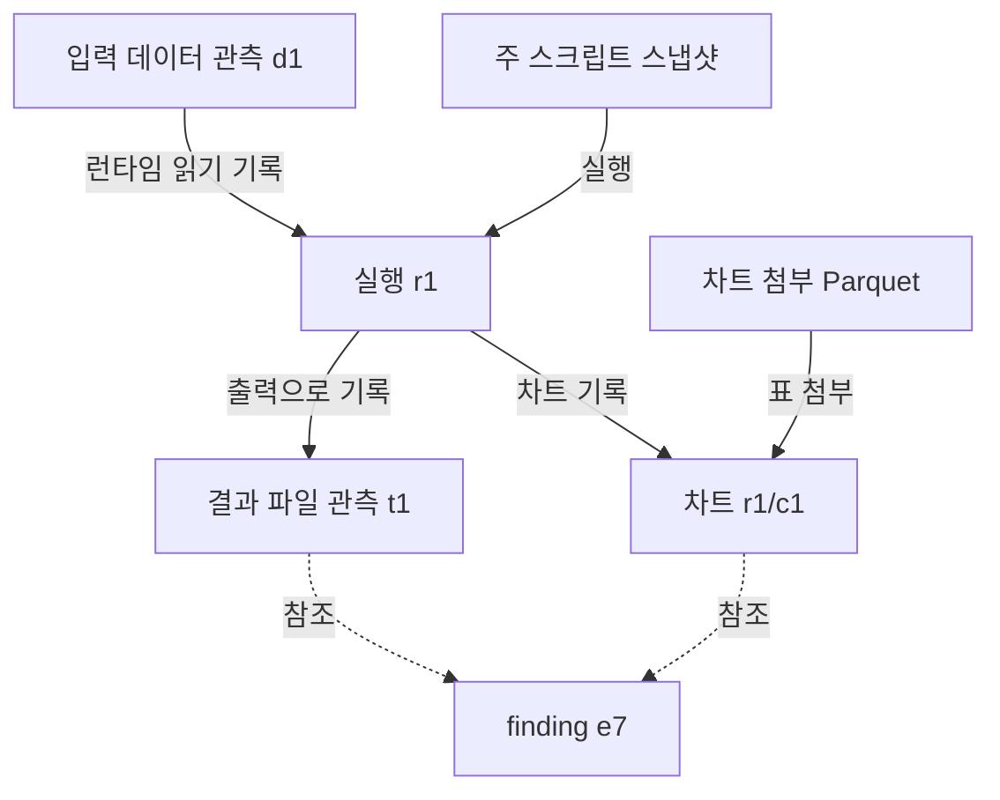

# 제안: baseline 분석 근거 그래프

Date: 2026-09-17

Author: Codex

Revision: 0.2 — 실제 baseline 기록·리포트 코드와 대조해 보완

Status: Proposal — 아래 경로·필드·동작은 도입 제안이다. 현재 계약·API 또는 구현 완료를 뜻하지 않는다.

## 1. 목표와 재검토 결과

차트·데이터·실행·코드·인사이트 어느 화면에서도 **현재 요소가 분석 관계에서 어디에 있는지 확인하고 관련 요소로 이동**할 수 있게 한다.
자유로운 Python 분석과 기존 HTML·journal 흐름을 유지하며, 기록에서 관계를 계산하는 읽기 전용 탐색으로 시작한다.
사람과 에이전트는 같은 ID·관계·관측 범위를 사용한다.

baseline `7b205cd`의 [기록 모델](../kit/labkit/core.py), [수집 코드](../kit/labkit/capture.py),
[실행 기록](../kit/labkit/runner.py), [HTML 리포트](../kit/labkit/report.py), [현재 계약](CONTRACTS.md)을 대조했다.
초안에서 보완한 중요한 부분은 다음과 같다.

| 초안의 간극 | 확인한 현재 동작 | 보완 방향 |
|---|---|---|
| 안정적인 ID만 있으면 과거 근거로 이동할 수 있다고 설명 | `refs.charts`는 `script::chart-id`를 저장하고 리포트는 현재 갤러리로 연결한다 | 차트의 논리적 이름과 `run ID + chart ID` 버전을 구별한다 |
| 데이터 파일 경로를 과거 버전처럼 취급 | `lab.save()`는 같은 `data/derived/<name>.parquet`를 다시 쓸 수 있다 | 기록된 해시와 과거 파일의 실제 보존 여부를 구별한다 |
| 그래프에서 상세 화면으로 이동하는 설명에 집중 | 기존 각 카드에는 그래프로 진입하는 연결이 없다 | 모든 요소에 `관계 보기`를 제공하고 양방향 이동·뒤로 가기를 설계한다 |
| 실행 입력을 모든 차트의 직접 입력처럼 연결할 가능성 | 수집은 주로 run 단위이고 차트에는 별도 첨부 표가 있다 | run 수준 의존과 차트에 직접 기록된 연결을 구별한다 |
| 선택된 행·분석 검사까지 첫 그래프에 포함 | baseline에는 행 계보·선택 기록이 없고, 재실행 비교와 경고만 있다 | 현재 가능한 탐색과 후속 기능을 단계별로 구분한다 |
| 프로젝트 리비전·스냅샷을 기존 기능처럼 서술 | `lab.json`에는 전역 프로젝트 ID나 불변 리비전이 없다 | 그래프 생성 기준을 별도 파생 식별자로 표현한다 |

## 2. 어느 요소에서나 진입하고 돌아오는 동선

1. 차트 카드, 데이터 페이지, 실행 페이지, 코드 스냅샷, journal 항목에 `관계 보기` 링크를 둔다.
2. 링크를 누르면 **그 화면에서 보던 버전**을 중심으로 작은 그래프를 열고 `현재 요소`를 표시한다.
3. 주변 노드를 선택하면 그래프의 초점과 상세 목록이 함께 바뀐다. `내용 열기`는 해당 버전의 차트·표·코드·journal 항목으로 이동한다.
4. `돌아가기`와 브라우저 뒤로 가기는 이전 초점·필터·원래 카드 위치를 복원한다. 최신 버전으로 이동하는 동작은 별도 링크로 둔다.

`어디에 위치하는가`는 픽셀 좌표보다 **상위 입력, 생성 실행, 하위 결과, 인용한 인사이트**를 뜻한다.
다중 입력·다중 출력이면 경로가 여럿일 수 있다. 전체 그래프 안의 단일 순번이나 한 줄짜리 분석 순서를 강요하지 않는다.
초점 노드의 종류·버전·현재 표시 범위와 숨긴 이웃 수를 함께 보여 준다.

| 요소에서 시작 | 바로 볼 관계 | 내용 열기 대상 |
|---|---|---|
| finding | 인용한 run·차트·데이터·관련 이벤트 | journal의 해당 `eN`, 버전이 고정된 근거 또는 미확정 참조 |
| 차트 버전 | 생성 run, 첨부 Parquet, 해당 차트를 인용한 항목 | `runs/<run-id>.html#chart-<chart-id>` |
| 데이터 관측 버전 | 기록한 입력/출력, 생성 실행 후보, 이를 사용한 실행 | 기록된 경로·해시와 확인 가능한 표; 과거 내용 미보존이면 메타데이터 |
| 코드 스냅샷 | 해당 코드를 실행한 run, 그 run의 결과 | run 페이지의 보존 코드와 차트 기록 줄 |
| 실행 | 입력·출력·차트·코드·환경·오류·재실행 관계 | 기존 run 페이지 |
| 재실행 비교 | 원 실행, 재실행, 비교 대상·범위·판정 | 재실행 run의 `reproduction` 상세 |

`decision`, `assumption`, `question`, `todo`는 각각 결정·가정·질문·할 일이다. 모두를 입증된 인사이트로 표시하지 않는다.
출처가 없는 finding도 독립 노드로 보여 주고 `근거 참조 없음`을 알린다. 에이전트의 자연어에서 근거 선을 자동 확정하지 않는다.

## 3. 정체성·버전·보존 여부

### 3.1 노드 식별

첫 범위는 단일 로컬 프로젝트다. 아래 키는 개념 예시이며 실제 인코딩·공개 API는 구현 단계에서 정한다.
HTML·에이전트 조회는 동일한 내부 키를 사용하고, URL에는 원본 절대 경로 대신 그 키를 인코딩한 식별자를 넣는다.

| 구분 | 정체성의 기준 | 주의점 |
|---|---|---|
| 실행 | `run ID` | 같은 코드를 다시 실행해도 다른 run이다 |
| 차트 논리적 이름 | `script path::chart ID` | 버전 목록을 모으는 이름이다. 과거 근거 버전이 아니다 |
| 차트 버전 | `run ID + chart ID` | 다른 실행의 같은 차트 ID가 충돌하지 않는다 |
| 데이터 관측 | 입력/출력의 `run ID + 역할 + 정규화 경로 + 기록 해시`, 또는 raw 메타데이터 참조 | 해시가 없으면 미확인 관측으로 남긴다. 동일 해시는 동일 생산자를 뜻하지 않는다 |
| 코드 스냅샷 | `run ID + snapshot 상대 경로`와 기록 해시 | 현재 `scripts/` 파일은 별도 작업본이다 |
| journal 항목 | 이벤트 `eN`과 원본 내용 | 수정·해결 관계가 생겨도 과거 이벤트를 덮어쓰지 않는다 |
| 재실행 비교 | 재실행 `run ID + reproduction` | 분석 방법 검사나 인사이트 승인으로 승격하지 않는다 |

폴더 이동은 프로젝트 상대 키를 유지한다. 프로젝트를 합치거나 여러 프로젝트를 한 그래프에서 탐색하는 일은 첫 범위 밖이며,
그때는 별도의 프로젝트 정체성을 설계해야 한다. 절대 경로나 프로젝트 제목을 영구 전역 ID로 삼지 않는다.

### 3.2 현재 journal 참조의 한계와 단계적 보강

현재 `refs.runs`와 `refs.events`는 특정 기록을 가리키지만, `refs.charts`는 논리적 차트 이름이고 `refs.data`는 데이터 이름·경로다.
따라서 기존 기록의 후자를 읽을 때는 `버전 미고정 참조`로 표시한다.
그 이벤트에 정확한 run 참조와 유일하게 대응하는 차트가 있으면 후보를 제시할 수 있지만, 이는 당시 버전이 직접 기록된 것과 다르다.
이벤트 시각 직전의 차트나 현재 최신 차트를 골라 확정된 과거 근거처럼 표시하지 않는다.

첫 탐색 구현은 기존 문자열 참조를 그대로 읽는다. 이후 새 finding 작성 시에는 **기존 refs에 더해 구체적인 차트 버전·데이터 관측 참조를 선택적으로 기록하는 보강**을 제안한다.
도구·SDK가 이 정보를 채워 모델의 수동 ID 조립을 줄인다. 필드 추가 방식과 `/1` 호환성은 후속 계약 변경에서 검토한다.
영구적인 근거 연결 보강은 journal 등 원본 기록에 남겨야 하며, 지워도 되는 그래프 캐시에만 보관해서는 안 된다.

인사이트 수정은 새 finding으로 기록한다. 기존 `resolves`는 열린 항목을 닫는 의미이므로, 그것만으로 앞선 결론을 반박·철회·대체했다고 해석하지 않는다.

### 3.3 기록된 버전이 항상 열람 가능한 것은 아니다

`lab.save()`의 파생 데이터와 외부 입력은 과거 바이트 사본이 없을 수 있다. 차트의 첨부 Parquet는 해당 run 아래에 보존될 수 있다.
그래프에는 `당시 기록 존재`와 `당시 내용 열람 가능`을 별도로 표시한다.

- 현재 파일이 기록 해시와 맞고 읽을 수 있으면 그 내용으로 표를 연다.
- 현재 파일이 달라졌거나 과거 사본이 없으면 기록·스키마 등 남아 있는 근거를 보여 준다. 현재 파일을 과거 표처럼 열지 않는다.
- 다운로드한 현재 표의 링크는 과거 관측 노드와 구분한다. 해시를 확인하지 않았다면 `내용 미확인`이다.
- 보존된 차트 첨부 표나 코드도 찾을 수 없는 경우 노드는 유지하고 파일 누락을 표시한다.

필요한 결과 표를 선택적으로 run 안에 보존하는 기능은 후속 단계다. 그래프를 만드는 것만으로 과거 파일이 복원되지는 않는다.
주 스크립트는 실행 바이트 스냅샷이지만 helper 모듈은 종료 시 수집한 사본이며 재실행에서는 현재 모듈을 읽는 한계가 있다.
환경도 현재 기록된 버전 정보만 보여 준다. 모든 코드·환경이 복원된다는 표시는 하지 않는다.

## 4. 관계의 의미와 근거

관계는 **종류·방향**, **원본 기록 위치**, **관측 또는 선언의 근거**를 가진다.
방향은 아래처럼 고정하고, 화면의 역방향 조회는 같은 관계를 뒤에서 따라가는 것으로 처리한다.

| 관계 | 방향 | 기록에서 알 수 있는 범위 |
|---|---|---|
| 입력으로 사용/지정 | 데이터 관측 → 실행 | `inputs[].via`에 따라 런타임 읽기, 정적 경로 발견, 호출자의 선언을 구분 |
| 실행된 코드 | 주 스크립트 스냅샷 → 실행 | `script.snapshot`·`sha256`; helper 사본은 별도 의미 |
| 출력으로 기록 | 실행 → 출력 관측 | `outputs[].via`가 `lab.save`인지 실행 전후 파일 차이인지 표시 |
| 차트 기록 | 실행 → 차트 버전 | 그 run의 `charts[]` 소속 |
| 표 첨부 | 첨부 Parquet → 차트 버전 | `charts[].data`; 실제 도형이 그 표로 계산됐다는 증명은 아님 |
| 참조 | 대상 기록/논리적 이름 → journal 항목 | `refs`; 선언된 인용이며 자동으로 지지·인과 관계라고 해석하지 않음 |
| 재실행 | 원 실행 → 재실행 | `rerun_of`; 비교 결과와 입력 동일 여부는 각각 별도 표시 |

`observed`, `declared`, `inferred`는 관계 근거를 설명하는 제안 용어다. `observed`도 도구가 무엇을 관측했는지의 범위에 한정된다.
런타임 훅으로 읽은 입력, 소스의 경로 리터럴(`scan`), 사용자가 선언한 입력(`declared`)을 모두 같은 실선으로 확인 완료 처리하지 않는다.
출력의 파일 차이는 실행 구간 중 변경 관측이며 특정 코드 줄의 쓰기 증명은 아니다.

run 입력을 그 안의 모든 차트에 직접 연결하면 실제보다 정밀한 계보가 된다.
직접 연결이 없는 경우 `차트 → 생성 run → 입력 후보` 경로로 보여 주고 **run 수준 관계**임을 표시한다.
같은 run의 결과 표와 차트 첨부 표가 동일한 데이터에서 왔는지도 이름만으로 판단하지 않는다.

다른 실행 사이의 `path + sha256` 일치는 생성 실행을 찾는 단서다. 명시적인 생산자 참조가 없으면 후보 연결로 표시한다.
생성 시점이 소비 실행보다 뒤인 후보를 연결하지 않으며, 같은 경로·해시의 생산자가 여럿이면 하나를 임의로 확정하지 않는다.
시간순 journal은 작업 순서를, 그래프는 위 관계를 보여 준다.

### 개념 예시

가상의 작은 예시다. 화살표의 라벨이 관계 의미를 나타낸다. 점선은 인용 관계이며 나머지 선도 각 기록의 관측 범위를 전제로 한다.

텍스트 대안: r1이 입력을 읽고 결과 파일과 차트를 기록했다. 차트에는 별도 Parquet가 첨부되어 있으며 finding이 결과와 차트를 인용한다.
결과 파일과 첨부 표의 연결은 이 기록만으로 확정하지 않는다. 분석 검사가 추가되면 검사 대상·판정·근거를 별도 연결한다.

## 5. 기존 기록에서 그래프와 링크 만들기

### 5.1 파생 인덱스와 생성 기준

`run.json`, raw 메타데이터, journal, 보존 코드·차트 아티팩트 참조에서 정규화된 노드·관계를 만든다.
`core.chart_index()`는 최신 성공 차트 중심이고 `list_datasets()`는 현재 파일 중심이므로, 그래프의 유일한 원천으로 쓰면 과거·실패·삭제된 항목을 놓친다.
run journal의 데이터 참조는 요약 중 잘릴 수 있다. 전체 입력·출력은 `run.json`에서 읽는다.
`finding` 외 이벤트도 원래 종류를 보존하며, 자유 형식 `CONTEXT.md`의 모든 문장을 자동 인사이트 노드로 만들지는 않는다.

그래프 캐시는 `.lab/cache/`에, 표시용 생성물은 `report/`에 둘 수 있다. 읽기용 인덱스는 원본에서 재생성 가능해야 한다.
기존 baseline에는 analytics의 원장 prefix나 불변 프로젝트 리비전이 없으므로 이를 전제하지 않는다.
새 `graph_revision`은 읽은 메타데이터의 내용 해시·참조 파일 목록과 그래프 변환 규칙 버전으로 만드는 **파생 생성 기준**이다.
캐시 식별자이며 전체 프로젝트의 과거 스냅샷 보존을 뜻하지 않는다.

생성 중 run·journal이 바뀌는지 확인하고 제한적으로 다시 읽거나 `일부 기록 갱신 중`을 표시한다.
실행 중·실패·취소·incomplete 기록도 상태를 가진 노드로 남긴다. 일부 출력이 있어도 완료된 성공 결과처럼 표시하지 않는다.
파일 누락·파싱 실패·새 스키마로 읽지 못한 기록은 조회의 누락 사유에 포함한다.

### 5.2 HTML·에이전트가 공유하는 조회

하나의 그래프 모델과 링크 해석기를 HTML·에이전트 응답이 공유한다.
현재의 주 사용 방식인 `file://` 리포트에서 열리도록, 첫 구현은 작은 그래프 payload를 HTML에 포함하고 상대 링크로 기존 페이지에 연결하는 방식을 권한다.
추가 서버를 실행하지 않아도 기본 탐색이 가능해야 한다. 대형 프로젝트의 payload 분할은 측정 후 정한다.

예시 진입점은 `report/graph.html#node=<불투명-ID>&rev=<생성기준>`이다. 현재 존재하는 경로가 아닌 구현 제안이다.
기존 index의 탭·anchor 해석과 충돌하지 않게 그래프 탐색 상태를 분리한다.
버전 고정된 차트는 run 페이지의 차트 anchor로 연결한다. 최신 갤러리 링크는 `최신 보기`로 구별한다.
노드가 사라지거나 생성 기준이 바뀌면 이를 알리고 같은 ID를 현재 기록에서 찾을 수 있는지 보여 준다. 다른 버전으로 조용히 대체하지 않는다.
정적 리포트 링크는 동일한 프로젝트 사본과 파일 배치에서 유효하며, 인터넷에 공개된 공유 링크나 과거 전체 상태의 복원을 뜻하지 않는다.

에이전트는 초점 ID, 관계 종류, 방향, 탐색 깊이로 필요한 부분을 읽는다.
응답은 초점·노드·관계·생성 기준·관측 한계·생략 여부·다음 페이지 정보를 포함한다. 새로운 도구 이름은 아직 확정하지 않는다.
최초 기본값의 제안은 1-hop, 노드 50개, 관계 100개이며 응답 문자 예산도 둔다. 실제 측정 전 성능 보장은 아니다.
일관된 정렬과 생성 기준에 묶인 페이지를 사용하고, 기준이 바뀌면 페이지 탐색을 다시 시작하도록 안내한다.
순환·중복 참조는 방문 집합으로 처리하며, 추정 관계를 따라 찾은 영향 후보에는 그 경로의 불확실성을 유지한다.

### 5.3 읽기 쉬운 표시

생성 계보는 방향이 있는 계층 배치를, 복잡한 관계는 초점 주변 목록과 접기·검색을 기본으로 한다.
데스크톱에서는 그래프와 상세 영역을 함께, 좁은 화면에서는 초점 정보·관계 목록을 먼저 제공한다.
상·하위 이동, 검색, 내용 열기, 뒤로 가기는 키보드·터치로 가능하게 하고, 색 외에 관계 이름·선 모양·상태 문구를 제공한다.
노드·스크립트·이벤트 텍스트는 데이터로 표시하며 실행 가능한 HTML로 삽입하지 않는다. 임의 HTML 차트는 기존 페이지의 명시적 링크로 연다.
문서의 Mermaid는 개념을 설명하는 원문이며 실제 HTML 그래프 구현이나 렌더링 검증 결과가 아니다.

## 6. 관측 조건과 변경 영향

사용자가 설명한 도구 미포함 실험은 정상 baseline 사용군의 추적 결함으로 평가하지 않는다.
그래프에서도 도구 미포함이라는 원인은 사용자 설명이나 설정 기록 등 근거와 함께 표시한다.
`inputs: []` 또는 텔레메트리 부재만으로 `tool_not_loaded`를 자동 판정하지 않는다. 사후 선언도 당시 런타임 관측으로 바꾸지 않는다.

관계가 없다는 것, 일부만 조회했다는 것, 도구가 관측하지 못했다는 것을 구별한다.
지원하지 않는 읽기, 파일 누락, 기록 손상은 각각 근거가 있을 때 표시하고 원인을 모르면 미확인으로 남긴다.

변경 영향은 다음 범위를 구분한다.

- 입력 해시가 현재 파일과 다름: 기존 Freshness 신호를 출처·판정 시점과 함께 표시한다.
- 현재 코드·정의·대상 데이터가 변경됨: 관련 결과·finding을 **재검토 후보**로 표시한다.
- 새 데이터 버전이 추가됨: 과거 버전에 대한 결론을 소급 오답 처리하지 않는다. 현재 분석의 대상으로 선택했을 때 갱신 필요성을 평가한다.
- 재실행 일치: 그 비교 대상·범위에 한정한다. 집계 방법의 정확성이나 인사이트 승인과 다르다.

baseline의 기존 `stale` 계산은 입력 변경 중심이며 코드 변경은 별도 상태다.
그래프의 코드·finding 영향 표시는 추가 설계 대상이다. 지원되지 않는 관계를 건너뛴 결과는 완전한 영향 목록이라고 주장하지 않는다.

## 7. 작은 도입 순서와 수용 기준

| 단계 | 제공할 것 | 필요한 변경 |
|---|---|---|
| G0: 기존 기록 탐색 | 각 요소의 `관계 보기`, run·차트·데이터 관측·journal·재실행 비교의 국소 그래프와 구조화 조회 | 기존 `/1` 읽기, 파생 인덱스·HTML·링크. 버전 미고정 참조는 그대로 표시 |
| G1: 새 인사이트의 근거 고정 | 새 finding에 특정 차트·데이터 관측을 연결하고 관련 검사 결과로 이동 | 선택적인 버전 참조 보강, 검사 대상·결과 기록, 기존 기록 호환성 검토 |
| G2: 필요한 과거 결과 보존 | 인사이트가 사용한 파생 표의 과거 내용 열람, 더 정밀한 변경 영향 | 선택적 표 보존·보존 정책. 행 선택은 별도 계보 계약이 마련된 뒤 검토 |

G0는 한 질문의 Python 분석·차트·finding으로 시작하고 기존 데이터 형식을 그대로 읽는다.
G1에서 키별 집계 검사를 연결하며, G2에서 필요한 바이트 보존을 더한다.
baseline에는 현재 행 단위 계보·마킹 기록이 없으므로 `선택된 행으로 이동`은 G0의 약속에서 제외한다.
각 단계는 독립적으로 검토할 수 있어야 하며, 그래프 DB나 시각적 워크플로 편집기는 첫 도입의 의존성이 아니다.

후속 구현에서 검증할 사례:

| 사례 | 기대 결과 |
|---|---|
| 과거 차트 카드에서 그래프를 열고 연결 노드로 이동한 뒤 돌아옴 | 같은 run·chart와 원래 카드 위치로 복원 |
| 두 run에 같은 chart ID가 존재 | 차트 버전 두 개를 구별하고 논리적 이름으로 묶음 |
| 기존 finding이 `script::chart-id`만 참조 | 버전 미고정으로 표시; 최신 차트가 과거 근거를 대신하지 않음 |
| 파생 Parquet를 같은 경로에 덮어씀 | 과거 관측은 유지하며, 보존되지 않은 표는 당시 내용 열람 불가 |
| 해시 없는 입력, 같은 경로·해시의 생산자 여러 개 | 미확인 또는 복수 후보를 표시하고 임의 생산자를 확정하지 않음 |
| run이 여러 입력과 차트를 가짐 | run 수준 의존과 차트의 직접 첨부 표 연결을 구별 |
| 도구 미포함 사유가 확인된 기록과 `inputs: []`만 있는 기록 | 전자는 출처가 있는 미관측 사유, 후자는 원인 미확인 |
| 실패 run, 누락 파일, 읽을 수 없는 스키마 | 노드 상태·누락 범위를 보존하고 성공으로 표시하지 않음 |
| 503개 입력·순환 이벤트 참조·갱신 중 페이지 탐색 | 상한·생략·페이지 변경 안내가 있고 탐색이 종료됨 |
| 동일 생성 기준으로 캐시를 다시 만듦 | 노드 ID·관계·링크가 같고 HTML·에이전트 조회가 일치 |
| 새 데이터 추가 또는 현재 분석 대상으로 선택 | 과거 결과를 유지하며 현재 목적의 재검토 후보를 구별 |
| `file://`, 좁은 화면, 키보드만 사용 | 관계 목록과 내용 열기·뒤로 가기가 가능하고 기준·필터가 보임 |

## 8. 확장 경계와 참고

커스텀 알고리즘은 보존 코드·패키지 정보·uv 환경 기록에 연결한다. Skill은 사용·해석·검증 지침이다.
향후 datalake는 원격 스냅샷·질의·권한 범위, KB/RAG는 문서 버전·인용 위치를 근거로 연결한다.
문서 인용과 수치 계산 입력의 의미를 유지하며, 자격 증명을 그래프에 저장하지 않는다.

Analytics Engine 측의 [기존 그래프 제안](https://github.com/handochan/aelix-analytics-engine/blob/2b64e8f78c93ffa556a1498ce8ddf083ae1577c9/docs/codex/PROPOSAL-EVIDENCE-GRAPH-2026-09-16.md)과 방향을 공유한다.
이 링크는 같은 상위 디렉터리의 두 저장소가 있는 작업공간 기준이다.
당시 baseline에는 Analytics Engine의 불변 번들·원장 리비전·선택 기록이 없으므로 그 보장을 그대로 가져오지 않는다.
외부 참고 모델은 W3C PROV와 OpenLineage이며, 참고 문서 링크와 적용 경계는 analytics 측 제안에 있다.

## 9. 개정 이력

| 리비전 | 내용 |
|---|---|
| 0.1 | 기본 그래프와 노드 간 이동 방향을 최초 기록 |
| 0.2 | 실제 코드 대조. 요소에서 그래프로의 진입·복귀, 차트 버전과 논리적 이름, 과거 데이터 미보존, 관계의 관측 범위, baseline에 없는 리비전·선택 기능, 단계별 도입과 반증 사례를 보완 |
